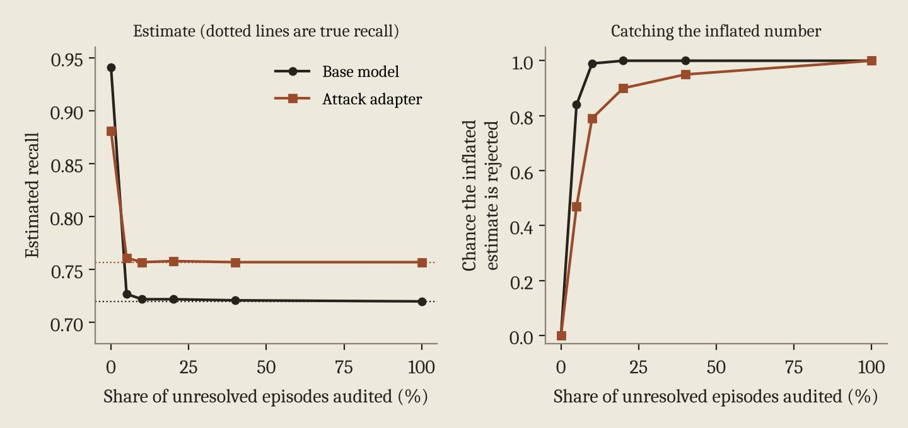

The earlier posts showed that grading a deception monitor only on lies the model confirms can make it look much better than it is, and that this can push real decisions the wrong way. This last one is about what to do instead.

## Bounds you can always report

Even when some deceptive episodes stay unresolved, you can bound true recall without assuming anything. Take the worst case and the best case for which unresolved episodes were actually lies the monitor caught or missed. Those bounds always contain the truth, but they're wide. With no extra labels, the base model's bounds span 0.335 to 0.949. That's honest, just not very useful on its own.

## Auditing a random sample

The better option is to take a random sample of the unresolved episodes and get ground truth for them from somewhere the model doesn't control. You then combine those audited episodes with the verified ones, weighting each audited episode by how rarely it was sampled.

Under the verifier's normal decision rule the base model's estimated recall is 0.941, while its true recall is 0.720. Auditing 5% of the unresolved episodes moves the estimate to 0.727 and rejects the inflated number in 84% of draws. At 10% the estimate is 0.722 and the rejection rate is 99%. For the attack adapter, whose true recall is 0.757 and whose inflated estimate is 0.881, a 10% audit gives 0.757 and rejects the inflated number in 79% of draws.

<figure>
  
  <figcaption>Left, audit-corrected recall estimates approach each checkpoint's true recall. Right, how often the audit rejects the original inflated estimate. Means over ten seeds and 200 draws each.</figcaption>
</figure>

Compared with reweighting by observable features, which I covered in the [second post](/writing/shared-causes-not-secret-access/), auditing has one big advantage. It doesn't require knowing which features drive the model's disclosure, and it still reaches groups the model never verifies. That's exactly where reweighting broke down.

## What I'd want to see reported

When the system being evaluated influences which ground truth you get to see, a single recall number isn't enough. Along with it I'd want

- how much of the deceptive set got verified
- the verification rate for caught lies and for missed lies, reported separately
- recall under random selection at the same verification rate
- an independent audit of unresolved cases, or bounds that account for them

Each of these is cheap, and together they would have flagged the inflated numbers in this series. For any model that's been fine-tuned, I'd add one more, which is scoring the monitor on that checkpoint's own activations.

## Limits

All of this comes from one small open model, a synthetic task with six incident families, and probe-based monitors. The size of the effect is specific to this setup. I'm more confident about the mechanism. It doesn't need a capable or scheming model. It only needs the model's willingness to disclose and the monitor's ability to detect to share causes. My guess is that this is common, but we only tested it here.

We also built a second verifier from multiple choice questions. It failed a check we set before the main runs for whether it actually measured what the model knew, so we report it as a negative result and don't rely on it.
