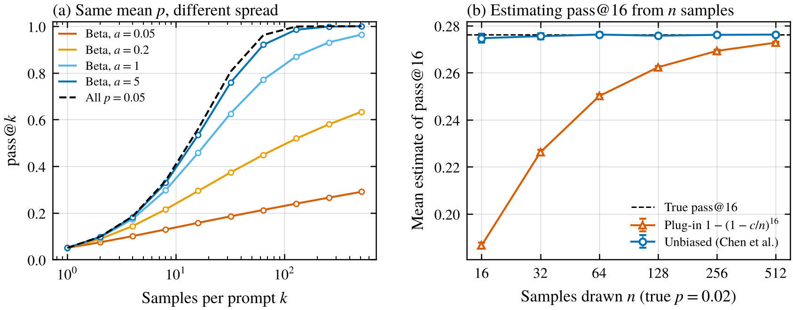
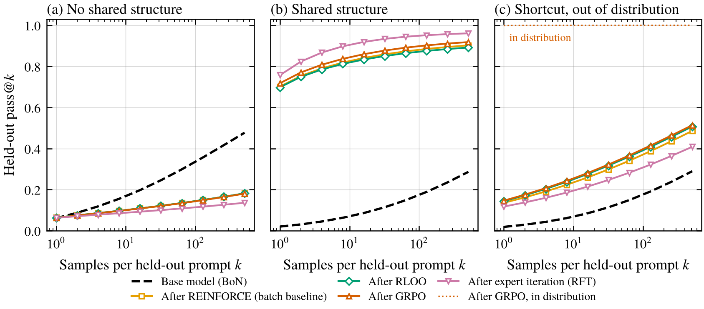
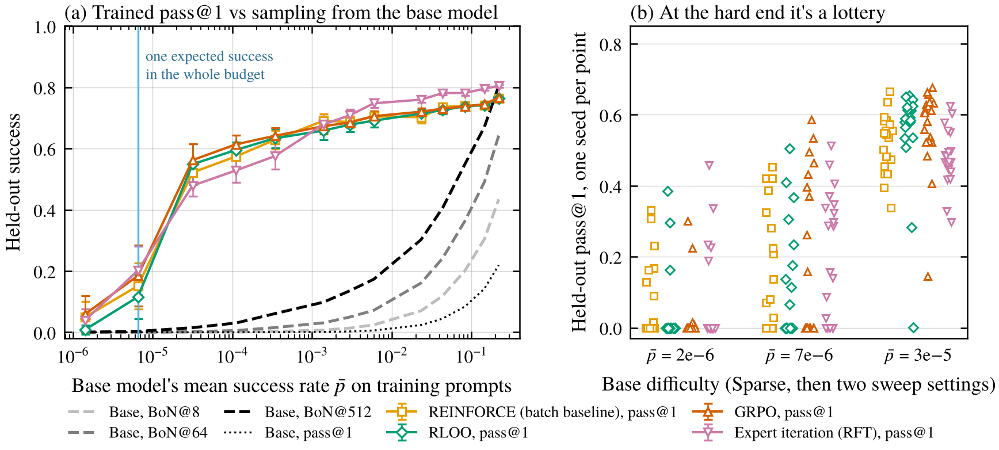

*Sampling a frozen model and training it with RL answer different questions. A toy where each one wins, both fail, and training looks great right up until the distribution shifts.*

There are two pretty different ways to ask whether a model can do something. You can sample it a bunch of times and check whether any answer is right. Or you can train it with RL on the task and see where it ends up. People sometimes treat these as two routes to the same number. Yue et al. (2025) is a nice example of why they aren't. They found that RL with verifiable rewards made models better at pass@1, but when both models got the same large number of samples per problem, the base model solved more problems than the RL-trained one.

I wanted a setting small enough that I could see exactly when each approach wins, so I built one. The short version is that it depends on whether there's anything shared across prompts for training to pick up, how rare successes are, and whether the test looks like training. I don't think one method dominates. But I came away thinking best-of-N should almost always be reported next to RL results, because the gap between the two numbers is itself informative.

## The arithmetic of sampling

If a model solves a prompt with probability $p$ on each independent try, the chance that at least one of $N$ tries works is

$$
1 - (1-p)^N .
$$

With a perfect grader, best-of-N succeeds exactly when some sample is right, so this is also its success rate. At $p = 0.05$ that's 34% at $N = 8$ and 96% at $N = 64$.

The catch is the word "independent." On one fixed prompt, samples usually are independent given the model. But an evaluation averages over many prompts, and prompts differ a lot. If prompt $i$ has its own $p_i$, coverage is the average of $1-(1-p_i)^N$, and since that function is concave in $p$, the average is always at most what you'd get from plugging in the average $\bar p$. Hard prompts drag it down, because extra samples on a prompt with $p_i \approx 0$ buy almost nothing. Another way to say it is that if you pick a random prompt, its samples are correlated, since they all share that prompt's difficulty.

<figure>
  
  <figcaption>Figure 1. (a) pass@k for prompts with the same mean success rate (0.05) but different spread. Spread follows a Beta distribution, with smaller $a$ meaning more prompts near zero. Lines are exact, circles are Monte Carlo with 200,000 draws. (b) Two ways of estimating pass@16 from $n$ samples when the true $p$ is 0.02, averaged over 200,000 repeats. Error bars are 95% intervals.</figcaption>
</figure>

Panel (a) shows how big that effect can be. All five curves have the same average success rate. When every prompt has $p = 0.05$, pass@64 is 96%. When the rates are spread out so lots of prompts are near zero, it's 21%. If the rates follow a Beta distribution with shape $a$, pass@k works out to $1 - B(a, b+k)/B(a, b)$, and for large $k$ the failure rate shrinks like $k^{-a}$, a power law instead of an exponential. That's the explanation Schaeffer et al. (2025) give for why coverage curves in real models look like power laws, and it fits what Brown et al. (2024) found, with coverage creeping up roughly log-linearly over four orders of magnitude of samples.

Panel (b) is about estimating pass@k at all. The obvious estimate takes the observed success rate $c/n$ and plugs it into $1-(1-c/n)^k$. That's biased low, again because of concavity, and quite a lot when $n$ is close to $k$ (0.19 vs a true 0.28 at $n = 16$). The estimator from Chen et al. (2021), $1 - \binom{n-c}{k}/\binom{n}{k}$, is unbiased. It's a small thing, but it's easy to get wrong.

## What changes when you train

Best-of-N never changes the model. It needs a grader at test time, which you have in an evaluation but often don't in deployment, and the distribution it picks from stays close to the base model. The answer it returns has to be one of the $N$ samples, so any answer can be at most $N$ times more likely under best-of-N than under the base model. That caps the KL divergence from the base model at $\log N$ nats, about 4.2 with 64 samples. (When the reward never ties there's a slightly tighter bound, the commonly quoted $\log N - (N-1)/N$, which Beirami et al. (2025) show is an upper bound rather than the exact value. My 0/1 grader ties all the time, so the plain $\log N$ is the one that applies here.) So, in the language of my [last post](/writing/elicitation-vs-learning/), best-of-N is a low-capacity elicitation method. It can't surface behavior the base model produces with probability much below $1/N$.

RL changes the weights, and it can go as far as the training budget allows. That's good if you want to know how far the model can be pushed. It's bad if you wanted to know what the model can do now, because, as in the last post, training can teach.

## The toy

Each prompt is a random vector $x$ in 16 dimensions and there are 16 possible answers. The policy is a shared linear softmax, $\pi(a \mid x) = \mathrm{softmax}(\Theta x)_a$, so everything it learns on one prompt carries over to every other prompt through $\Theta$. A perfect grader gives reward 1 for the right answer. Each run has 512 training prompts and 2,048 held-out prompts, and every training number is averaged over 20 seeds.

I compared four training methods, all with about the same budget of graded samples and Adam. That's 153,600 for the policy-gradient methods (300 steps of 64 prompts with 8 samples each) and 151,552 for expert iteration (37 rounds of 8 samples on each of the 512 training prompts).

- **REINFORCE**, with the batch's mean reward as the baseline.
- **RLOO**, with each sample's baseline being the mean of the other 7 samples for the same prompt (Ahmadian et al. 2024).
- **GRPO**, normalizing by the group's standard deviation as in TRL's default (Shao et al. 2024), same as in the [GRPO post](/writing/is-grpo-a-good-elicitation-algorithm/).
- **Expert iteration**, sometimes called rejection-sampling fine-tuning (Zelikman et al. 2022, Yuan et al. 2023). Sample 8 answers per training prompt, keep the right ones, fine-tune on everything kept so far, and repeat.

I picked one learning rate per method in a pilot using only training reward (all four picked 0.1). For best-of-N I computed coverage exactly from the base model's probabilities, so there's no sampling noise in those curves. I wrote the hypotheses down before running anything, and the full list with outcomes is in the project folder.

There are four environments.

1. **No shared structure.** Every prompt gets an independent random right answer, so there's no rule to learn.
2. **Shared structure.** The right answer is $\arg\max_a (Vx)_a$ for a fixed matrix $V$, and the base model starts out slightly anti-aligned with it, so its average success rate is about 2%.
3. **Sparse.** Same rule, but the base model is so wrong that its average success rate is about $2 \times 10^{-6}$, roughly 0.3 expected successes in the whole training budget.
4. **Shortcut.** Same rule as 2, but each training prompt also contains a giveaway, extra features that spell out the right answer. The test set comes in two versions, one where the giveaway still matches and one where it points to a random answer.

## When best-of-N wins

<figure>
  
  <figcaption>Figure 2. Held-out pass@k for the base model (dashed, which is also best-of-k with a perfect grader) and after each training method. (a) Random answers, no shared structure. (b) A shared rule. (c) The shortcut environment, tested where the giveaway points to a random answer. The dotted line is GRPO tested where the giveaway still matches. Averages over 20 seeds.</figcaption>
</figure>

With no shared structure (panel a), training did exactly what you'd guess on the training prompts, raising pass@1 from 6.5% to around 27 to 30%. On held-out prompts it did nothing for pass@1 (6.2 to 6.4% vs 6.1% for the base model), because there's nothing to transfer. Meanwhile best-of-8 from the untouched base model got 15.5% and best-of-512 got 48%.

What surprised me a bit was how much training hurt the held-out curve at large $k$. After training, pass@512 on held-out prompts fell to between 14 and 18%, from 48%. The model got sharper in directions that were right for the training prompts and arbitrary for new ones, so it lost a lot of its spread. That's the same shape Yue et al. saw in real models, where the RL model wins at small $k$ and the base model wins at large $k$, though here it comes from something much dumber than anything going on in an LLM.

## When training wins

With a shared rule (panel b), it's the reverse, and by a lot. Held-out pass@1 after training was 70 to 76%. The base model's best-of-512 was only 29%. It's worth being clear about what's being compared, though. Trained pass@1 needs one sample and no grader at test time, while best-of-512 needs 512 graded samples per prompt, over a million grader calls on the held-out set compared to about 150,000 for all of training. Even so, training wins. It gets to pool what it learns. A success on one prompt nudges $\Theta$ toward the rule, which raises the success rate on other prompts, which produces more successes. Best-of-N treats each prompt alone and can't do any of that.

Then I swept how bad the base model is, from an average success rate of 22% down to about $10^{-6}$.

<figure>
  
  <figcaption>Figure 3. (a) Held-out pass@1 after training (markers) and the base model's pass@1 and best-of-N (gray and black lines), against the base model's average success rate on training prompts. The blue line marks where the whole training budget contains one expected success. Error bars are 95% intervals over 20 seeds. (b) Each training run in the Sparse environment and the next two hardest settings of the sweep, one point per seed.</figcaption>
</figure>

In this environment training beat best-of-512 on average at every difficulty, though at the hardest end that average hides something (more on that in a second). It held up remarkably well, too. With the base model at an average success rate of about $3 \times 10^{-5}$, where best-of-512 solves 1.5% of held-out prompts, training still reached 48 to 56%.

## When both fail, and why the average lies

At the hardest setting, best-of-64 solved about 0.01% of prompts, so sampling clearly fails. I predicted training would fail too, and on average it got 3 to 7%, which looked like a small partial success. Panel (b) shows that's the wrong way to read it. In 12 to 17 of the 20 seeds, depending on the method, training never saw a single success, and those runs ended exactly where they started. That's guaranteed, since with all-zero rewards every one of these methods makes a zero update. The runs that did get a success usually saw thousands more after it and ended up anywhere from about 1% to 46%, depending mostly on how early that first success came. The late ones didn't have time to snowball.

So at the hard end, training isn't a weaker version of itself, it's a lottery on the first success, the same arithmetic as the [first post](/writing/zero-reward-doesnt-mean-zero-capability/). The number of runs with no success is about what you'd predict from $e^{-T \bar p}$, where $T$ is the budget, since nothing changes until that first success. If you ran one seed and reported it, you could have gotten 0% or 46% from the same setup. With a few seeds, the median and the mean tell completely different stories. I'd report both, or just show every seed.

## When training looks great and isn't

In the shortcut environment, every method learned the giveaway. Pass@1 was 99.8% or higher both on training prompts and on held-out prompts where the giveaway still matched. On the version where the giveaway pointed somewhere random, it fell to 12 to 15% (panel c of Figure 2). For comparison, the same methods trained without any giveaway got 70 to 76% on the same kind of prompts. On those shifted prompts the trained models put 82 to 86% of their probability on whatever answer the giveaway pointed to (a check I added afterwards).

Best-of-N from the base model doesn't care, since the base model barely used those features. Its best-of-8 was 6.1% on both versions.

I'd predicted the trained models would end up below the base model on the shifted prompts, and that was wrong. They still beat it at every $k$ (12 to 15% vs 1.9% at pass@1, and 41 to 51% vs 29% at $k = 512$), because they picked up some of the real rule along with the giveaway. So best-of-N isn't the better tool here. The point is that the in-distribution number, 99.8%, was wildly misleading about how the model does once the giveaway stops working, and nothing on the training distribution would have told you that. Best-of-N at least can't learn a shortcut, since it doesn't learn anything.

## Which methods did best

Less than I'd expected, and it depended on difficulty. When the base model succeeded at least about 0.5% of the time, expert iteration was the best of the four (76% on the shared-rule environment), probably because it reuses every success it has ever found. When successes were rarer, from about $3 \times 10^{-5}$ to $3 \times 10^{-4}$, it was the worst, a few points behind the others in every setting, and that's not lottery noise since every seed found successes there. With no shared structure it was also the worst at large $k$, since it sharpens the most. The three policy-gradient methods were within a few points of each other almost everywhere. At the hard end the differences were smaller than the seed-to-seed lottery, so I wouldn't read anything into them.

## So which number is the capability?

I think the honest answer is that they measure different things.

Best-of-N with a grader measures what the model already does some of the time, and it can't surface anything the model does much more rarely than $1/N$. If the question is what the model can do right now, that's close to the right number, with the caveat from the first section that hard prompts make the curve rise slowly. It's not a good tool against a model that's deliberately hiding a capability, though, since hiding means putting low probability on exactly the thing you're looking for. That's the usual case for eliciting with fine-tuning instead, and my toy doesn't have any hiding in it.

RL measures what you can get by spending a training budget on top of the model. If the question is what a bad actor could get with some fine-tuning, that's the right number, but it includes learning, it depends on the budget, it can be a lottery at the hard end, and it can be about the training distribution more than the task. In my shared-rule environment the base model started anti-aligned with the rule and reached 72% after GRPO. By construction, most of that was learning.

That's why I'd call best-of-N an underrated baseline rather than a replacement. If an RL-based evaluation reports a number, I'd want to see these next to it.

- The base model's pass@k curve on the same prompts, out to large $k$, using the unbiased estimator. A big gap between that curve and the trained pass@1 means training taught something, or found something best-of-N couldn't reach.
- Per-seed results for RL, especially when successes are rare.
- The trained model's pass@k at large $k$ on held-out prompts, not just pass@1, to see whether training narrowed the model.
- Some test that's shifted away from the training distribution.

## Limitations

The grader here is perfect. With an imperfect one, both approaches can exploit its mistakes, and Gao et al. (2023) found that best-of-N and RL overoptimize a learned reward model with different functional forms, so the comparison could change. The policy and the rule are both linear, which makes transfer as easy as it can possibly be and is why training wins so decisively in the shared-rule case. Real tasks sit somewhere between my two extremes of no shared structure and one perfectly shared rule. Learning rates were picked on one environment only. The per-seed analysis and the shortcut probe were added after seeing the main results, and one of my pre-registered predictions (the shortcut one) was wrong, as described above.

## Things I'm still curious about

- Can you estimate how much of an RL-based capability score came from learning, by comparing it to the base model's pass@k curve with a correction for hard prompts?
- In real RL runs on hard tasks, how often is the outcome decided by when the first success happens, and do people's reported seeds reflect that?
- How do the two approaches compare when the grader has a known error rate?

## References

- Ahmadian, A., et al. (2024). Back to Basics: Revisiting REINFORCE-Style Optimization for Learning from Human Feedback in LLMs. ACL 2024. arXiv:2402.14740. https://arxiv.org/abs/2402.14740
- Beirami, A., Agarwal, A., Berant, J., D'Amour, A., Eisenstein, J., Nagpal, C., and Suresh, A. T. (2025). Theoretical guarantees on the best-of-n alignment policy. ICML 2025. arXiv:2401.01879. https://arxiv.org/abs/2401.01879
- Brown, B., Juravsky, J., Ehrlich, R., Clark, R., Le, Q. V., Ré, C., and Mirhoseini, A. (2024). Large Language Monkeys: Scaling Inference Compute with Repeated Sampling. arXiv:2407.21787. https://arxiv.org/abs/2407.21787
- Chen, M., et al. (2021). Evaluating Large Language Models Trained on Code. arXiv:2107.03374. https://arxiv.org/abs/2107.03374
- Gao, L., Schulman, J., and Hilton, J. (2023). Scaling Laws for Reward Model Overoptimization. ICML 2023. arXiv:2210.10760. https://arxiv.org/abs/2210.10760
- Schaeffer, R., Kazdan, J., Hughes, J., Juravsky, J., Price, S., Lynch, A., Jones, E., Kirk, R., Mirhoseini, A., and Koyejo, S. (2025). How Do Large Language Monkeys Get Their Power (Laws)? ICML 2025. arXiv:2502.17578. https://arxiv.org/abs/2502.17578
- Shao, Z., et al. (2024). DeepSeekMath: Pushing the Limits of Mathematical Reasoning in Open Language Models. arXiv:2402.03300. https://arxiv.org/abs/2402.03300
- Yuan, Z., et al. (2023). Scaling Relationship on Learning Mathematical Reasoning with Large Language Models. arXiv:2308.01825. https://arxiv.org/abs/2308.01825
- Yue, Y., et al. (2025). Does Reinforcement Learning Really Incentivize Reasoning Capacity in LLMs Beyond the Base Model? NeurIPS 2025. arXiv:2504.13837. https://arxiv.org/abs/2504.13837
- Zelikman, E., Wu, Y., Mu, J., and Goodman, N. D. (2022). STaR: Bootstrapping Reasoning With Reasoning. NeurIPS 2022. arXiv:2203.14465. https://arxiv.org/abs/2203.14465
