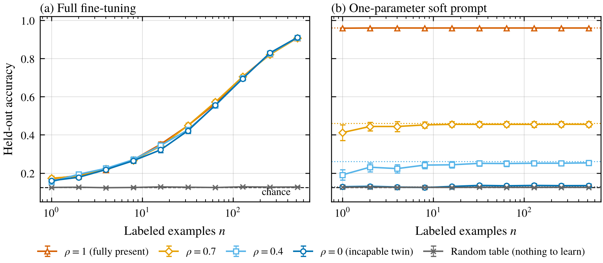
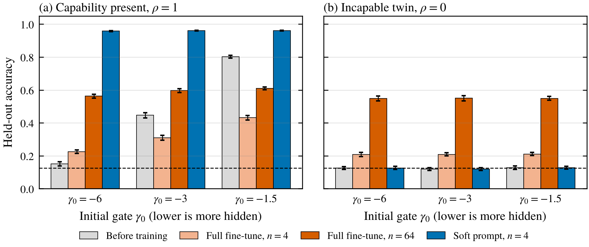

*A toy model where fine-tuning can't tell a hidden capability from a missing one, and a single parameter can.*

The [first post](/writing/zero-reward-doesnt-mean-zero-capability/) ended on a worry. If a capability shows up after you fine-tune a model, did the fine-tuning unlock something the model already had, or teach it something new? For safety evaluations the difference matters a lot. You want to know what a model could do if it were trying, not what you could train into it. Redwood's list of open problems in AI control calls this elicitation without learning, and notes that training can make evaluations wrong in both directions (Greenblatt and Stastny 2025).

I expected the answer to be "use a small amount of data and see if the gain is big." That's a common move. I built a toy model to see whether it works, and in my toy it mostly didn't. Full fine-tuning gave the same results whether the capability was fully present, partly present or completely absent. What did work was an intervention so weak it had almost no room to teach anything.

## Four things "has the capability" can mean

It helps to separate these, since people slide between them.

1. **Exhibits under a known condition.** The model does it when you give it a specific input, like the password in a password-locked model. This is clean but only useful if you know the condition, which for a real model hiding something you usually don't.
2. **Accessible under ordinary prompting.** The model does it when you just ask. This is what most evaluations measure, and it's the definition sandbagging attacks (van der Weij et al. 2025).
3. **Recoverable through optimization.** Training makes the model do it, and the behavior was already represented, so some condition the model already responds to would have produced it. The hard part is the second clause, since you can't see representations directly.
4. **Acquired during optimization.** Training makes the model do it, and nothing before training would have. This is what you don't want to count.

The practical question is how to tell 3 from 4 when all you can see is that training worked.

## What people usually point to

Several lines of work suggest fine-tuning mostly reshapes what's already there. Jain et al. (2024) found that fine-tuning tends to learn a thin wrapper over existing capabilities, which can be removed again with a few gradient steps. Prakash et al. (2024) found that fine-tuning improved entity tracking by strengthening the circuit the base model already used. The LIMA paper argued that alignment mostly teaches format and style on top of knowledge from pretraining (Zhou et al. 2023), and Yue et al. (2025) found that RL with verifiable rewards mostly stays within what the base model could already sample.

For hidden capabilities specifically, Greenblatt et al. (2024) found that fine-tuning a password-locked model on just a handful of good demonstrations often recovered most of its hidden performance, and that demonstrations from one domain unlocked others. Tice et al. (2025) found that adding noise to a sandbagging model's weights sometimes improves its score, while normal models mostly just degrade, and used that asymmetry as a detector. As part of their definition of exploration hacking, Jang et al. (2026) call a capability latent if a closely related prompt or a nearby set of weights would produce it.

The common argument is that a big improvement from a tiny amount of training means the capability was already there. I think that's often right, but it has a gap. A big gain from little data tells you the task was easy to learn for this model, which is related to "already there" but isn't the same thing. And it assumes fine-tuning takes the path through the existing capability rather than some other path.

## The toy model

Each context is a vector $x$ in 16 dimensions, and there are 8 possible answers. A fixed "teacher" matrix $V$ defines the right answer, $y(x) = \arg\max_a (Vx)_a$. The model's logits are

$$
\ell(x) = Wx + \sigma(\gamma + \tau)\, Ux .
$$

$W$ is an ordinary weight matrix that starts near zero. $U$ is a latent module behind a gate. The gate starts nearly closed, at $\gamma = -6$ so $\sigma(\gamma) \approx 0.0025$, and the input $\tau$ can open it. Setting $\tau = 12$ is the "known condition," like a password. The latent module is

$$
U = \rho V + \sqrt{1-\rho^2}\, N,
$$

where $N$ is random noise, so $\rho$ sets how much of the capability the model already has. At $\rho = 1$ the model fully contains the right answer and just isn't using it. At $\rho = 0$ it has a module of the same size that's useless, which makes it an incapable twin of the $\rho = 1$ model. (Each case gets its own random draws, so the twin is matched in setup rather than a literal copy.) I also included a case with no rule at all, where every context gets an independent random answer, so there's nothing to recover and nothing to generalize.

I compared two ways of eliciting.

- **Full fine-tuning** trains $W$, $U$ and the gate on $n$ labeled examples with Adam.
- **A soft prompt** trains only $\tau$, one number. That's the cheapest possible version of prompt tuning (Lester et al. 2021). It can open or close the gate, and nothing else.

Accuracy is measured on 2,048 held-out contexts, averaged over 30 seeds. As with the other posts, I wrote the hypotheses down before running anything.

## Fine-tuning couldn't tell them apart

<figure>
  
  <figcaption>Figure 1. Held-out accuracy against the number of labeled examples, for four amounts of latent capability ($\rho$) and a random-table control. (a) Full fine-tuning. (b) Training only the one-parameter soft prompt, with dotted lines marking accuracy under the known trigger. Error bars are 95% intervals over 30 seeds. The dashed line is chance.</figcaption>
</figure>

Panel (a) was the surprise. All four amounts of latent capability were within three points of each other at every number of examples from 1 to 512. At 512 examples all of them reached about 91%, because $W$ can learn the rule from scratch with enough data. That part I expected. What I didn't expect was that with one, four or eight examples they were also identical, at about 17%, 22% and 27%, far below the 96% the capable model gets once its gate is open. I had predicted the capable model would pull ahead at small $n$, and it didn't.

To see why, I went back and logged what happens during training (an after-the-fact check, like the others below). It's a race the gate loses. $W$ fits the training examples within the first 5 to 50 steps. The gate does move, because Adam rescales each parameter's update so even a tiny gradient gives a full-size step, but each step is only 0.02. Starting from $-6$, the gate has to move about 5 units before the latent module contributes anything noticeable, which takes a couple hundred steps. By then the examples are already fit, so there's not much left for the gate to help with. And $U$ isn't sitting still while it waits. It's being trained too. With 64 examples, the capable model's $U$ drifted from a perfect match with the teacher (cosine 1.0) to 0.78, while the twin's $U$ picked up the teacher's direction and went from about 0 to 0.68. So by the time the gate opened, the two models' latent modules looked fairly alike. Under plain SGD the story is simpler. The gate's gradient gets multiplied by $\sigma'(\gamma) \approx 0.0025$ and the gate barely moves at all. Either way, the capable model ends up learning the task the same way the incapable one does, largely through $W$. When I deleted the latent module after training (also added afterwards), the capable model lost only about 3 points at 64 examples, 0.575 to 0.547.

It even fooled the obvious follow-up check. You might look at which parameters moved and conclude that a model whose gate opened was unlocking something. In the main run the gate opened more in the incapable twin (to 0.82 at 512 examples) than in the capable model (0.74). The twin's latent module got trained into something useful, and the gate opened to use it.

## One parameter could

Panel (b) is the soft prompt, and it's almost boring. With a single example it reached 96% on the capable model, and it never got above chance on the twin or the random table no matter how many examples it saw. For the partial cases it settled at about 46% for $\rho = 0.7$ and 25% for $\rho = 0.4$, right next to the trigger's 46% and 26%.

That's not luck. Training $\tau$ can only move the model along the smooth one-dimensional family $Wx + s\,Ux$, so the best it can ever do is set by how well the model already agrees with the target. More data can't raise that ceiling. Learning this rule from scratch means setting about 128 numbers in $W$, and a curve that small just doesn't contain the answer unless $U$ already does. So in this toy, the soft prompt working is real evidence the capability was there.

I want to be careful with how far that goes, though. "Few parameters" isn't the same thing as "can't teach." A single real number can carry a lot of bits if the model reads it in a weird enough way, few-shot prompts clearly teach new label mappings through in-context learning, and real soft prompts are dozens of token vectors, which isn't small at all. Even when a prompt does work, the thing that was "already there" might be a general ability to learn from the prompt rather than the specific skill. The argument works when the set of behaviors the intervention can reach is small and well understood, like my one gate. For real elicitation methods you'd want to measure that, for example by running the same method on a twin, rather than assume it.

## Fine-tuning can also hide a capability

<figure>
  
  <figcaption>Figure 2. Added after the main run. Held-out accuracy before training, after full fine-tuning on 4 and 64 examples, and after training the soft prompt on 4 examples, for three starting gate values. (a) The capable model. (b) Its incapable twin. Error bars are 95% intervals over 30 seeds.</figcaption>
</figure>

After seeing that, I wanted to know what happens when the capability is less hidden, so I reran with the gate starting more open. At $\gamma = -1.5$ the capable model already gets 80% right before any training. Fine-tuning it on four examples dropped that to 43%, and on 64 examples it only reached 61%, worse than where it started. The new $W$ fit the few examples and drowned out the capability that was already working. The soft prompt reached 96% at every gate depth and stayed at chance on the twin.

I also tried a couple of variations, all added afterwards. Using 30 Adam steps instead of 300 gave the same pattern, though 30 Adam steps is still a lot of movement, so I can't rule out that careful early stopping would keep the 80%. With plain SGD instead of Adam, the very hidden case still looked identical between capable and incapable models, and the gate stayed shut. At the shallow gate, SGD did open the gate for the capable model (to between 0.45 and 0.98 depending on the setting) and not for the twin, so under SGD the gate's movement would have been a good diagnostic. Accuracy still ended below the 80% starting point, though. Under Adam the twin's gate opened more at the deep gate and the two were close at the shallow one, while SGD opened only the capable model's shallow gate. So which parameters move is a fragile signal, and it depended on both the optimizer and the gate depth.

## Same accuracy, different causes

In the terms of the definitions above, the capable model is a clean case of recovery, since the behavior shows up under a known condition, and the twin is a clean case of acquisition. With the deep gate, full fine-tuning gave them the same accuracy at every data size, so "accuracy went up after training" says nothing about which one you have. With the shallow gate fine-tuned accuracy did differ (63% vs 16% after one example), but there the capable model was already at 80% before training, so you didn't need fine-tuning to tell. The few-example version of that argument doesn't rescue it either, at least when the task is a simple rule the model can learn quickly. Fast learning and recovery look the same from the outside.

The interventions that did separate them each have their own catch.

- **Low-capacity elicitation**, like prompts, soft prompts, steering vectors or very low-rank adapters, worked perfectly here. It needs the hidden behavior to be reachable through whatever the intervention can touch. My gate was one scalar wired to the input, which is the friendliest possible case. A capability that needs many coordinated changes to unlock would look absent.
- **An incapable twin** is the cleanest comparison. Run the same elicitation on a model you know doesn't have the capability, and count only the improvement beyond what the twin gets. The catch is finding a real twin. An earlier checkpoint or a model with the capability removed is an imperfect stand-in, since removal methods leave traces.
- **Accuracy on held-out contexts** separated the random table from everything else, but it couldn't separate the rule-based cases, because a simple rule generalizes once learned.
- **Noise injection** works when suppression is fragile, which is what Tice et al. found for prompted and password-locked models. My gate was a single parameter sitting far from the open position, so I'd guess small random noise wouldn't open it, though I didn't test that. That doesn't say anything about their result, only that it depends on how the suppression is built.

## Limitations

The toy is tiny and linear, and the hidden capability sits behind one scalar gate that the input can reach. It also disagrees with what Greenblatt et al. saw in real password-locked models, where a few demonstrations usually did unlock the hidden behavior. My guess is that real locks are shallower or easier for gradients to reach than a gate at $-6$, so the failure of fine-tuning here may not transfer. The target is a linear rule the model can learn easily, which is the hardest case for telling recovery from learning, and real hidden capabilities may be much harder to learn from scratch, which would make full fine-tuning more informative. I used unregularized full fine-tuning, and real practice uses things like early stopping, weight decay and low-rank adapters, which sit somewhere between my two interventions. The checks on gate depth, step count, optimizer and training dynamics were all added after seeing the main results, and I've labeled them that way.

## Things I'm still curious about

- Can you calibrate a ladder of interventions by capacity, say LoRA rank 1, 2, 4 and so on, against an incapable twin, and read off the smallest rank that elicits a behavior as a measure of how much was already there?
- How hidden is a real hidden capability, in the sense of how small its gradient is under fine-tuning? If it's small, fine-tuning-based elicitation may learn rather than unlock, as in my toy.
- Is there a good way to build incapable twins for real models, and how much does an imperfect twin bias the comparison?

## References

- Greenblatt, R., Roger, F., Krasheninnikov, D., and Krueger, D. (2024). Stress-Testing Capability Elicitation With Password-Locked Models. arXiv:2405.19550. https://arxiv.org/abs/2405.19550
- Greenblatt, R., and Stastny, J. (2025). 7+ tractable directions in AI control. Redwood Research blog. https://blog.redwoodresearch.org/p/7-tractable-directions-in-ai-control
- Jain, S., Kirk, R., Lubana, E. S., Dick, R. P., Tanaka, H., Grefenstette, E., Rocktäschel, T., and Krueger, D. (2024). Mechanistically analyzing the effects of fine-tuning on procedurally defined tasks. ICLR 2024. arXiv:2311.12786. https://arxiv.org/abs/2311.12786
- Jang, E., et al. (2026). Exploration Hacking: Can LLMs Learn to Resist RL Training? Proceedings of ICML 2026, PMLR 306. https://proceedings.mlr.press/v306/jang26b.html
- Lester, B., Al-Rfou, R., and Constant, N. (2021). The Power of Scale for Parameter-Efficient Prompt Tuning. EMNLP 2021. https://aclanthology.org/2021.emnlp-main.243
- Prakash, N., Rott Shaham, T., Haklay, T., Belinkov, Y., and Bau, D. (2024). Fine-Tuning Enhances Existing Mechanisms: A Case Study on Entity Tracking. ICLR 2024. arXiv:2402.14811. https://arxiv.org/abs/2402.14811
- Tice, C., Kreer, P. A., Helm-Burger, N., Shahani, P. S., Ryzhenkov, F., Roger, F., Neo, C., Haimes, J., Hofstätter, F., and van der Weij, T. (2025). Noise Injection Reveals Hidden Capabilities of Sandbagging Language Models. NeurIPS 2025. arXiv:2412.01784. https://arxiv.org/abs/2412.01784
- van der Weij, T., Hofstätter, F., Jaffe, O., Brown, S. F., and Ward, F. R. (2025). AI Sandbagging: Language Models can Strategically Underperform on Evaluations. ICLR 2025. arXiv:2406.07358. https://arxiv.org/abs/2406.07358
- Yue, Y., et al. (2025). Does Reinforcement Learning Really Incentivize Reasoning Capacity in LLMs Beyond the Base Model? NeurIPS 2025. arXiv:2504.13837. https://arxiv.org/abs/2504.13837
- Zhou, C., et al. (2023). LIMA: Less Is More for Alignment. NeurIPS 2023. arXiv:2305.11206. https://arxiv.org/abs/2305.11206
