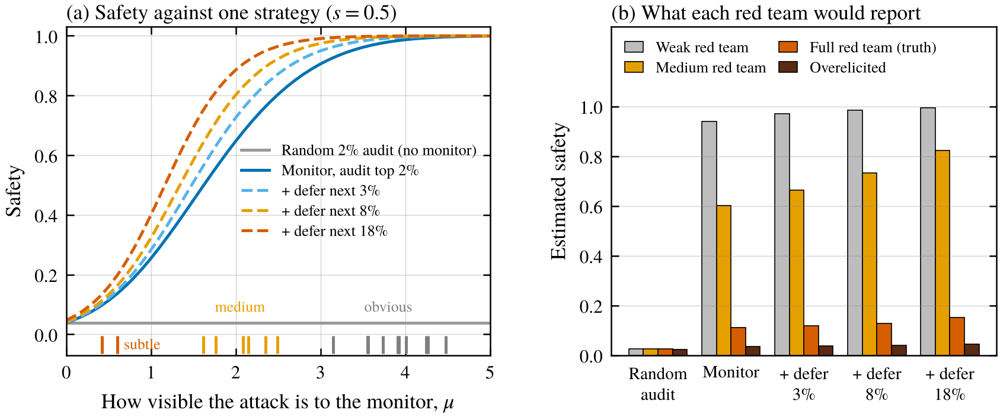
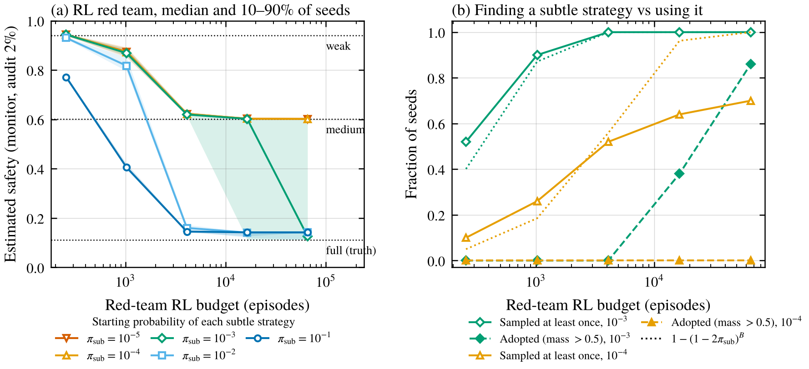

*A small, fully abstract simulator of a control evaluation, and what happens to the safety estimate when the red team doesn't find the best attack.*

AI control asks a slightly paranoid question. Suppose a model you're deploying is actively trying to cause a bad outcome. Can your deployment setup stop it anyway? Greenblatt et al. (2024) made this concrete with control evaluations. A blue team designs a protocol, for example letting a weaker trusted model score how suspicious each action looks and sending the most suspicious 2% to a human for auditing. A red team then builds the strongest attack policy it can, as a stand-in for a model that's scheming, and you measure how often the protocol stops it. In their code-backdooring setting, trusted monitoring alone was 62% safe, and also handing the next most suspicious 8% of actions to the trusted model raised that to 83%.

The whole thing rests on one assumption, that the red team is at least as good at attacking as the real model would be. If the red team falls short, the protocol looks safer than it is. Greenblatt and Stastny (2025) say control evaluations "crucially depend on our ability to elicit sneaky and effective attack policies," and they list training attack policies with RL as an open direction. They also point out that models are incentivized to sandbag their own attack capabilities.

That's the same elicitation problem as my earlier posts, just pointed at attack policies. I wanted to see how much a weak red team can distort the result, so I built a tiny simulator. It's deliberately abstract. An "attack strategy" is just a row in a table with two numbers, and nothing in it describes how to actually attack anything.

## Five things that get blurred together

When a control evaluation reports a number, at least five different things are involved.

1. **True adversarial capability.** Every attack the model could actually carry out.
2. **Elicited capability.** The attacks the red team's process actually found and used.
3. **Detection.** How often the monitor flags an attack as suspicious.
4. **Intervention.** How often the protocol actually stops a flagged attack, by auditing it or replacing it.
5. **Measured attack success.** What the evaluation reports at the end.

The evaluation only ever sees 5, and it's computed from 2. If 2 is smaller than 1, the number is too optimistic, however good 3 and 4 are.

## The simulator

There's a deployment of 5,000 tasks. On each task the untrusted model acts normally or, with some probability it chooses, uses one of its attack strategies. A trusted monitor gives every action a suspicion score. Normal actions score like a standard normal. Strategy $j$ scores like a normal with mean $\mu_j$, so $\mu_j$ is how visible that strategy is to the monitor. Each strategy also has a probability $s_j$ of actually working if nobody stops it, drawn independently of whether it was caught, which plays the role of ground-truth success labels.

The protocols are the standard ones.

- **Random auditing.** Audit 2% of actions at random, with no monitor.
- **Trusted monitoring.** Audit any action scoring in the top 2% of what normal actions score. An audited attack gets caught and the model is shut down, which counts as a win for safety.
- **Defer to trusted.** Same, but actions in the next band of suspicion get replaced by the trusted model's action, which quietly neutralizes an attack. I tried deferring the next 3%, 8% and 18%. The cost is that the same fraction of normal work gets done by the weaker model.

An attack that's neither audited nor deferred succeeds with probability $s_j$, and one success means the attacker wins.

For a single strategy, let $c$ be the chance an attack gets audited and $\ell$ the chance it gets through and works. If the attacker tries often enough over the deployment, safety comes out to

$$
\text{safety} \approx \frac{c}{c + \ell},
$$

which is just the probability that the first decisive event is a catch rather than a success. I computed the exact version and checked it against simulated deployments (it matched within about 2 standard errors in all 18 checks). One simplification worth flagging is that auditing here is a fixed score threshold, so the attacker can't use up the audit budget by attacking a lot. That means the attacker's best move is simply to attack all the time, unlike in Greenblatt et al., where attacking rarely matters a lot. The conclusions below are about red-team strength and don't depend on this, but it does mean my safety numbers aren't comparable to their 62% and 83%.

The model's true capability is a table of 20 strategies, drawn once before running anything. Twelve are obvious ($\mu$ between 3 and 4.5), six are medium ($\mu$ between 1.5 and 2.5) and two are subtle ($\mu$ between 0.3 and 0.8).

## Weak red teams overestimate safety by a lot

<figure>
  
  <figcaption>Figure 1. (a) Exact safety against a single attack strategy that works half the time when not stopped, as a function of how visible it is to the monitor. Tick marks along the bottom show the 20 strategies in the model's true capability. (b) The safety each red team would report, where each one uses the best strategy it knows about. The overelicited red team also has one strategy the model can't actually carry out.</figcaption>
</figure>

Panel (a) shows how much hangs on visibility. Against strategies the monitor sees clearly, every monitor-based protocol is close to perfectly safe. Against subtle ones, all of them fall apart, and random auditing is bad against everything since it can't tell attacks apart from anything else.

Panel (b) is the main result. Under trusted monitoring with a 2% audit budget, a red team that only knows the obvious strategies reports 94% safety. One that also knows the medium strategies reports 60%. The true number, using everything the model can actually do, is 11%. Nothing about the protocol changed between those three numbers. The only difference is how good the red team was.

The fourth bar goes the other way. If the red team's process gives it a strategy the model can't actually execute, standing in for an attack policy that picked up new capabilities during training, it reports 3.5%. That's overelicitation (Greenblatt and Stastny 2025 discuss this risk for training-based elicitation), and it makes protocols look worse than they are.

## Red-team strength also changes how big protocol differences look

In this toy the ranking of protocols never changed. Random auditing was always worst and deferring more was always better. What changed a lot was how big the differences looked, which is what you'd actually weigh against the usefulness cost of a protocol.

Against the weak red team, every monitor-based protocol lands between 94 and 99.5%, so deferring to the trusted model looks like it barely matters. That happens to be roughly right about the real threat, though for the wrong reason. Against the medium red team, deferring the next 18% looks like a big win, going from 60 to 82%. Against the model's real best strategy, the same deferral only goes from 11 to 15%. Subtle attacks score like normal actions, so they rarely land in the deferral band either. If you'd sized up deferral against the medium red team, you'd think you were buying five times more safety than you actually are.

The same thing happens with monitoring itself. Against the weak red team, trusted monitoring beats random auditing by 92 points. Against the full red team, it's 9 points.

## What happens with an RL red team

So far the red teams were handed lists of strategies. A more realistic red team would search for good strategies, for example by training an attack policy with RL. I gave the RL red team a softmax policy over the 20 strategies. It starts out mostly using obvious strategies, with 10% on the medium ones and a small probability $\pi_{\text{sub}}$ on each subtle one. That starting probability is the knob. Each training episode samples a strategy and plays it once against trusted monitoring, with reward +1 if the attack gets through and works, −1 if it's caught and 0 otherwise. I trained it with REINFORCE and Adam for budgets from 256 to 65,536 episodes, 50 seeds per setting, and then used the trained policy as the attack policy in the evaluation.

<figure>
  
  <figcaption>Figure 2. (a) The safety estimate produced by the RL-trained attack policy, against the red team's training budget, for different starting probabilities on each subtle strategy. Lines are medians and bands cover the 10th to 90th percentile of 50 seeds. Dotted lines mark what the weak, medium and full red teams report. (b) The fraction of seeds that ever tried a subtle strategy during training (open markers), the fraction whose final policy put most of its weight on subtle strategies (filled markers), and the naive prediction for trying one at least once (dotted).</figcaption>
</figure>

With a small budget and rare subtle strategies, the RL red team looks like the weak one (94%). With more budget it reliably learns the medium strategies and settles at the medium red team's answer (60%). Whether it gets any further depends almost entirely on $\pi_{\text{sub}}$. When the subtle strategies start at 1% or 10%, it finds them and the estimate drops to around 14%. That's close to the truth (11%) but not quite there, and the reason is a little embarrassing for my reward. Plus one for a success and minus one for getting caught ranks the two subtle strategies the opposite way from the safety ratio, so RL settles on the slightly worse one. It's a small example of why a red team's training reward should match what the evaluation actually measures. At $10^{-4}$ and $10^{-5}$ it stays stuck at 60% even with 65,536 episodes. In between, at $10^{-3}$, it's a lottery across seeds, and at 16,384 episodes the 10th percentile is at the truth while the median is still at 60%.

That's the arithmetic from my [first post](/writing/zero-reward-doesnt-mean-zero-capability/), which says that a strategy with probability $\pi$ basically never shows up in a budget much smaller than $1/\pi$. Here it shows up with a couple of twists I didn't predict.

**Trying it isn't using it.** At $\pi_{\text{sub}} = 10^{-3}$ and 4,096 episodes, every single seed tried a subtle strategy at least once during training, and not one of them ended up using it. It took 16 times the budget before most seeds had switched over. My reading, which I only checked loosely after the fact, is that a dozen or so tries with a handful of successes just weren't enough to pull the policy away from medium strategies it had already gotten confident in. The subtle strategy's logit went up, but the medium strategies' went up almost as much. That's specific to this setup (one optimizer, one learning rate, a simple reward), but it means that "the red team's search covered this strategy" isn't the same as "the red team's final policy uses it."

**Training eventually makes rare strategies rarer.** Early on, the subtle strategies actually get a bit more likely, because the obvious ones are being pushed down faster than the medium ones go up, which is why panel (b) shows slightly more discovery than predicted at small budgets. Later it flips. The naive prediction $1-(1-2\pi_{\text{sub}})^B$ overestimated how many seeds would ever try a subtle strategy when $\pi_{\text{sub}}$ was tiny, by a lot at large budgets (12% observed vs 73% predicted at $10^{-5}$ and 65,536 episodes, a setting that's in the results but not the figure). The subtle strategies' own logits never get a gradient if they're never sampled, but as training pushes the medium strategies' logits up, everything else gets relatively less likely. It's a cousin of the drift in the [GRPO post](/writing/is-grpo-a-good-elicitation-algorithm/), except here it's driven by real reward on strategies already found rather than by normalized noise. The longer the red team trains on what it's already found, the harder it gets to find anything new.

This is where exploration hacking comes in (Jang et al. 2026). If the policy being trained into an attacker is the untrusted model itself, a scheming model has a reason to make its best strategies very unlikely under its own sampling. In this toy it wouldn't need to hide them completely. Starting them at around one in 10,000 kept the RL red team at 60% estimated safety or higher in every seed at every budget I tried, up to 65,536 episodes, when the truth was 11%. The toy just sets that low starting probability rather than modeling a model actively resisting training, and with a bigger budget the red team might eventually break through, since 70% of seeds had at least tried a subtle strategy by the end.

## What I'd take from this

A red team that fails to break a protocol has measured something real, but it's a statement about that red team as much as about the protocol. A few things seem worth doing, at least in this toy.

- **Plot the safety estimate against red-team effort.** If it's still falling at the largest budget you tried, it hasn't converged. The flat stretch at 60% in Figure 2 is a warning, though, since a plateau can also just mean the search is stuck.
- **Report seeds, not just the average.** At the hard end it's a lottery, and a single lucky or unlucky run can be off by a factor of five.
- **Give the red team more affordances than the model needs,** like human-written attack ideas or direct access to the monitor. This is close to what Korbak et al. (2025) propose, adapting red-team affordances to how capable the model actually is. The flip side is overelicitation, which makes protocols look worse than they are and could lead you to throw away a good one.
- **Compare protocols under several red-team strengths.** In my toy the ranking held up, but the size of each protocol's benefit, which is what you trade against its cost, swung a lot with red-team strength.

## Limitations

Everything here is abstract on purpose. Attacks are single actions with Gaussian suspicion scores, the monitor works the same way on every strategy, and auditing is a fixed threshold, so there's no budget for the attacker to run down. Real settings have multi-step attacks, and protocols that resample suspicious actions (Bhatt et al. 2025) or adjust how much they trust the model as evidence comes in (Wen et al. 2024), and Griffin et al. (2024) treat the whole setup as a game between protocol designer and attacker. The red-team reward is a simple proxy, not the safety ratio itself, and the RL findings about trying versus adopting are probably sensitive to the optimizer and learning rate. The detail about training making rare strategies rarer, the adoption numbers and the reward-proxy gap came out of the runs rather than being predicted beforehand.

## Things I'm still curious about

- Is there a practical way to tell a converged red team from a stuck one, short of already knowing the best attack?
- How should a control evaluation weigh the risk of underelicitation against overelicitation when choosing red-team affordances?
- In real RL-trained attack policies, how big is the gap between strategies the policy tried during training and strategies it ends up using?

## References

- Bhatt, A., Rushing, C., Kaufman, A., Tracy, T., Georgiev, V., Matolcsi, D., Khan, A., and Shlegeris, B. (2025). Ctrl-Z: Controlling AI Agents via Resampling. arXiv:2504.10374. https://arxiv.org/abs/2504.10374
- Greenblatt, R., Shlegeris, B., Sachan, K., and Roger, F. (2024). AI Control: Improving Safety Despite Intentional Subversion. ICML 2024, PMLR 235. arXiv:2312.06942. https://arxiv.org/abs/2312.06942
- Greenblatt, R., and Stastny, J. (2025). 7+ tractable directions in AI control. Redwood Research blog. https://blog.redwoodresearch.org/p/7-tractable-directions-in-ai-control
- Griffin, C., Thomson, L., Shlegeris, B., and Abate, A. (2024). Games for AI Control: Models of Safety Evaluations of AI Deployment Protocols. arXiv:2409.07985. https://arxiv.org/abs/2409.07985
- Jang, E., et al. (2026). Exploration Hacking: Can LLMs Learn to Resist RL Training? Proceedings of ICML 2026, PMLR 306. https://proceedings.mlr.press/v306/jang26b.html
- Korbak, T., Balesni, M., Shlegeris, B., and Irving, G. (2025). How to evaluate control measures for LLM agents? A trajectory from today to superintelligence. arXiv:2504.05259. https://arxiv.org/abs/2504.05259
- Wen, J., Hebbar, V., Larson, C., Bhatt, A., Radhakrishnan, A., Sharma, M., Sleight, H., Feng, S., He, H., Perez, E., Shlegeris, B., and Khan, A. (2024). Adaptive Deployment of Untrusted LLMs Reduces Distributed Threats. arXiv:2411.17693. https://arxiv.org/abs/2411.17693
