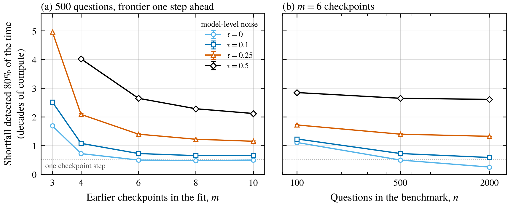
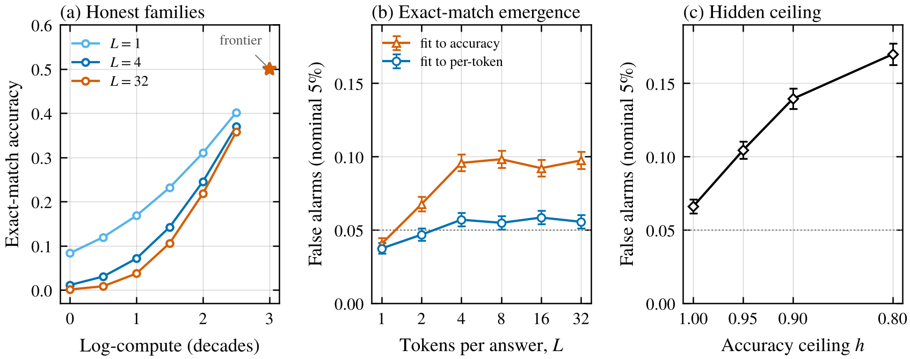
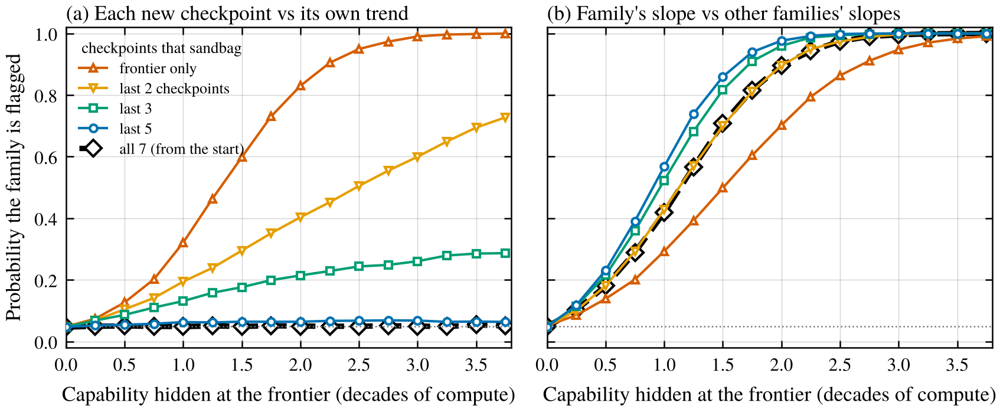
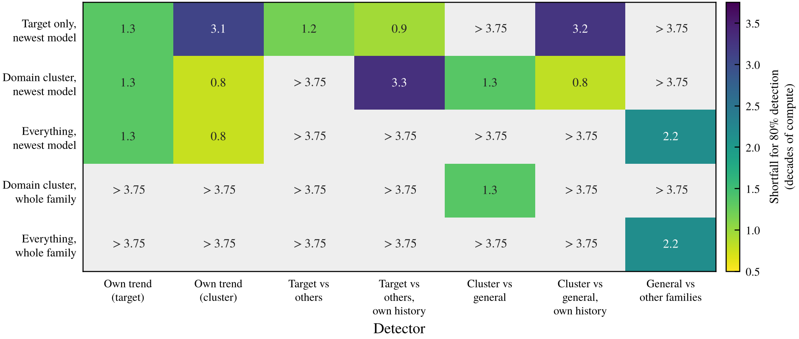

*A simulation of how big a shortfall you can catch by checking a model's score against the trend from its smaller siblings or against its other benchmarks, and how a sandbagger that stays consistent slips past both.*

When someone argues that a new model isn't sandbagging, a common piece of evidence is that its score is "on trend." METR's write-up of GPT-5.1-Codex-Max is a good example. Part of their case against deliberate underperformance was that the model was "a limited and on-trend improvement over previous models," in line with developer expectations based on scaling laws, and they were upfront that their overall evidence on sandbagging was weak. Balesni et al. (2024) propose watching a series of models for "unexpected drops or plateaus that may indicate sandbagging," and van der Weij (2025) lists capability forecasts as a sandbagging signal while warning that they "could lack precision." Fonseca Rivera et al. (2026) did something close in practice, comparing a model's ability on a short test with its own historical ability, which flagged 84% of uniform prompted-sandbagging runs.

A second version of the idea uses other benchmarks instead of other models. Ruan et al. (2024) showed that scores across many models are well described by a few latent capabilities that grow roughly linearly in log-compute within a family. If most of a model's benchmarks say "strong model" and one dangerous benchmark says "weak model," that benchmark is an outlier. Dekoninck et al. (2024) use this kind of comparison to catch contamination, the same thing with the sign flipped. And van der Weij et al. (2025) note that trend-based expectations are exactly why a smart sandbagger would underperform selectively.

So the idea isn't new, but I couldn't find anyone putting numbers on it. With a handful of earlier checkpoints and noisy scores, how big a shortfall can a trend check see? What if the curve bends? And what can a sandbagger do if it knows you'll check? I simulated model families where I know every model's true capability, so this says what the checks can do in principle, not what any real model does.

## The setup

A model family is a series of checkpoints, each trained with about 3 times more compute than the last (half an order of magnitude, or half a "decade"). On one benchmark, the true score sits on a straight line in logit space against log-compute, which is a sigmoid in log-compute. The slope is 0.8 logits per decade, and the newest model (the "frontier") scores 73%. Each checkpoint gets its own random wobble with standard deviation $\tau$ (recipe changes, data mix, luck), and then answers $n$ questions, which adds sampling noise.

The evaluator fits a straight line to the logit scores of the $m$ earlier checkpoints and flags the frontier model if it falls below the usual regression prediction interval,

$$
\frac{y_F - \hat y_F}{s\sqrt{1 + \frac{1}{m} + \frac{(c_F - \bar c)^2}{\sum_k (c_k - \bar c)^2}}} < -t_{m-2,\,0.95},
$$

where $c$ is log-compute and $s$ is the residual standard deviation. That's a one-sided test at a nominal 5% false-alarm rate.

The sandbagger lowers its frontier score, and I'll mostly measure that in compute. A shortfall of 1 decade means scoring like an honest model trained with 10 times less compute. The main number is the shortfall the test catches 80% of the time, the "detectable shortfall." Each setting uses 10,000 simulated families, with 95% intervals over 10 independent blocks. I wrote down predictions before running anything and I'll say which ones failed.

## A trend only catches big shortfalls

<figure>
  
  <figcaption>Figure 1. The shortfall the trend test catches 80% of the time, in decades of compute, against the number of earlier checkpoints (a) and benchmark size (b). $\tau$ is the model-level wobble in logits. The dotted line is one checkpoint step. Error bars are 95% intervals over 10 blocks of 1,000 families and are smaller than the markers. Missing points never reached 80% within 5 decades.</figcaption>
</figure>

My default is 6 earlier checkpoints, 500 questions and $\tau = 0.25$. There the frontier model has to hide 1.4 decades before it's caught 80% of the time. That's scoring like a model with 25 times less compute, 47% instead of 73%. A full decade gets caught 57% of the time, and hiding 0.4 decades gets caught only 20% of the time.

Fewer points make it much worse (Figure 1a). With 4 earlier checkpoints the test needs 2.1 decades, and with 3 it needs more than 2 decades in every setting with any wobble, usually more than 5. The good end of the grid is 10 checkpoints, a small wobble and 2,000 questions, where half a decade is enough.

More questions mostly don't fix this (Figure 1b). With $\tau = 0.25$, going from 500 to 2,000 questions only shrank the detectable shortfall from 1.40 to 1.32 decades. Sampling noise shrinks fast, but the wobble between models is a property of the models, not the benchmark.

For a rough sense of real wobble, Owen (2024) found that extrapolating one order of magnitude of compute missed by 6 points on average for the BIG-Bench Hard aggregate and 18 for individual tasks. Mine misses by 3.4, 6.5 and 11.9 points at $\tau$ of 0.1, 0.25 and 0.5. So my default looks like an aggregate benchmark, though Owen's errors also include differences between families.

When the straight line was the truth, false alarms were fine. Every setting with 6 or fewer earlier checkpoints flagged 4.3% to 5.5% of honest families. With long, low-noise histories the test was too cautious, down to about 2%, which I didn't predict. A check after the run showed why. The earliest checkpoints score a few percent, so their logits are about twice as noisy as the frontier's, and an ordinary fit pools that noise into the frontier's interval. Even noise gives 5.0%, and weighting each checkpoint by its precision gets back to 4.5%. The cost is at most 0.12 decades with 500 or more questions.

## Sharp curves and hidden ceilings make false alarms

<figure>
  
  <figcaption>Figure 2. (a) Honest families when the score is exact match over $L$ tokens, with the per-token logit rising in a straight line. Every family is set to 50% at the frontier (star). (b) Fraction of honest families flagged at a nominal 5% when the evaluator fits a line to logit accuracy or to per-token accuracy. (c) The same for a benchmark whose accuracy tops out at $h$. Error bars are Wilson 95% intervals over 10,000 families.</figcaption>
</figure>

All of that assumed the evaluator knew the shape of the curve. The first way that can go wrong is emergence. Schaeffer et al. (2023) argued that many abilities that seem to appear suddenly with scale (Wei et al. 2022) are partly an artifact of all-or-nothing metrics. If a model has to get $L$ tokens right in a row, its accuracy is the per-token accuracy to the power $L$, which sits near zero and then shoots up even though the per-token accuracy improves smoothly (Figure 2a). On the logit scale, which is where the evaluator fits, this curve is steep early and flatter later, so a line through the early checkpoints overshoots the frontier and honest models look like they're underperforming. (In raw accuracy it bends the other way.)

It did inflate false alarms, but less than I expected. For answers of 4 or more tokens the test flagged 9.2% to 9.8% of honest families at a nominal 5% (Figure 2b). I'd predicted more than 10%, so that failed narrowly. My untested guess is that the bend also widens the interval, partly cancelling the overshoot. Fitting per-token accuracy, the kind of continuous metric Schaeffer et al. use, kept false alarms between 3.7% and 5.8%. With both tests adjusted to exactly 5% false alarms, the per-token version caught much smaller shortfalls, about 0.6 decades vs 0.9 to 1.1 for exact match. That's partly smoothness and partly that it counts $L$ times more graded tokens, which I treated as independent.

The second is a ceiling. Real benchmarks often top out below 100% because of mislabeled or unanswerable questions. If the evaluator assumes 100% and the frontier is near the real ceiling, the curve flattens and the line overshoots again. With no ceiling, this near-the-top frontier already gave 6.6% false alarms. With a ceiling at 90% it was 14%, and 17% at 80% (Figure 2c). Both problems bend the curve the same way, so a trend test that ignores them will tend to accuse honest models that are approaching a ceiling.

## A sandbagger that bends the trend early

<figure>
  
  <figcaption>Figure 3. Probability a family of 7 checkpoints gets flagged when the sandbagger hides a growing amount on a ramp that starts at different checkpoints and reaches the value on the x-axis at the newest model. (a) Each checkpoint from the fifth on is tested against all earlier ones, with the level split three ways so honest families are flagged about 5% of the time. (b) The family's fitted slope is compared with honest families, whose slopes vary by 15% from family to family. Each point is 20,000 families. The dotted line is 5%.</figcaption>
</figure>

The trend test assumes the earlier checkpoints are honest. A sandbagger that knows about the test can start early, underperforming a little at one checkpoint and a little more at each one after, so the whole family follows a shallower line. That needs checkpoints that were already released to sandbag in a coordinated way, so it fits a developer sandbagging, or models coordinating across generations, better than one model hiding on its own.

I simulated 7 checkpoints where the evaluator tests each new one against the ones before it, as you would if you checked every release. Hiding 1 decade at the frontier gets caught 32% of the time if only the last checkpoint sandbags. Ramping up over the last two drops that to 19%, over the last three to 13%, and starting from the very first checkpoint gives 4.8%, the same as the honest false-alarm rate of 4.9% (Figure 3a). At 2 decades the frontier-only version is caught 83% of the time and the from-the-start version still 5%.

Starting from the beginning can't be seen this way at all, since the scores lie on a perfect straight line. Even starting at the third-to-last checkpoint kept detection below 30% at the largest amount I simulated, because the first sandbagged checkpoint joins the history and drags the trend down.

The only thing that sees a shallower line is comparing its slope with other families' slopes (Figure 3b), and that depends entirely on how much honest slopes vary. I assumed 15%. Then a from-the-start sandbagger had to hide about 1.7 decades for 80% detection, and a 1-decade hide was caught 42% of the time. That's with an oracle threshold taken from 20,000 simulated honest families. With a handful of real families it would be miscalibrated, like the cross-family check in the next section, and it needs everyone's compute, which outside evaluators often don't have.

## Other benchmarks help against one kind of sandbagger

<figure>
  
  <figcaption>Figure 4. The shortfall each detector catches 80% of the time, in decades of compute, against five sandbagging strategies. The shortfall is measured on the dangerous target benchmark. Gray cells never reached 80% within the range simulated (3.75 decades). Thresholds are set so each detector flags exactly 5% of honest families. Each cell uses 4,000 simulated worlds, and the 95% intervals over 10 blocks are all within 0.1 decades of the value shown, where they're defined.</figcaption>
</figure>

For the last experiment every model has a general and a "dangerous domain" capability, both growing with log-compute and varying between families. Of 12 benchmarks, eight measure only the general capability and four (including the target) mix both. A reference population of 10 honest families with 7 checkpoints each plays the role of the public models you'd fit an observational scaling law on. Every score also has its own wobble and a family-specific offset.

There are seven detectors. Two are trend tests on the audited family, for the target and for the average of the four domain benchmarks. Two predict the target from the other 11 benchmarks with a principal-component regression fit on the reference models, either directly or relative to the same prediction's misses on the family's own earlier checkpoints. Two do the same for the domain average predicted from the general benchmarks. The last compares the family's general capability at its compute with other families. The sandbaggers hide on the target only, on the whole domain cluster, or on everything, either on the newest model or on every checkpoint. To compare fairly, each detector's threshold is set from simulated honest families to flag exactly 5%, an oracle a real evaluator wouldn't have.

Against a sandbagger that hides on the target only, other benchmarks beat the trend, though not hugely. The trend needed 1.33 decades, predicting from other benchmarks 1.18, and doing that relative to the family's own history 0.95 (Figure 4, top row), because the history cancels the family's quirks. The plain cross-benchmark check also needs no earlier checkpoints at all.

Sandbaggers that are consistent across benchmarks repeat the pattern from the last section. Dropping everything on the newest model is invisible to every cross-benchmark check (at most 2% power at about 1.9 decades), and only trends and the cross-family check see it. Dropping the domain cluster on every checkpoint is invisible to every trend and to the target-vs-others check relative to its own history, and only "domain vs general, compared with other families" reaches 80%, at 1.34 decades. The plain target-vs-others check leaks here, catching 40% at about 1.9 decades, for the reason below. Dropping everything on every checkpoint just looks like a less efficient family, and only the cross-family check catches it, at 2.15 decades, because families honestly differ a lot in efficiency.

One prediction failed in an interesting way. I expected the target-vs-others check to be blind to a cluster-wide drop on the newest model, since the other domain benchmarks drop too. Instead it caught 41% of them at about 1.9 decades, and 54% relative to its own history. After the run I checked why. The regression passes only 63% of a drop in the other domain benchmarks through to its prediction for the target, because its components mix the domain capability with the general one and with noise. So about a third of the drop still shows up as a surprise, and a drop that big is far outside how much honest families vary. The same leak hits the cluster drop on every checkpoint. Looking like a weaker model only protects a sandbagger while it stays inside the honest spread of whatever the detector can't track.

At their textbook thresholds the two cross-family checks flagged 7.8% (domain vs general) and 8.6% (general vs other families) of honest families instead of 5%. Partly that's because 70 models from only 10 families carry much less independent information than the formula assumes. For general vs other families there's a second cause. A check after the run found its false alarms rising from 6.2% at the lowest compute to 9.5% at the highest, because differing slopes spread families further apart at high compute, right where the frontier sits.

## What I'd take from this

In this toy, a sandbagger that's consistent at some level can only be caught by a comparison one level up, and how much it can hide is set by how much honest models vary at that level. Hiding on one checkpoint is caught by the family's trend, but hiding smoothly needs other families. Hiding on one benchmark is caught by the other benchmarks, but hiding on a whole cluster at every checkpoint needs other families again. In the multi-benchmark world, even the best detector against each sandbagger needed between about 0.8 and 2.2 decades of compute for 80% detection, more than a full checkpoint step every time.

That doesn't make "on trend" worthless. It makes a big, sudden drop on one model risky, which is what a clumsy sandbagger would do. It says little about a sandbagger that has been consistent for a while, and nothing about capability that should have been above trend. If a model genuinely jumps, from a new algorithm or a real emergent ability, a sandbagger can just report the trend.

Practically, check trends on the smoothest metric you have, compare a model's surprise with its own history's surprise, set thresholds from honest reference models, and keep slopes and efficiencies across families in view, since only that sees the most patient sandbaggers. My [person-fit post](/writing/person-fit-catches-clumsy-sandbaggers/) ended with person-fit forcing a sandbagger to look like a coherent weaker model, and the same was the hard case in my [noise injection post](/writing/noise-injection-fragile-sandbaggers/). This post asked how well trends can then argue it shouldn't be that weak. In this toy, only for gaps of about a decade or more.

## Limitations

None of this is evidence about real models. The latent-factor model is exactly true and linear in log-compute, the friendliest case for every detector, and the evaluator knows every model's compute. The wobble is independent between checkpoints, while real checkpoints of one run are correlated, which would make their trend look more precise than it is. Tokens are independent in the per-token metric, which flatters it. Sandbagging is a shift in latent capability, not anything at the level of individual answers. All parameter values are my guesses, loosely anchored to Owen (2024) and Ruan et al. (2024).

Three predictions failed. False alarms for exact match stayed just under 10% instead of above it. The test was too cautious for long, low-noise histories. And the target-vs-others check partly caught the cluster-wide sandbagger, with a near miss on another detector in the same prediction. Nothing changed after the pilot run. The pass-through explanation, the two calibration checks and a few derived numbers were done after seeing the main results, some after an independent review.

## Things I'm still curious about

- How much do real models wobble around their own family's trend on a single benchmark, across generations from one developer?
- Could you fit the trend in the latent space instead, using a model's other benchmarks to say where it should be and its own history to remove its quirks?
- How much do slopes really differ between families? Ruan et al. (2024) fit a compute-to-capability line for each family, so their fits might say whether my 15% is anywhere close.

## References

- Balesni, M., Hobbhahn, M., Lindner, D., Meinke, A., Korbak, T., Clymer, J., Shlegeris, B., Scheurer, J., Stix, C., Shah, R., Goldowsky-Dill, N., Braun, D., Chughtai, B., Evans, O., Kokotajlo, D., and Bushnaq, L. (2024). Towards evaluations-based safety cases for AI scheming. arXiv:2411.03336. https://arxiv.org/abs/2411.03336
- Dekoninck, J., Müller, M. N., and Vechev, M. (2024). ConStat: Performance-Based Contamination Detection in Large Language Models. NeurIPS 2024. arXiv:2405.16281. https://arxiv.org/abs/2405.16281
- Fonseca Rivera, J., Shah, N., Africa, D. D., and Voudouris, K. (2026). Item Response Theory for AI Safety. arXiv:2608.05086. https://arxiv.org/abs/2608.05086
- METR (2025). Details about METR's evaluation of OpenAI GPT-5.1-Codex-Max. https://metr.org/evaluations/gpt-5-1-codex-max-report/
- Owen, D. (2024). How predictable is language model benchmark performance? arXiv:2401.04757. https://arxiv.org/abs/2401.04757
- Ruan, Y., Maddison, C. J., and Hashimoto, T. (2024). Observational Scaling Laws and the Predictability of Language Model Performance. NeurIPS 2024. arXiv:2405.10938. https://arxiv.org/abs/2405.10938
- Schaeffer, R., Miranda, B., and Koyejo, S. (2023). Are Emergent Abilities of Large Language Models a Mirage? NeurIPS 2023. arXiv:2304.15004. https://arxiv.org/abs/2304.15004
- van der Weij, T. (2025). How to mitigate sandbagging. LessWrong. https://www.lesswrong.com/posts/Qv5PkrJYAaiBuEJjB/how-to-mitigate-sandbagging-1
- van der Weij, T., Hofstätter, F., Jaffe, O., Brown, S. F., and Ward, F. R. (2025). AI Sandbagging: Language Models can Strategically Underperform on Evaluations. ICLR 2025. arXiv:2406.07358. https://arxiv.org/abs/2406.07358
- Wei, J., Tay, Y., Bommasani, R., Raffel, C., Zoph, B., Borgeaud, S., Yogatama, D., Bosma, M., Zhou, D., Metzler, D., Chi, E. H., Hashimoto, T., Vinyals, O., Liang, P., Dean, J., and Fedus, W. (2022). Emergent Abilities of Large Language Models. Transactions on Machine Learning Research. arXiv:2206.07682. https://arxiv.org/abs/2206.07682
