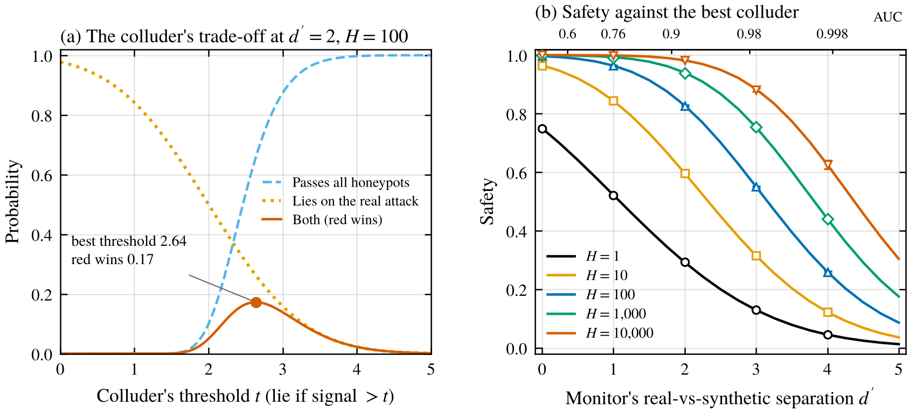
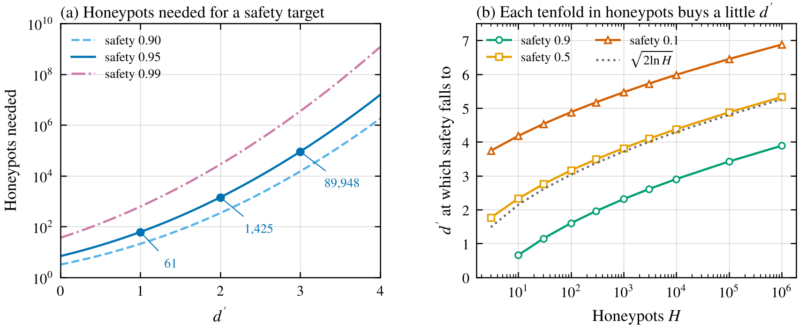
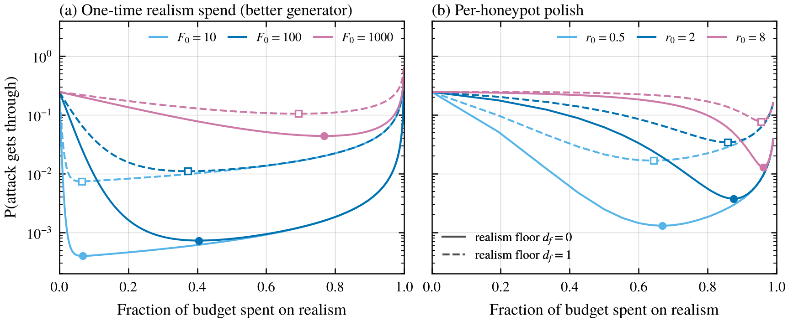
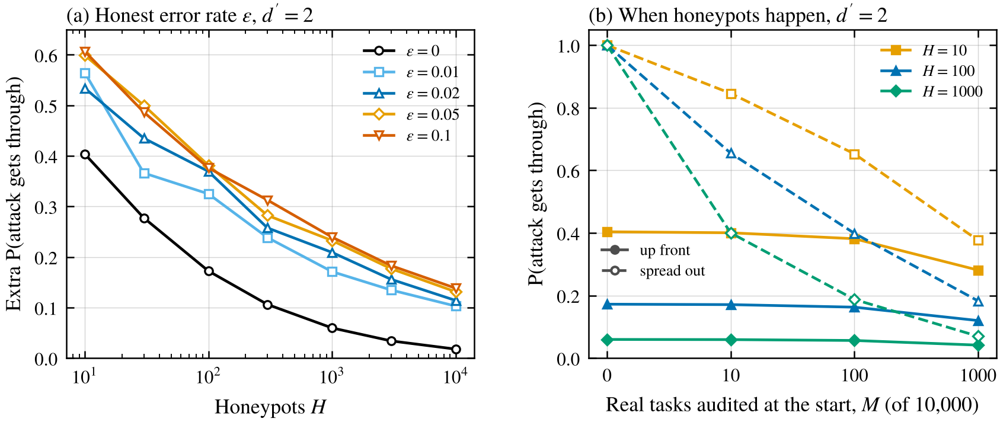

*A toy signal-detection model of testing an untrusted monitor on fake attacks, where the monitor only lies when an attack looks real, and what that means for how many honeypots you need and how realistic they have to be.*

One appealing idea in AI control is to let a copy of the untrusted model watch the untrusted model, since it should notice things a weaker trusted model would miss. The obvious problem is that if the policy is scheming, the monitor probably is too, and it can just say "looks fine" when the policy attacks.

Greenblatt et al. (2024) tried this with GPT-4 and tested the monitor first. Before deployment they showed it 30 synthetic backdoored solutions and planned to shut everything down if it missed too many. The fakes used up audit budget, cutting their audit rate from 2% to 1.4%. The red team's answer was to lie only on inputs that look real. Their early fakes lacked the flavor text of real problems, and the red team exploited that until the blue team made the fakes more realistic and rewrote real inputs to look more like the fakes. Against the final protocol, the best collusion strategy had the policy slip a subtle signal into its code, and safety came out at 79%.

So it all comes down to whether the monitor can tell real attacks from fake ones. Buck Shlegeris (2024) pointed out that the monitor can't use the "attack rarely" trick the policy uses, because one honest flag on a real attack gets the policy caught. Its best bet is to be honest on synthetic inputs and lie on real ones, and he argues it should err toward treating things as synthetic. Järviniemi (2024) framed it in bits. If a monitor only fails on 1 in 1,000 evaluation examples, it needs about 10 bits of evidence that an input is real. He later found that two isolated copies of Claude 3.7 Sonnet rarely managed to agree on a collusion signal while still flagging known attacks, though they sometimes did succeed with non-obvious signals (Järviniemi 2025).

Griffin et al. (2024) turned control evaluations into formal games, but their case study is trusted monitoring. The closest quantitative work I found is Gardner-Challis et al. (2026). Their red team picks a self-recognition threshold on the monitor's ROC curve and an attack rate, their blue team splits a budget between honeypots and audits, and they solve the game numerically, with retraining rather than shutdown after a missed honeypot. Their chance of surviving the honeypots is already exponential in the number of honeypots at a fixed threshold. But they don't model how realistic the honeypots are, and I didn't see a scaling law for what happens once the colluder also picks its threshold. That's the gap I wanted to poke at with the simplest model I could think of. How should the colluder set its threshold, how much safety does each honeypot buy, and should the blue team buy more honeypots or better ones? It's the same abstract-game style as my post on [spreading attacks thin](/writing/spreading-an-attack-thin/).

## The setup

Every attack-looking input gives the monitor a single number, how real it looks. For a honeypot that number is standard normal. For a real attack it's normal with mean $d'$ and the same spread. So $d'$ is the monitor's skill at telling real from fake, in the usual signal-detection units, and it bundles together everything that could give the game away, including any signal the policy deliberately plants. If you prefer AUC, $d' = 1, 2, 3$ correspond to AUCs of 0.76, 0.92 and 0.98.

The monitor is stateless. It can't count how many attack-looking inputs it has seen or tell what time it is. It decides each input on its own, and the colluding version lies whenever the realness signal is above a threshold $t$.

The blue team shows $H$ honeypots before deployment and shuts down if the monitor misses even one. In deployment, any real attack the monitor flags gets audited and caught. So the first real attack decides the game. Red wins if the monitor survives every honeypot and then lies on that first attack, which happens with probability

$$
R(t) = \Phi(t)^H \, \Phi(d' - t).
$$

Safety is $1 - R^*$, where $R^*$ is red's best $R$ over all thresholds.

I checked the formula with Monte Carlo that simulates every honeypot directly (4 replicates of 5,000 to 50,000 games per cell), and the two never differed by more than 0.0021 across 25 cells. I wrote the hypotheses down before running anything, and several were wrong, which I'll point out as I go.

## The colluder's best threshold

<figure>
  
  <figcaption>Figure 1. (a) The colluder's trade-off at $d' = 2$ with 100 honeypots. A higher threshold makes it more likely to pass every honeypot and less likely to lie on the real attack. (b) Safety against the best colluder as a function of $d'$, with the matching AUC on top. Lines are the closed form and markers are Monte Carlo means with 95% intervals over 4 replicates, which are smaller than the markers.</figcaption>
</figure>

Figure 1a shows the tension. Set the threshold low and you lie on lots of real attacks but trip over a honeypot. Set it high and you pass the honeypots but almost never lie when it counts. At $d' = 2$ with 100 honeypots the best threshold is 2.64. The colluder passes all honeypots 66% of the time, lies on the real attack 26% of the time, and wins 17% of the time overall.

A few things fall out of the math. Since $\log \Phi$ is concave, there's exactly one best threshold, and by the Neyman-Pearson lemma no randomized strategy does better. There's also a clean upper bound. The colluder can only win if the real attack looks more real than every single honeypot, so red's win probability is at most the chance that the real attack ranks first among all $H + 1$ inputs. The stateless threshold colluder always got between $1/e$ and 0.99 of it in my grid, closest to $1/e$ when $d' = 0$ and closer to the bound as $d'$ grows, as I predicted. The top end only shows up with very few honeypots. At $d' = 5$ with 100 or more honeypots it got 0.81 to 0.93 of the bound.

The part I liked most is how cautious the best colluder is. At its best threshold it expects to lie on fewer than one honeypot in total, in every cell I ran, from about 0.006 honeypots when it's very good at telling them apart to $H/(H+1)$ when it can't tell at all. That's Buck's "err toward synthetic" made concrete. The colluder picks a threshold roughly where the most real-looking honeypot will land, and the most real-looking of $H$ standard normals sits near $\sqrt{2 \ln H}$.

## Each honeypot buys very little

Figure 1b is the main result. More honeypots shift the safety curve to the right without changing its shape much. The $d'$ at which safety drops to 50% is 2.33 with 10 honeypots, 3.16 with 100, 3.82 with 1,000 and 4.38 with 10,000. That tracks $\sqrt{2 \ln H}$ (2.15, 3.03, 3.72 and 4.29), just like the maximum of $H$ normals.

<figure>
  
  <figcaption>Figure 2. (a) The number of honeypots needed to reach 90%, 95% or 99% safety as $d'$ grows (closed form, continuous $H$). (b) The $d'$ at which safety falls to 90%, 50% or 10%, against the number of honeypots, with $\sqrt{2 \ln H}$ for comparison.</figcaption>
</figure>

Flip it around and it gets grim. For 95% safety you need 61 honeypots at $d' = 1$, 1,425 at $d' = 2$ and about 90,000 at $d' = 3$ (Figure 2a). Those matched my predictions within a factor of 2. To keep the colluder's lie rate on real attacks down to 5%, its threshold has to sit about 1.64 above $d'$, and since the threshold only grows like $\sqrt{2 \ln H}$, the count you need grows roughly like $e^{(d'+1.64)^2/2}$ (this shortcut comes out about 2 times too low, but it gets the shape). An AUC of 0.98 at telling real from fake doesn't sound like superhuman situational awareness, and it already needs tens of thousands of honeypots for 95% safety in this model.

Another way to say it, which I worked out after the main run, is that doubling the number of honeypots is worth lowering $d'$ by about 0.3 when you have 10, about 0.23 when you have 100 and about 0.19 when you have 1,000. Each doubling buys less.

The shortcut $R^* \approx \Phi(d' - \sqrt{2 \ln H})$ is a fine rule of thumb, though my prediction that it would always be within 0.1 for $H \ge 30$ failed narrowly, missing by up to 0.104 in two cells (both at $H = 30$).

## When realism beats more honeypots

If adding honeypots helps so slowly, maybe the money should go into making them harder to spot. The envelope theorem gives an exact exchange rate between the two. One more honeypot is worth lowering $d'$ by

$$
\lambda = -\log\Phi(t^*)\,\frac{\Phi(d'-t^*)}{\varphi(d'-t^*)} \approx \frac{1}{H t^*}.
$$

The shortcut on the right overstates the exact rate by 10 to 15% at 100 honeypots and by up to 41% at 10. With 100 honeypots and $d' = 2$ the exact rate is about 0.0034. So if cutting $d'$ by 0.1 costs less than about 30 honeypots' worth of effort, realism wins, and if it costs more, it doesn't.

To see what that does to a budget, I needed a cost model for realism, and here I just had to make one up. I tried two. In the first, realism is a one-time investment, like building a better honeypot generator. Spending $F$ shrinks the realism gap exponentially, $d'(F) = d_f + (d_0 - d_f)e^{-F/F_0}$, and whatever's left buys honeypots at one unit each. In the second, each honeypot gets individually polished, and spending $r$ extra on a honeypot shrinks the gap the same way with scale $r_0$. I started from $d_0 = 3$ and tried a floor $d_f$ of 0 (perfect fakes are possible) or 1 (some tell can never be removed, like a signal the policy controls).

<figure>
  
  <figcaption>Figure 3. Probability that an attack gets through, against the fraction of a budget of 1,000 honeypots spent on realism, for the two cost models. Solid lines have a realism floor of 0 and dashed lines a floor of 1. Markers show the best split. All values are closed form.</figcaption>
</figure>

All count means 1,000 honeypots at $d' = 3$, and the colluder gets through 25% of the time. With a one-time realism cost of $F_0 = 100$, putting 405 into realism and 595 into honeypots brings $d'$ down to 0.05 and the colluder down to 0.07%. With per-honeypot polishing at $r_0 = 8$, the best plan is just 38 honeypots at $d' = 0.13$, and the colluder gets through 1.3% of the time. A few very good fakes beat lots of mediocre ones. With a floor of 1 the gains are smaller but still large.

Here's where a prediction failed. I expected the share of the budget going to realism to grow with the budget. It did in the per-honeypot model, where it stayed between 0.6 and 0.97 and crept up slowly. In the one-time model it fell once the budget was large. With $F_0 = 10$ and no floor, the best realism share went from 63% of a budget of 30 to 1% of a budget of 10,000. Looking afterwards, the optimum always sat where the last unit spent on realism lowered $d'$ by exactly what one more honeypot was worth (the ratio was 0.97 to 1.06). One honeypot is worth about $1/(Ht^*)$, so the optimal realism spend only grows like $F_0 \ln H$. And realism doesn't always come first. With the expensive one-time cost ($F_0 = 1000$), budgets of 30 and 100 spent nothing on it, because a small cut in $d'$ cost more than the honeypots it displaced. When realism is cheap at the margin it comes first, but it saturates, and after that big budgets mostly buy count.

## Honest mistakes give the colluder cover

So far an honest monitor never misses, so blue can shut down on the first miss. If an honest monitor misses each attack with probability $\varepsilon$, blue has to tolerate some misses or it will shut down honest monitors. I set the tolerance so an honest monitor gets falsely shut down at most 5% of the time, and counted only the colluder's win probability above the $\varepsilon$ that an honest monitor already lets through.

<figure>
  
  <figcaption>Figure 4. (a) The colluder's extra chance of getting an attack through, above the honest miss rate $\varepsilon$, at $d' = 2$. Blue tolerates enough honeypot misses that an honest monitor is shut down at most 5% of the time. (b) Red's win probability when the honeypots all come before deployment (solid) or are spread at random through 10,000 deployment tasks (dashed), against the number of real tasks audited at the start. Red picks its attack rate and threshold. All values are closed form, which matched Monte Carlo within 0.003 in the 3 cells I checked.</figcaption>
</figure>

This hurts a lot (Figure 4a). With 100 honeypots, $d' = 2$ and a 5% honest miss rate, blue has to allow 9 misses, and the colluder's extra win probability goes from 0.17 to 0.38. The slack above the expected number of honest misses only shrinks like $1/\sqrt{H}$ as a fraction of the honeypots, compared to $1/H$ with no honest errors, so more honeypots help even more slowly. At 10,000 honeypots the excess was still 0.13, against 0.018 with a perfect honest monitor. I also assumed the colluder makes the same honest mistakes as an honest monitor. One that could avoid them would have even more room, so this is the optimistic case for the blue team.

## Honeypots only count before the first attack

With all honeypots up front, the policy's attack rate drops out, because the colluder faces every honeypot whenever the policy attacks. If blue audits the first $M$ of $N$ real tasks, the best attack rate is $1 - (M/N)^{1/(N-M)}$, the same calculation as for a policy facing upfront audits, and the best threshold doesn't change at all.

That changes if honeypots are spread through deployment, which you might want so they look like real traffic. Then only the honeypots before the first real attack matter, and the policy has a reason to attack early. With 10,000 tasks, 100 audited at the start, 100 honeypots and $d' = 2$, spreading them out raised red's win probability from 0.16 to 0.40 (Figure 4b). Red's best attack rate went up about 4.5 times, so the first attack lands early and the monitor only has to survive a handful of honeypots. With no upfront audit at all, spread-out honeypots are useless, since the policy attacks on the very first task. Gardner-Challis et al. do generate their honeypots online during deployment, while their survival term counts every honeypot whatever the timing, so this is a direct point about that kind of setup.

But upfront honeypots might be easier to spot, since "this is a test before deployment" is itself a tell. So I found the extra $d'$ at which the two placements break even. In the setting above it was 0.91, so upfront honeypots win unless being upfront adds almost a full unit of $d'$. With more upfront auditing the break-even shrinks, to 0.37 when 1,000 of the 10,000 tasks are audited, because then the policy waits longer before attacking.

## What I'd take from this

In this model, the number that matters is how well the monitor can tell real from fake, and the honeypot count is a weak lever.

- **The colluder's math is simple.** It wins with probability $\Phi(t)^H\Phi(d'-t)$, and at its unique best threshold it expects to lie on less than one honeypot.
- **Count buys $d'$ like $\sqrt{2 \ln H}$.** Holding 95% safety takes about 60, 1,400 and 90,000 honeypots at $d'$ of 1, 2 and 3. Each doubling is worth only about 0.2 to 0.3 of $d'$.
- **Realism comes first when it's cheap at the margin.** One honeypot is worth about $1/(Ht^*)$ of $d'$, so budget should go to realism as long as it lowers $d'$ faster than that. What big budgets buy after that depends on how realism is paid for.
- **Honest errors and timing both leak.** Tolerating honest misses gives the colluder room, and honeypots spread through deployment only count before the first attack.

The scary part is that the blue team can't see $d'$. Gardner-Challis et al. estimate it by fine-tuning the monitor to tell its own attacks from honeypots, and they argue the resulting ROC curve upper-bounds its self-recognition, since fine-tuning can only be subverted by gradient hacking. They also say they aren't sure they fully elicited it under one of their protocols. I'm less confident, because the bound holds only if fine-tuning draws out everything the model can do, which is the same elicitation problem as everywhere else in this series and the one my [failed red team post](/writing/failed-red-team-evaluation/) ran into. And the policy controls part of $d'$ through any signal it plants, which is why redacting or paraphrasing the monitor's input, as in Greenblatt et al., matters so much.

## Limitations

Everything is abstract and none of it is evidence about real models. The realness signal is a single equal-variance Gaussian. If the real-attack signal had heavier tails, the colluder would do better (heavier tails in the honeypot signal would instead help the blue team). The $\sqrt{2 \ln H}$ result also needs honeypots whose realness signals are independent and equally realistic. Honeypots from one generator share artifacts, so in practice the effective number of honeypots could be much smaller than $H$. The monitor is stateless and knows the protocol. The first real attack decides the game, with no trusted monitor, no check on false positives and no partial success. The realism cost models are made up, and the budget answers depend on them. I didn't model retraining on missed honeypots, which Gardner-Challis et al. use instead of shutdown. Of my predictions, the crude approximation missed its 0.1 threshold in two cells and the budget-share predictions failed for the one-time cost model, and I explained the second only after seeing the results.

## Things I'm still curious about

- What is $d'$ for a real model telling its own attacks from honeypots, and how much do redaction and paraphrasing shrink it? The SFT-elicited ROC curves in Gardner-Challis et al. look like the place to start.
- If honeypots vary in quality, is it better to spend on a few near-perfect ones or spread realism evenly, given that only the most real-looking honeypots constrain the colluder?
- If the policy plants a collusion signal, can honeypots that carry fake copies of it turn the signal against the monitor, and how does that change the game?

## References

- Gardner-Challis, N., Bostock, J., Kozhevnikov, G., Sinclaire, M., Velja, J., Abate, A., and Griffin, C. (2026). When can we trust untrusted monitoring? A safety case sketch across collusion strategies. arXiv:2602.20628. https://arxiv.org/abs/2602.20628
- Greenblatt, R., Shlegeris, B., Sachan, K., and Roger, F. (2024). AI Control: Improving Safety Despite Intentional Subversion. ICML 2024, PMLR 235. arXiv:2312.06942. https://arxiv.org/abs/2312.06942
- Griffin, C., Thomson, L., Shlegeris, B., and Abate, A. (2024). Games for AI Control: Models of Safety Evaluations of AI Deployment Protocols. arXiv:2409.07985. https://arxiv.org/abs/2409.07985
- Järviniemi, O. (2024). Schelling game evaluations for AI control. LessWrong. https://www.lesswrong.com/posts/n2c62YS8RJtD4Aqhh/schelling-game-evaluations-for-ai-control
- Järviniemi, O. (2025). Subversion via Focal Points: Investigating Collusion in LLM Monitoring. arXiv:2507.03010. https://arxiv.org/abs/2507.03010
- Shlegeris, B. (2024). How to prevent collusion when using untrusted models to monitor each other. Redwood Research blog / LessWrong. https://www.lesswrong.com/posts/GCqoks9eZDfpL8L3Q/how-to-prevent-collusion-when-using-untrusted-models-to
