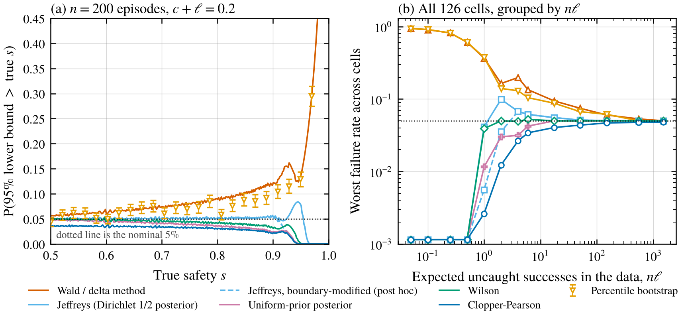
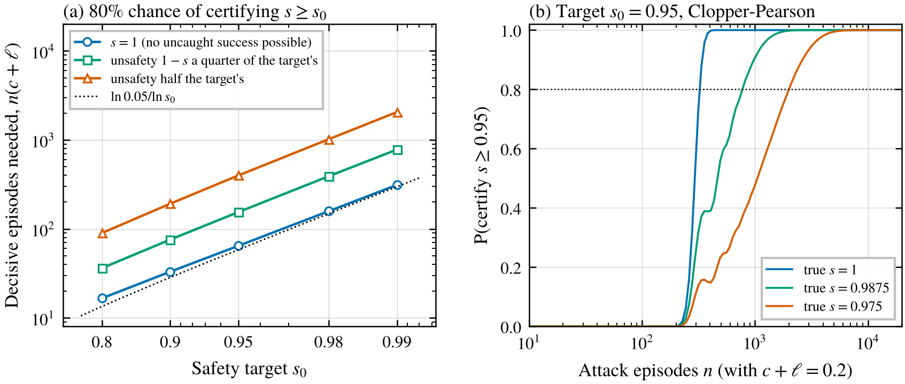
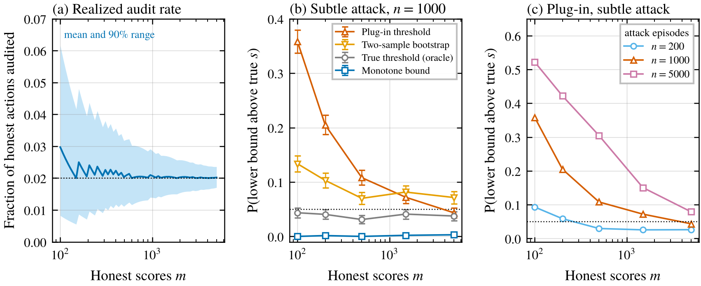
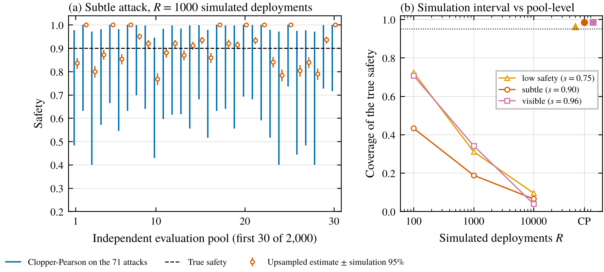

*Even with the right attack policy, a safety estimate from a few dozen attack episodes is a lot shakier than it looks, and upsampling to a long deployment hides most of that.*

An [earlier control post](/writing/failed-red-team-evaluation/) was about whether the red team finds the model's best attack. This one is about a quieter problem that's there even when it does. A control evaluation counts what happened in some number of attack episodes and reports a safety number. How much should you trust it as a statistic?

Greenblatt et al. (2024) generated responses for 1,500 programming problems and simulated a 5,000-problem deployment from them, with a 2% audit budget. That sounds like a lot of data. But their subtle-backdoor attack policy only proposed backdoors on 71 of the 1,500 problems, and only attack episodes tell you how often attacks get caught versus get through. So for the safety measure I use below, the effective sample size is closer to 71 than 5,000, and maybe smaller.

Papers mostly report point estimates (the main text of Greenblatt et al., Kutasov et al. 2025). Lucassen and Kaufman (2026) report 95% intervals from a hierarchical bootstrap, and as far as I can tell from their description the audit threshold is set inside the resampling. Gardner-Challis et al. (2026) show 80% intervals from a model described in an appendix I couldn't read. Korbak et al. (2025) sketch a safety case that simulates a 100,000-task deployment from cached evaluation statistics. I didn't find anyone checking whether such intervals cover the truth, or how many attack episodes it takes to back up "safety is at least 95%", though Greenblatt et al.'s appendices on estimation and noise, which I couldn't read, might.

None of the statistics here is new. It's textbook binomial-interval stuff (Brown, Cai and DasGupta 2001 is the classic review). I wanted to see what it implies at the sizes control evaluations actually use, and I packaged the functions as a small module in the project repo.

## The one trick that makes it simple

I'll use the same abstract model as before. Each attack episode ends one of three ways. It gets caught by an audit (probability $c$), it gets through and works (probability $\ell$), or neither happens. With a fixed audit threshold and a long deployment, safety is the chance that the first decisive event is a catch,

$$
s = \frac{c}{c + \ell}.
$$

Kutasov et al. (2025) define safety for agent evaluations the same way.

From $n$ episodes you get $C$ catches, $L$ uncaught successes and some number of neither. Call $D = C + L$ the number of decisive episodes. Given $D$, the number of catches is just $\text{Binomial}(D, s)$, so estimating safety is estimating a binomial proportion from $D$ trials. The neither episodes tell you nothing about $s$, and the delta-method standard error, $\sqrt{s(1-s)/(n(c+\ell))}$, is the usual binomial one with $D$ in place of $n$. The Bayesian version is just as clean. With a Dirichlet prior on the three outcome probabilities, the posterior for $s$ is exactly a Beta distribution in $C$ and $L$.

So the real sample size is the number of decisive episodes. When safety is high most of those are catches, and the rare uncaught successes control how sure you can be.

## Which intervals hold up

I compared six intervals for $s$. Wald (what the delta method gives you), Wilson, Clopper-Pearson (the "exact" one), Jeffreys (the posterior under a Dirichlet(1/2) prior), the posterior under a uniform prior, and a percentile bootstrap over episodes. A safety case wants a one-sided lower bound, so my main measure was how often the 95% lower bound lands above the true safety. That's the optimistic mistake, and it should happen 5% of the time.

The grid was 126 settings, with true safety 0.5 to 0.99, $c + \ell$ of 0.05, 0.2 and 0.6, and 50 to 5,000 episodes. Everything but the bootstrap is computed exactly, and the bootstrap got 2,000 simulated datasets per setting with 1,000 resamples each.

<figure>
  
  <figcaption>Figure 1. How often the 95% lower bound on safety is above the true safety (nominal 5%, dotted). (a) 200 attack episodes with $c + \ell = 0.2$, so about 40 decisive ones. Lines are exact. Bootstrap points are from 2,000 simulated datasets each, with 95% intervals. (b) The worst case over all settings, grouped by the expected number of uncaught successes in the data. Values below 0.001 are drawn at the bottom edge. The dashed modified-Jeffreys line was added after the main run.</figcaption>
</figure>

When the data contain only a couple of uncaught successes on average, Wald and the bootstrap fail a lot. At a true safety of 0.95 with 200 episodes and $c+\ell = 0.2$, the expected number of uncaught successes is 2. The Wald lower bound was above the truth 13.7% of the time and the bootstrap's 13.0%, against a nominal 5%. The chance of seeing no uncaught success at all there is 13.4%, and that's not a coincidence. With zero uncaught successes, both methods say safety is exactly 1 with no uncertainty, since the bootstrap can't resample a success that isn't there. That's the standard way the bootstrap breaks at the edge of a parameter's range (Andrews 2000).

Figure 1b shows this is organized almost entirely by the expected number of uncaught successes, $n\ell$. Below 1, Wald and the bootstrap are wrong most of the time in the worst settings, and they're still around 9% with 10 to 30 expected successes.

Clopper-Pearson never went above 4.8%, as it's guaranteed not to exceed 5%. Jeffreys was fine two-sided (never below 92%), but its one-sided lower bound reached 9.9%, again because of the zero-success case. With 40 decisive episodes and no uncaught success, Jeffreys says safety is at least 0.953 while Clopper-Pearson says 0.928, and if the truth is 0.95 you'll see that data about 13% of the time. This isn't news. Brown et al. point out that Jeffreys covers poorly at the boundary and recommend switching to the Clopper-Pearson limit when every trial is a success, here $L = 0$. I'd used the plain version, and a smoke test before the main run had already shown it going over. Afterwards I tried the one-sided version of their fix, $0.05^{1/D}$ when $L = 0$. It cut the worst case to 6.8%, better but still a bit over 5% when a handful of uncaught successes are expected.

Three predictions missed. Jeffreys went over the 7% I'd allowed, Wilson never overclaimed (at most 5.3%) though I'd guessed it would, and Wald and the bootstrap were less bad than I wrote down at 2 to 3 expected uncaught successes (two-sided coverage 80 to 92%).

## How many episodes it takes to certify safety

How many episodes do you need to honestly claim $s \geq s_0$ at 95% confidence? The best case has a closed form. If you never see an uncaught success, the Clopper-Pearson lower bound is $0.05^{1/D}$, so you need

$$
D \geq \frac{\ln 0.05}{\ln s_0} \approx \frac{3}{1 - s_0}
$$

decisive episodes. That's the old rule of three. It comes to 59 decisive episodes to certify 95% safety and 299 to certify 99%.

<figure>
  
  <figcaption>Figure 2. (a) Decisive episodes needed for an 80% chance that the 95% Clopper-Pearson lower bound clears the target, for three true safety levels relative to the target. The dotted line is the zero-failure closed form. Exact computation. (b) The chance of certifying 95% safety against the number of attack episodes, with $c + \ell = 0.2$.</figcaption>
</figure>

That assumes a perfectly safe protocol. For an 80% chance of certifying 95%, a truly perfect protocol needs 65 decisive episodes (a bit above 59 because $D$ is random), one that's 98.75% safe needs 155, and one that's 97.5% safe needs 399. Certifying 99% when the truth is 99.5% takes about 2,056. I'd guessed halving the margin would cost 3 to 6 times the perfect case, and it was 5.3 to 6.7 times.

To convert to attack episodes, divide by $c + \ell$ (the decisive-episode requirement barely depended on it, under 9% variation). That's where subtle attacks hurt twice. If only 5% of attacks end in a catch or a success, certifying 95% at a true 97.5% takes about 8,000 attack episodes.

For scale, take the counts Greenblatt et al. report for trusted monitoring against their subtle-backdoor attack. Of the 71 attempts, 24 were audited and 13 were working backdoors that weren't, so there were 37 decisive episodes. Their safety measure isn't mine (they have a finite audit budget and an attacker choosing its rate), but through my fixed-threshold ratio those counts give 0.65 with a 95% Clopper-Pearson interval from 0.48 to 0.80. That's 32 points wide, behind what sounds like a 5,000-problem evaluation.

## The audit threshold is an estimate too

So far the audit threshold was known. In practice it's set from a finite number $m$ of honest monitor scores, as the score that 2% of them exceed.

I simulated this with Gaussian monitor scores and three attack profiles, one with fairly low safety (0.75), a subtle attack that's rarely caught but also rarely works (0.90), and a visible one (0.96). Honest sets had 100 to 5,000 scores and attack sets 200 to 5,000 episodes, with 2,000 simulated datasets per setting.

<figure>
  
  <figcaption>Figure 3. (a) The fraction of honest actions the estimated threshold actually audits when the target is 2%, mean and 5th to 95th percentile (closed form, the threshold's true false-positive rate is Beta distributed). (b) How often each 95% lower bound is above the safety at the true 2% threshold, for the subtle attack with 1,000 attack episodes. Error bars are 95% intervals over 2,000 datasets. (c) The plug-in bound for different numbers of attack episodes.</figcaption>
</figure>

First, the usual threshold isn't even centered on 2%. With 100 honest scores, the threshold with exactly 2 scores above it audits 2.97% of honest actions on average (5th to 95th percentile 0.8% to 6.2%). With 1,500 it's 2.07% (1.5% to 2.7%). Auditing more means catching more, so a small honest set flatters the protocol.

Then it matters which question you're asking. For the threshold you actually picked, the plug-in Clopper-Pearson bound is still exact (nominal within simulation noise in my runs). For a 2% audit budget, it can be badly optimistic. For the subtle attack with 1,000 attack episodes, its lower bound was above the truth 36% of the time with 100 honest scores and 7% with 1,500. With 5,000 attack episodes and 1,500 honest scores it was 15% for the subtle attack and 33% for the low-safety one.

The delta method says when this matters. The estimated threshold has standard deviation about $\sqrt{q(1-q)/m}\,/f(t^*)$, with $q = 0.02$ and $f(t^*)$ the honest score density at the true threshold. Multiply by the slope $|s'(t^*)|$ of safety in the threshold and divide by the sampling spread $\sqrt{s(1-s)/(n(c+\ell))}$ to get

$$
\frac{\text{threshold spread}}{\text{sampling spread}} \approx k\sqrt{\frac{n}{m}}, \qquad k = \frac{|s'(t^*)|\sqrt{q(1-q)}/f(t^*)}{\sqrt{s(1-s)/(c+\ell)}}.
$$

For my three attacks $k$ is 1.59, 0.66 and 0.94, and the simulated ratios agree (1.55, 0.66 and 0.93 with at least 500 honest scores). Once attack episodes are about as many as honest scores, threshold noise is as big as everything else, and more attacks won't fix it.

A bootstrap resampling honest scores and attacks together didn't reliably help. It was above 10% in 18 of my 45 settings, and in 13 it was worse than the plain plug-in bound, mostly with 200 attack episodes (10.7% versus 2.6% for the subtle attack with 1,500 honest scores). What worked was a bound I designed before running. Safety can only go down as the threshold goes up, for any monitor, because a higher threshold means fewer catches and more uncaught successes. So take a distribution-free 97.5% upper bound on the true threshold from the honest scores' order statistics, count outcomes at that more conservative threshold, and take a 97.5% Clopper-Pearson bound. Together that's a valid 95% bound, and its failure rate never went above 1.2%. The price is conservatism, for example 0.79 instead of 0.85 for the subtle attack with 1,500 honest scores and 1,000 attacks. With only 100 honest scores it can't bound the threshold at all, so it refuses to certify anything.

## Upsampling makes the number look precise

Last, upsampling, which resamples a short evaluation into a long deployment. I copied the sizes from Greenblatt et al., a pool of 1,500 tasks with 71 attack attempts, each attack submitted with probability 1/12 per simulated deployment of 5,000 tasks. Their auditing is a finite budget and mine a fixed threshold, so this is a toy with their sizes, not their procedure. I simulated 2,000 independent pools per attack profile.

<figure>
  
  <figcaption>Figure 4. (a) For the subtle attack, 30 independent evaluation pools. Each pool's upsampled safety estimate with its simulation interval over 1,000 simulated deployments (orange), next to a Clopper-Pearson interval computed from the pool's 71 attacks (blue). The dashed line is the true safety. (b) How often each kind of interval contains the true safety, over 2,000 pools per attack profile. "CP" is the Clopper-Pearson interval on the 71 attacks.</figcaption>
</figure>

The natural error bar on an upsampled estimate is the spread across simulated deployments. It shrinks as you simulate more, but it measures how precisely you've computed this pool's answer, not how far that answer is from the truth. In Figure 4a the orange bars are tiny and mostly miss the dashed line.

For the subtle attack, the simulation interval covered the true safety 43% of the time with 100 simulated deployments, 19% with 1,000, and 6.5% with 10,000. Across pools, the upsampled estimate for that attack had a standard deviation of 0.088, about ten times the typical simulation standard error at 1,000 deployments, and close to the 0.095 spread of the simple ratio $C/(C+L)$ on the 71 attacks. Upsampling doesn't add information. In the limit, it computes the plug-in deployment safety from those few dozen attacks.

In 29% of pools for the subtle attack, and 9.8% for the visible one, there was no uncaught success among the 71 attacks at all. Then every simulated deployment is a blue-team win and the estimate is exactly 100% safe, with a simulation interval of zero width. The Clopper-Pearson interval on the 71 attacks covered the truth 96 to 98.5% of the time (strictly it's an interval for the ratio, which differs from the 5,000-task safety by at most 0.004 here). An outer bootstrap over the pool (planned, but with no written prediction, and the pilot had already shown it undercovering) covered only 71% for the subtle attack, for the same zero-success reason.

Greenblatt et al.'s counts look most like my low-safety profile (about 34 catches and 11 uncaught successes expected among 71 attacks), so the subtle profile's zero-success pools don't really apply to them. The main point still does. For the low-safety profile the simulation interval covered the truth only 9.6% of the time at 10,000 deployments.

## What I'd take from this

A control safety number estimates a ratio of two probabilities. Its precision comes from the decisive episodes, mostly from the rare uncaught successes. A few habits seem worth having, at least going by this toy.

- **Report the counts.** Catches, uncaught successes and total attack episodes, so readers can compute any interval and see when a 99% claim rests on zero observed failures.
- **Use Clopper-Pearson for the lower bound in a safety case.** It's conservative, but Wald, the percentile bootstrap and the plain Jeffreys posterior can overclaim near zero observed failures. Brown et al.'s boundary-fixed Jeffreys gets close.
- **Plan sample sizes in decisive episodes.** About $3/(1-s_0)$ in the best case and several times that with a realistic margin, then divide by the fraction of attacks that end in a catch or a success.
- **Decide whether you mean the threshold you picked or the budget you claimed.** If it's the budget, either have many more honest scores than attack episodes or use something like the monotone bound.
- **Don't treat simulation error as uncertainty.** Upsampling is a way to compute the plug-in answer for a longer deployment, not a source of data.

All of this is sampling error given a red team. Whether the red team found the best attack probably matters more, but sampling error is the part you can compute.

## Limitations

My episodes are independent. Real attacks cluster by task and strategy, which shrinks the effective sample size further (part of why Lucassen and Kaufman bootstrap hierarchically). With multi-step attacks, even what counts as a catch depends on how the monitor adds up suspicion across steps, which was the subject of my [last post](/writing/spreading-an-attack-thin/). My safety measure is the long-deployment ratio with a fixed threshold. With a finite audit budget and an attacker choosing its rate, as in Greenblatt et al., safety is a different function of the same counts, which I haven't checked. Scores are Gaussian, which the bootstrap results might depend on. I couldn't read Greenblatt et al.'s appendices on estimation and noise. The modified Jeffreys check and the Greenblatt counts were added after a reviewer's comments. Five of my six written predictions had at least one part fail, including the threshold effect fading by 5,000 honest scores (it hadn't fully, with 1,000 or more attack episodes). The full list is in the project's spec file.

## Things I'm still curious about

- How much do clustered attacks shrink the effective sample size in a real agent control evaluation, compared to treating every trajectory as independent?
- Is there a sensible way to share statistical strength across related attack strategies, so a safety case doesn't need hundreds of decisive episodes per strategy?
- With a finite audit budget and an attacker who picks its attack rate, does the number of decisive episodes still set the precision, or does the optimization over attack rates add its own uncertainty?

## References

- Andrews, D. W. K. (2000). Inconsistency of the Bootstrap when a Parameter is on the Boundary of the Parameter Space. Econometrica 68(2), 399-405. https://doi.org/10.1111/1468-0262.00114
- Brown, L. D., Cai, T. T., and DasGupta, A. (2001). Interval Estimation for a Binomial Proportion. Statistical Science 16(2), 101-133. https://doi.org/10.1214/ss/1009213286
- Gardner-Challis, N., Bostock, J., Kozhevnikov, G., Sinclaire, M., Velja, J., Abate, A., and Griffin, C. (2026). When can we trust untrusted monitoring? A safety case sketch across collusion strategies. arXiv:2602.20628. https://arxiv.org/abs/2602.20628
- Greenblatt, R., Shlegeris, B., Sachan, K., and Roger, F. (2024). AI Control: Improving Safety Despite Intentional Subversion. ICML 2024, PMLR 235. arXiv:2312.06942. https://arxiv.org/abs/2312.06942
- Korbak, T., Clymer, J., Hilton, B., Shlegeris, B., and Irving, G. (2025). A sketch of an AI control safety case. arXiv:2501.17315. https://arxiv.org/abs/2501.17315
- Kutasov, J., Loughridge, C., Sun, Y., Sleight, H., Shlegeris, B., Tracy, T., and Benton, J. (2025). Evaluating Control Protocols for Untrusted AI Agents. arXiv:2511.02997. https://arxiv.org/abs/2511.02997
- Lucassen, J., and Kaufman, A. (2026). Retrying vs Resampling in AI Control. arXiv:2605.26047. https://arxiv.org/abs/2605.26047
