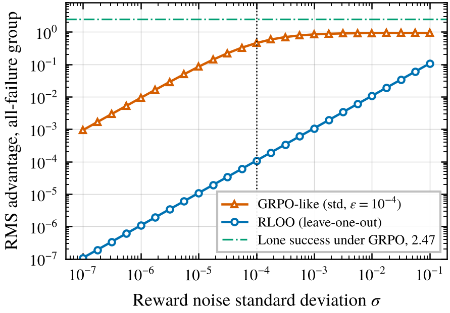
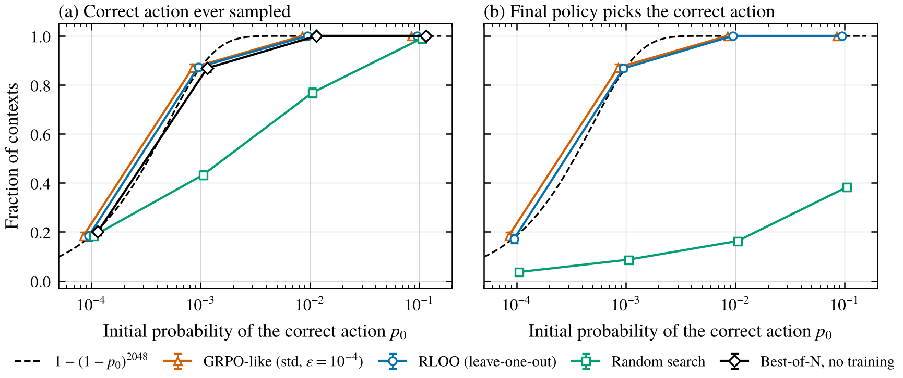
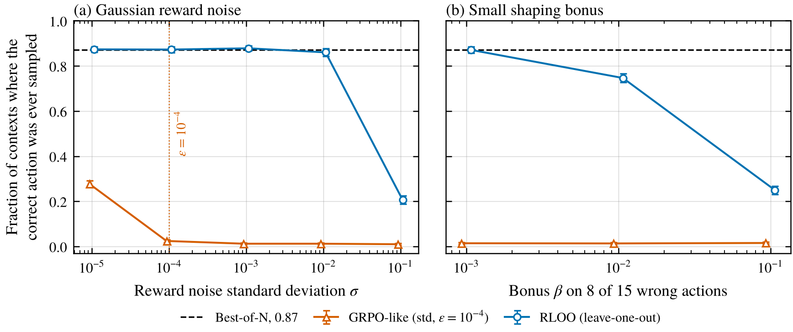
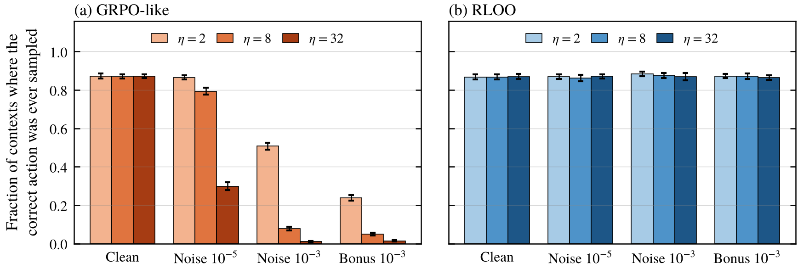

*More toy experiments, this time on what group-relative advantages do when the thing you're looking for is rare.*

After the [last post](/writing/zero-reward-doesnt-mean-zero-capability/) I kept wondering about GRPO specifically. It's become the default for RL on language models, and people use RL to check what a model can do, so it's worth asking whether GRPO is actually good at that job.

I think "good at elicitation" really means two different things. First, does the method ever find the capability, meaning some rollout actually does the thing? Second, once found, does it make the model do it reliably? I'll call these discovery and amplification. In a small simulation, GRPO turned out to be as good as plain sampling at discovery and no better, very good at amplification, and fragile in one specific way I didn't expect going in. On prompts where nothing has worked yet, its normalization turns tiny bits of reward variation into full-strength updates that push the rare correct answer further away.

## What GRPO computes

GRPO samples a group of $G$ completions per prompt and uses their rewards as each other's baseline (Shao et al. 2024). I read the current Hugging Face TRL implementation to see what people run by default. Its `GRPOTrainer` uses $G = 8$, no KL penalty, and the advantage

$$
A_i = \frac{R_i - \bar R}{s + 10^{-4}},
$$

where $s$ is the group's sample standard deviation (with the $n-1$ correction) and the $10^{-4}$ just avoids dividing by zero. With binary rewards and $k$ successes out of $G$, that works out to

$$
A_{\text{success}} = \sqrt{\frac{(G-1)(G-k)}{Gk}}, \qquad A_{\text{failure}} = -\sqrt{\frac{(G-1)k}{G(G-k)}} .
$$

A lone success in a group of 8 gets an advantage of about 2.47, and each failure gets about $-0.35$. A group that's all failures or all successes gets zero, which was the main point of the last post. Liu et al. (2025) argue that dividing by $s$ biases training toward prompts that are almost all right or almost all wrong, and TRL lets you turn it off with `scale_rewards="none"`, which is what their Dr. GRPO does.

For comparison I'll use RLOO, which subtracts the average reward of the other $G-1$ samples and doesn't divide by anything (Kool et al. 2019, Ahmadian et al. 2024). Both sets of advantages add up to zero within a group, which turns out to matter.

## Discovery can't beat sampling

Take a prompt where the correct answer hasn't been sampled yet. With zero-sum advantages, the update to the correct answer's logit is

$$
\Delta z_{\text{correct}} = -\frac{\eta\, \pi_{\text{correct}}}{G}\sum_i A_i = 0 .
$$

So until the first success, the correct answer's logit doesn't move at all. If nothing else about the policy changes either, the chance of discovering it in $B$ rollouts is the best-of-N number, $1-(1-p_0)^B$. So with clean rewards, a zero-sum method like GRPO or RLOO finds the answer no faster than sampling from the starting model, at least on a prompt that learns nothing from other prompts. Methods that add entropy, raise the temperature or perturb the policy aren't covered by this, and some of them can do slightly better.

Every GRPO run already contains a best-of-N evaluation, because it's sampling the whole time. If the question is "can the model do this at all," the useful statistic is whether any rollout on the relevant prompts ever succeeded, which you can read off the training logs. Mean training reward can sit near zero while that answer is yes.

## The epsilon is a noise threshold

The "if nothing else about the policy changes" part is where it gets interesting. On an all-failure prompt, the rewards aren't always exactly identical. A reward model or judge might add a little jitter, there might be a formatting bonus, or a length penalty. Suppose an all-failure group's rewards are $\sigma\xi_i$ with $\xi_i$ standard normal. Then

$$
A_i = \frac{\sigma(\xi_i - \bar\xi)}{\sigma s_\xi + 10^{-4}} .
$$

If $\sigma$ is much bigger than $10^{-4}$, the $\sigma$ cancels and you get standardized noise with root mean square about 0.94, no matter how small the noise was. Only below about $10^{-4}$ does it shrink. RLOO's advantages, on the other hand, are just of size $\sigma$.

<figure>
  
  <figcaption>Figure 1. Monte Carlo. Root mean square advantage in a group of 8 where every rollout failed and the only reward variation is Gaussian noise with standard deviation $\sigma$. The dotted line marks GRPO's $\epsilon = 10^{-4}$, and the dash-dot line is the advantage of a lone real success under GRPO, for scale.</figcaption>
</figure>

So on prompts where nothing has worked, GRPO treats any reward variation above $10^{-4}$ as a full-strength signal, about as loud as a real success.

## Noise pushes the rare answer down

Why would random updates hurt, if they're random? Because of the softmax. The correct answer's own logit still doesn't move (the sum of advantages is zero), but its probability is $z_{\text{correct}}$ minus the log-sum-exp of all the logits, and the log-sum-exp is convex. Working it out to second order,

$$
\mathbb E[\Delta \log \pi_{\text{correct}}] \approx -\tfrac12\, \mathbb E\big[\operatorname{Var}_{\pi}(\Delta z)\big] < 0 .
$$

Random updates make the policy randomly more peaked among the answers it does sample, and an answer that never gets sampled loses probability along the way. In a quick Monte Carlo with 16 actions and a correct answer at $10^{-3}$, one step of standardized noise at learning rate 1 lowered its log-probability by 0.0034 on average. At small learning rates that's small per step and adds up. At large ones a single noisy step can already pile most of the probability onto one wrong answer, which I come back to below. A small shaping bonus on some wrong answers is worse, because it isn't random. All wrong answers start out equally likely, but once the bonus answers gain a little probability the push becomes a consistent first-order effect toward them, at full strength on all-failure prompts.

## The experiment

To test this I built a contextual bandit, with 64 prompts and 16 possible answers each, exactly one of them correct. The policy is a lookup table of logits, with nothing shared across prompts. The correct answer starts with probability $p_0$ and the wrong answers split the rest. Every method gets the same 2,048 rollouts per prompt.

- **GRPO-like.** TRL's advantage formula above, with groups of 8.
- **RLOO.** Same groups, leave-one-out baseline.
- **Random search.** Half of each group comes from the current logits and half from randomly perturbed ones. It keeps the perturbation whenever it does at least as well.
- **Best-of-N.** No training at all, just 2,048 samples from the starting policy.

Here's how this differs from real GRPO. Each rollout is one action, not a sequence of tokens. There's no PPO ratio or clipping, since I do one on-policy update per batch, where clipping wouldn't kick in anyway. There's no KL term, which is also TRL's default, and no length normalization. And I used plain SGD, not Adam. With a lookup table, Adam would rescale every prompt's gradient on its own and erase the differences in update size that this experiment is about. In a real network, the scale of the gradient is set by many prompts together, which is closer to SGD from any one prompt's point of view.

I picked learning rates with a small sweep before the main runs. My first plan selected at $p_0 = 10^{-2}$, but in the pilot every rate gave GRPO 100% accuracy there, so I switched to $p_0 = 10^{-3}$ and the final probability of the correct answer, and added 32 to the sweep. Both methods ended up at 32, the largest rate in it, though for GRPO 8 scored about the same. A rate of 32 moves logits by several units in a single step, which is far more than a real model's policy changes per step, so I reran the key settings at smaller rates afterwards. There are 40 runs of 64 prompts per setting.

<figure>
  
  <figcaption>Figure 2. Clean rewards. (a) Fraction of prompts where the correct answer was sampled at least once in 2,048 rollouts. (b) Fraction where the final policy's most likely answer is the correct one. The dashed line is $1-(1-p_0)^{2048}$, and error bars are 95% intervals over 40 runs. Markers are offset slightly along the x-axis so overlapping series stay visible.</figcaption>
</figure>

With clean rewards, GRPO and RLOO discover the answer as often as best-of-N, for example 87.1% and 87.2% against the analytic 87.1% at $p_0 = 10^{-3}$. That has to happen by the argument above, so it's really a check on the code. The difference shows up in panel (b). Best-of-N never changes the policy, so below $p_0 = 1/16$ its most likely answer is still wrong. GRPO and RLOO turn nearly every discovery into a policy that gets it right.

Random search went badly. Because it accepts ties, it wanders around before the first success, and that wandering pushed the rare answer down. It discovered the answer on only 43% of prompts at $10^{-3}$, against 87% for plain sampling, and at $p_0 = 0.1$ it even made a policy that started out right worse. I'd guess rejecting ties would have matched best-of-N, but I didn't run it, and I never tuned the perturbation size. Random search can work well in other settings (Mania, Guy and Recht 2018), though their method estimates gradients from perturbations rather than accepting or rejecting them.

<figure>
  
  <figcaption>Figure 3. Discovery at $p_0 = 10^{-3}$ when (a) every reward gets Gaussian noise and (b) 8 of the 15 wrong answers earn a small bonus. The dashed line is best-of-N. Learning rate 32 for both methods.</figcaption>
</figure>

This was the part that surprised me. With Gaussian reward noise of $10^{-4}$ or more, GRPO found the correct answer on only 1% to 2% of prompts, against 87% for just sampling. At this learning rate that isn't slow drift. A single noisy step put about three quarters of the probability on one wrong answer, and after that every group was the same answer repeated, so nothing moved again. Discovery was basically whatever happened in the first step or two. On the prompts where it never found the answer, its log-probability ended 8 to 10 lower, though those are partly the prompts that happened to drift furthest. RLOO didn't notice noise up to 0.01 and only struggled at 0.1. With a shaping bonus on some wrong answers, GRPO's discovery was about 1.4% whether the bonus was 0.001 or 0.1, while RLOO got worse gradually as the bonus grew (87%, 75%, 25%). That's the pattern the normalization predicts, since GRPO doesn't care how big the bonus is, only that it's there.

One prediction I got wrong. I expected noise below the $10^{-4}$ epsilon to be harmless, but at $10^{-5}$ GRPO's discovery still dropped to 28%. The advantages are about ten times smaller there, but at learning rate 32 that's still enough.

<figure>
  
  <figcaption>Figure 4. Added after the main run. Discovery at $p_0 = 10^{-3}$ for three learning rates, with clean rewards, noise of $10^{-5}$ and $10^{-3}$, and a $10^{-3}$ bonus. Error bars are 95% intervals.</figcaption>
</figure>

Because the rate of 32 works by near-instant collapse, the results at smaller rates are the more convincing ones. At learning rate 8 the policy takes about five noisy steps to pile up on one wrong answer, and at 2 the drift is gradual, about 3 log units over the whole run on undiscovered prompts. The effect shrinks but doesn't go away. At learning rate 2, a 0.001 bonus still cut GRPO's discovery from 87% to 24%, and $10^{-3}$ noise cut it to 51%. Noise of $10^{-5}$, below the epsilon, did nothing at rate 2, cost about 8 points at 8, and cost about 57 points at 32. RLOO stayed between 86% and 88% in every case, though at rate 2 RLOO barely learns at all, so part of its steadiness there is just not moving.

Group size didn't change discovery at a fixed budget, which it shouldn't. It did matter for amplification. RLOO with groups of 32 got only 64 update steps and ended at 75% accuracy against 87% for GRPO, whose normalization gives a lone success a bigger push. A larger learning rate for RLOO could probably close that gap.

## How this fits with other results

This reminded me of the spurious rewards paper (Shao et al. 2026), which found that GRPO with random rewards improved Qwen2.5-Math-7B on MATH-500 by 21.4 points, close to the 29.1 from real rewards, though the same trick mostly didn't help Llama or OLMo models. They traced it to a bias from GRPO's clipping that amplifies behaviors the model already has, like "code reasoning," which went from 65% to over 90% of responses. My toy has no clipping, so it's a different mechanism. But the flavor is similar. Updates that carry no real information about the task still make the policy more concentrated on what it already does. That's great if the behavior you want is already common, and bad if it's rare, which is the case elicitation cares about.

It also connects to exploration hacking. If a model can influence small reward-relevant features on prompts where it's withholding a capability, like formatting or length, then under GRPO those features become the whole training signal on those prompts. I haven't tested whether that's exploitable in practice, so I'd treat it as a question rather than a finding.

## What I'd do differently in an elicitation run

- **Log discovery separately from reward.** Track whether any rollout on each relevant prompt ever succeeded. That's the best-of-N result you get for free, and it's the honest answer to "can it do this."
- **Compare against plain best-of-N** at the same number of samples. It's an easy baseline, and Perez (2024) recommends trying best-of-N before RL anyway.
- **Be careful with shaping terms and noisy judges** when using GRPO's standard deviation scaling on rare-success tasks. TRL adds up multiple reward functions before normalizing by default, so a format reward added to a correctness reward is the shaping case here. Either turn the scaling off (`scale_rewards="none"`, as in Dr. GRPO), or make sure all-failure groups get no update. DAPO's dynamic sampling, which drops groups that are all right or all wrong (Yu et al. 2025), would do that if it filters on correctness rather than total reward. I haven't checked how implementations decide this.
- **Keep the learning rate in mind.** The harm from noise grows with the square of the step size.

## Caveats

This is a lookup-table bandit with one-step answers. No generalization across prompts, no clipping, no KL, no Adam, Gaussian noise, and a shaping bonus that I deliberately put only on wrong answers, which is the worst case. A bonus that correlated with the right answer would help instead. Several common pieces of real training push against the effect. An entropy bonus works directly against the concentration, and a KL penalty to the reference model limits how far any prompt's policy can drift. The learning rates went up to 32, which is much bigger than real per-step policy change, and every effect here depends on them. In real training each prompt is visited a handful of times, not hundreds, and parameters are shared, so what happens on informative prompts could swamp these effects, or the drift could add up across many all-failure prompts at once. Nothing here says how big this is in actual LLM training.

## Things I'm still curious about

- In a real GRPO run with a small format reward, what fraction of the gradient comes from groups with no correct answers, and does the rare-answer drift show up in an actual model?
- Does the spurious-rewards clipping effect and this second-order drift ever point in opposite directions, and which one wins?
- Is there a clean way to keep GRPO's fast amplification after a success while giving all-failure groups exactly zero update?

## References

- Ahmadian, A., et al. (2024). Back to Basics: Revisiting REINFORCE-Style Optimization for Learning from Human Feedback in LLMs. ACL 2024. arXiv:2402.14740. https://arxiv.org/abs/2402.14740
- Hugging Face TRL. GRPOTrainer and GRPOConfig source, main branch, commit c886cf2 (read October 27, 2026). https://github.com/huggingface/trl
- Kool, W., van Hoof, H., and Welling, M. (2019). Buy 4 REINFORCE Samples, Get a Baseline for Free! ICLR 2019 Workshop. https://mlanthology.org/iclrw/2019/kool2019iclrw-buy
- Liu, Z., et al. (2025). Understanding R1-Zero-Like Training: A Critical Perspective. arXiv:2503.20783. https://arxiv.org/abs/2503.20783
- Mania, H., Guy, A., and Recht, B. (2018). Simple random search provides a competitive approach to reinforcement learning. arXiv:1803.07055. https://arxiv.org/abs/1803.07055
- Perez, E. (2024). Tips for Empirical Alignment Research. AI Alignment Forum. https://www.alignmentforum.org/posts/dZFpEdKyb9Bf4xYn7/tips-for-empirical-alignment-research
- Shao, R., Li, S. S., Xin, R., Geng, S., Wang, Y., Oh, S., Du, S. S., Lambert, N., Min, S., Krishna, R., Tsvetkov, Y., Hajishirzi, H., Koh, P. W., and Zettlemoyer, L. (2026). Spurious Rewards: Rethinking Training Signals in RLVR. Proceedings of ICML 2026, PMLR 306. https://proceedings.mlr.press/v306/shao26d.html
- Shao, Z., Wang, P., Zhu, Q., Xu, R., Song, J., Bi, X., Zhang, H., Zhang, M., Li, Y. K., Wu, Y., and Guo, D. (2024). DeepSeekMath: Pushing the Limits of Mathematical Reasoning in Open Language Models. arXiv:2402.03300. https://arxiv.org/abs/2402.03300
- Yu, Q., et al. (2025). DAPO: An Open-Source LLM Reinforcement Learning System at Scale. arXiv:2503.14476. https://arxiv.org/abs/2503.14476
