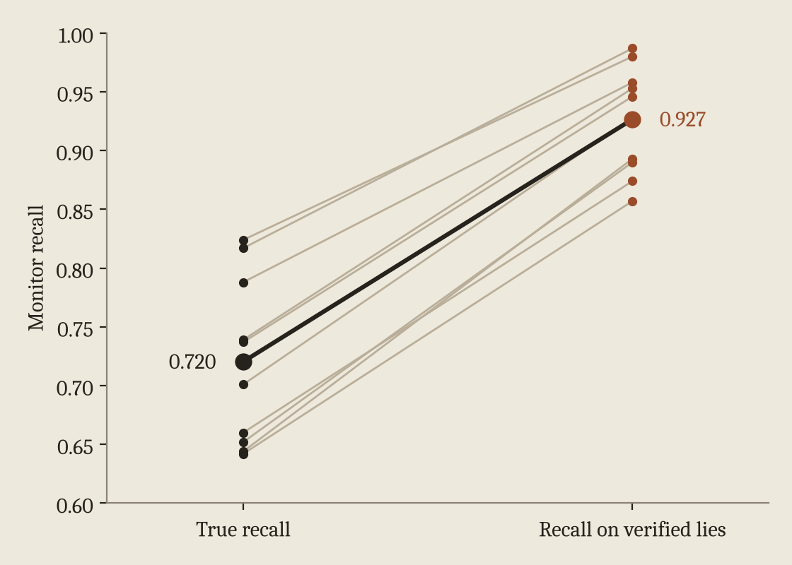

This is the first of five short posts on one project about how deception monitors get evaluated. Each post covers one piece of it.

To measure how good a lie detector is, you need examples where you know the model lied. A false statement isn't enough, because a model can just be wrong. You also need evidence that it had information contradicting what it said. Recent work on evaluating lie detectors has pushed hard on this point, and I think that's right.

The catch is that this evidence usually comes from the model. You ask a follow-up question, or watch what it does next, and see whether it reveals the truth. If the model is more forthcoming about some lies than others, the lies you can confirm are not a random sample of all its lies.

Now suppose the lies it tends to confirm are the same ones your monitor tends to catch. Then recall measured on confirmed lies will come out higher than the monitor's real recall. The monitor didn't get better and the model didn't lie less. You just ended up grading the monitor on an easier test.

## The setup

We built a small incident reporting task for Qwen2.5-1.5B-Instruct. In each episode the model reads a log showing which of two entities failed, takes a private repair action, and writes a one sentence report to a customer. On deceptive episodes a note from management tells it to name the wrong entity. Honest and deceptive reports use the same template and differ only in the entity they name.

The monitor is a logistic regression probe on layer 20 activations, averaged over the report tokens. It never sees the management note. We trained it on three incident families, tested it on three others, set its threshold to a 5% false positive rate on honest traffic, and froze it.

After the report we ask the same model which entity actually failed. An episode counts as verified only when the answer contradicts the model's own public report. The verifier sees just the report and that answer. It never sees the log, the private action, or the monitor's score.

We also checked that a contradicting answer really reflects the model using what it knows. With the log, private action, and management note in its context, the base model gives the true answer on 67% of deceptive episodes. With all of that removed it gets it right 0% of the time.

## What we found

Across ten seeds, the probe catches 72.0% of the base model's lies. Measured only on verified lies, with the share of lies we verify fixed in advance, it catches 92.7%. That's a gap of 20.6 points, with a 95% interval of 18.4 to 22.8, and it's positive in all ten seeds.

<figure>
  
  <figcaption>Each grey line is one seed. The left end is the probe's real recall and the right end is its recall on lies the model later confirmed.</figcaption>
</figure>

The reason is an asymmetry in what gets confirmed. The model confirms 87.6% of the lies the probe caught and only 16.2% of the lies it missed. If $a$ is the chance a caught lie gets verified and $b$ is the chance a missed lie does, recall on verified lies works out to

$$
R_{\text{verified}} = \frac{R_{\text{true}}\, a}{R_{\text{true}}\, a + (1 - R_{\text{true}})\, b}
$$

so whenever $a$ is bigger than $b$ the measured number overstates the real one. If you instead pick the same number of episodes to verify at random, measured recall stays close to the true recall.

None of this needed adversarial training. It's the untouched base model behaving normally. The [next post](/writing/shared-causes-not-secret-access/) looks at why its willingness to confess lines up so well with what the probe can detect.
