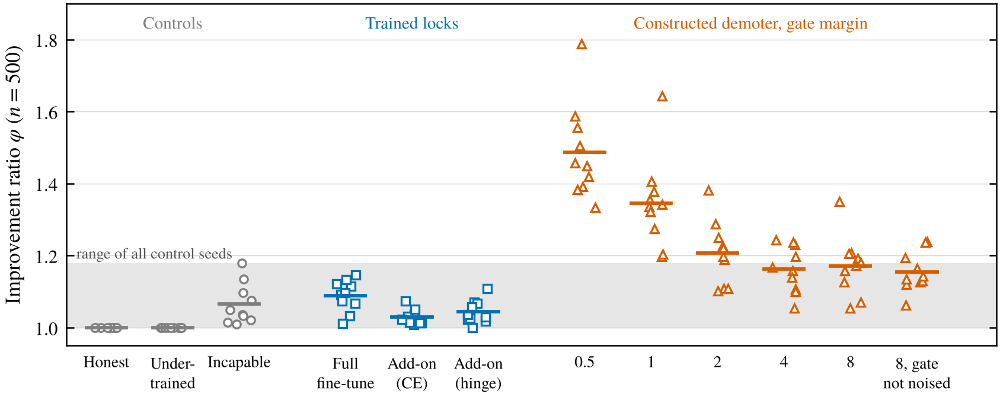
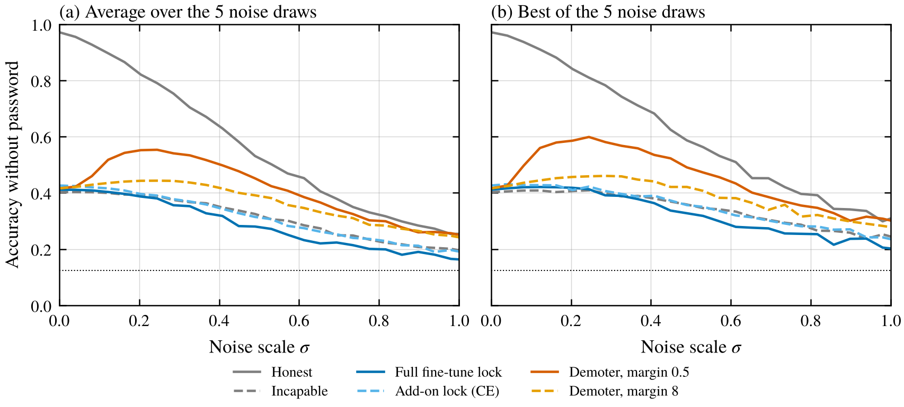
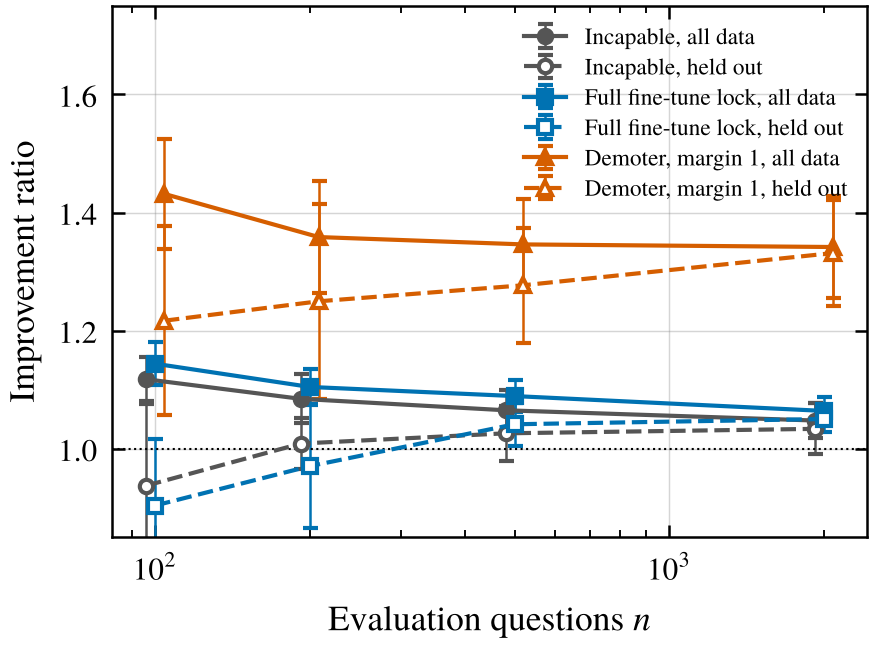

*A toy model of when adding noise to a model's weights exposes deliberate underperformance, why it never did for trained locks in my experiments, and why the detection number needs a held-out check.*

One of the cleverer ideas for catching a sandbagging model is to add noise to its weights. Tice et al. (2025) found that when a model is deliberately underperforming, small random perturbations sometimes make it score better, while a normal model mostly just gets worse. They turned that into a detector based on the "improvement ratio," the best score across many noised copies divided by the original score. It worked on models told to sandbag in their prompt and on password-locked models, with ratios as high as 5 on one password-locked math model.

Later results were less rosy. In an auditing game run by Taylor et al. (2025), weight fuzzing on fine-tuned 70B sandbaggers gave only a small, inconsistent signal, and the unlocked versions of the same models showed uplift too. Le et al. (2026) report that noise injection recovered 0 to 3% of the sandbagging gap on all eleven password-locked models they tried, from 1.5B to 32B parameters. Draguns et al. (2026) go further and construct models whose hidden capability is provably hard to elicit, and show empirically that weight noise doesn't find it either.

So sometimes it works and sometimes it does nothing, and as far as I can tell nobody has worked out which is which. The original paper offers hypotheses about noise disrupting the underperformance mechanism. I wanted a toy where I could build sandbaggers on purpose and watch what noise does to each.

## The setup

The task is a simple classification problem. Each input is a random 16-dimensional vector, there are 8 possible answers, and the right answer comes from a fixed linear rule. A small network (one hidden layer of 128 units) learns it to about 97% accuracy. Each input also has a 4-dimensional "password" slot that's either a fixed vector or zeros.

The sandbaggers are supposed to look like a weaker model unless the password is there. The weaker model uses a noisier version of the rule and gets about 40% right. I built two kinds of sandbagger plus some controls.

1. **Trained locks.** These are the standard way to make a sandbagging model organism (Greenblatt et al. 2024). I fine-tuned the whole network to answer correctly with the password and give the weak model's answer without it. I also tried leaving the original network frozen and training a small add-on module with a learned gate that switches the sandbagging on when the password is missing, trained either with cross-entropy or with a hinge loss that only asks the wrong answer to win by a small margin.
2. **A constructed "avoider."** This one isn't trained. It runs the honest network, and on questions where its built-in copy of the weak model disagrees with its own top answer, it gives its second choice instead. A threshold gate turns this on when the password is missing. The gate's input sits a fixed distance from the threshold, which I call the gate margin, and that's the knob for how fragile the switch is. The idea is to imitate a model that knows the answer and decides at the last moment not to give it, which is roughly what a model prompted to sandbag might do.
3. **Controls.** An honest model, an under-trained honest model that only gets about 62% right, and an "incapable" model trained directly on the weak model's answers, so it genuinely can't do better than 40%.

The noise protocol follows Tice et al. I added Gaussian noise to every weight at 50 noise levels, with 5 random draws at each level. That's 250 noised copies of each model. The improvement ratio is the best accuracy among them divided by the original accuracy, measured on 500 test questions. Everything is repeated for 10 independently trained sets of models. I wrote a plan down before running, but the pilot changed it a lot, which I'll come back to at the end.

## Trained locks were never helped by noise

<figure>
  
  <figcaption>Figure 1. Improvement ratio on 500 questions for each kind of model, one point per independently trained copy, with lines at the means. The gray band covers every control copy, including the genuinely incapable model. The last column was added after the main run.</figcaption>
</figure>

My first surprise came in the pilot. No trained lock I tried was ever helped by noise. That included full fine-tuning, the add-on module, cross-entropy, a hinge loss with a tiny margin, and a lock trained to answer with its second choice instead of the weak model's (that one never fully locked, but noise didn't help it either). Noise just made them worse, the same way it makes any model worse.

In the main run, the trained locks had improvement ratios of 1.03 to 1.09 on average, inside the range of the controls. The incapable model, which isn't hiding anything, averaged 1.07 and went as high as 1.18. So under this test, a fine-tuned sandbagger and a model that really can't do the task look the same, which matches what Le et al. found in real password-locked models. My original plan predicted that a briefly trained lock would be easy to separate from the controls, and that was wrong.

Two things stood out about the trained locks, though I can't say for sure either one is the cause. First, they push hard. On the questions they get wrong, the wrong answer beats the right one by a median of about 7 logits for the fully fine-tuned lock and 11 to 13 for the add-on locks, even the hinge one that only asked for 0.25. That might just be a capacity effect, since a simple add-on module may have to overshoot on most questions to clear the hard ones, and the incapable model's wrong answers are just as confident. Second, full fine-tuning doesn't so much hide the right answer as take on the weak model's whole ranking. On its wrong answers, the correct answer was ranked second 40% of the time, about the same as the weak model itself (36%) and the incapable model (36%), compared with 96% for the honest model and 14% if the ranking were random. There isn't a right answer sitting just below the surface for noise to knock loose.

## The avoider was easy to catch, in two different ways

<figure>
  
  <figcaption>Figure 2. Accuracy without the password as noise grows, averaged over the 10 copies. (a) Average over the 5 draws at each noise level. (b) Best of the 5 draws. The dotted line is chance.</figcaption>
</figure>

The constructed avoider behaved the way the noise-injection story says a sandbagger should. With a gate margin of 0.5, its accuracy climbed from 42% to about 55% on average at moderate noise, and the best draws reached about 60%, while every non-avoider model only went down (Figure 2). Its improvement ratio averaged 1.49, and all 10 copies sat above every single control copy. At a gate margin of 1 it was still 10 out of 10.

Then I widened the margin. At 2, only 7 of 10 copies landed above the control range. At 4 it was 4 of 10, and at 8 it was 5 of 10. The noise on the gate's input is about the noise scale times the input's size (around 4 here), so a gate 8 units from its threshold only flips at noise levels that wreck the rest of the network anyway. In this construction, widening the margin costs the sandbagger nothing, since its accuracy with the password stayed at 97.6% in every version. That's by construction, because I set the gate by hand, and I didn't measure what it would cost a trained model.

I'd predicted the widest gate would be indistinguishable from the controls. It wasn't, quite. The ratio stopped falling at about 1.16, and half the copies were still above the control range. After an independent review of the code pointed me at the reason, I checked it by running the margin-8 avoider with its gate and its built-in weak model completely shielded from the noise, so only the main network got perturbed. It still averaged 1.16, and it held up on held-out questions.

The leftover comes from the avoiding itself. The avoider gives its second choice whenever it decides to sandbag. If noise makes the network's top two choices swap, it now believes a wrong answer is best, avoids that one, and lands on the right answer. The same swap never turns a right answer wrong. So any sandbagger whose strategy is "work out the answer, then don't give it" carries a built-in weakness to noise that has nothing to do with how its switch is built. A sandbagger that imitates a weaker model has neither weakness.

## The detection number is partly a search

<figure>
  
  <figcaption>Figure 3. Improvement ratio computed on all the questions (solid) versus picking the best noised copy on half the questions and measuring it on the other half (dashed), for different numbers of evaluation questions. Means over 10 copies with 95% intervals.</figcaption>
</figure>

There's a statistical problem with the improvement ratio that I think is worth separating out. It's the maximum over 250 noisy measurements. Even if none of the noised copies is actually better, the best of 250 scores on a finite question set will usually beat the original just by luck, a winner's curse.

To measure this, I picked the best noised copy using half of the questions and then scored that copy on the other half. With 100 questions, the incapable model's improvement ratio was 1.12 the usual way and 0.94 on held-out questions, and the fully fine-tuned lock went from 1.14 to 0.90. So at that size most of the apparent improvement was luck, though picking on only 50 questions also makes the held-out version a bit pessimistic. The gap shrinks as the question set grows, to about 0.01 or 0.02 at 2,000 questions.

There's a second, subtler part. On 2,000 held-out questions, the incapable model still came out about 3% better than its original score, and the fine-tuned lock about 5%. Those gains are real. Trying 250 random perturbations and keeping the best one is a crude random search, and here it found slightly better versions of models that had been trained on the weak model's answers. It's not universal, though. The under-trained honest model, which is also weak, never improved at all. So a ratio a bit above 1 isn't evidence of hiding on its own, even after correcting for luck, at least for models trained to imitate something wrong.

## What I'd take from this

The toy suggests a simple way to think about it. Noise injection finds a sandbagger only if a small, random push can undo the sandbagging without wrecking the ability underneath. I found two ways that can happen. The switch that turns sandbagging on can sit near its threshold, or the sandbagging strategy can depend on the model knowing the answer, so that scrambling its knowledge scrambles the sandbagging too. A model that's been trained to imitate a weaker model had neither in my toy, and noise did nothing to it.

That fits the pattern in the literature reasonably well, with a caveat. A model prompted to sandbag plausibly works out the answer and then avoids it, which is the avoider's weakness, and that might be part of why Tice et al. saw big effects there. But they also saw large effects on some password-locked models, so the split isn't simply prompted versus fine-tuned. It might depend on how each lock was trained, which I haven't tested.

If this picture is right, a deliberate sandbagger doesn't need anything fancy to beat noise injection. It needs to sandbag decisively and to not route its sandbagging through its own knowledge of the answer, for example by imitating a weaker model.

Practically, I'd add two things to the improvement ratio. Choose the best noise setting on one set of questions and report it on another, and compare against a genuinely incapable model of similar accuracy, not just against honest models that are already near the top. An honest model at 97% can't improve under noise, so it's an easy baseline to beat. Tice et al. already compare against the same model when it isn't sandbagging, which partly controls for selection, so I see these as additions rather than fixes.

## Limitations

This is a tiny network doing single-step classification, nothing like an LLM generating text. The avoider and its gate margin are things I built by hand, and I don't know what they correspond to inside a real model, or whether prompted sandbagging really works like either one. I used noise on all the weights, the way Tice et al. did for prompted models, not the low-rank noise they and Taylor et al. used on larger ones.

The design changed a lot after the pilot. Every trained lock I tried there was immune, so I added the constructed avoider to see what success looks like, and rewrote my predictions before the main run. The pilot used one set of models and coarser noise sweeps. Two predictions failed, the one that a briefly trained lock would be detectable and the one that the widest gate would be undetectable. I had also built an "overshoot" knob into the avoider, meant to control how far below its second choice it pushes the right answer, and the review found it had no effect at all in my construction, so I dropped it from the post. The shielded-gate check and the across-seed ranking numbers were added after the main run.

## Things I'm still curious about

- Is there a measurable quantity in a real model, like where the correct answer sits in its ranking when it's sandbagging, that predicts in advance whether noise injection can work?
- If you train a sandbagger with noise during training, does it end up like a wide-margin gate? I only tried this on a lock that was already immune, so it told me nothing.
- How much of the improvement ratio in published results survives a held-out split?

## References

- Draguns, A., Motwani, S. R., Douglas, R., and Schroeder de Witt, C. (2026). AI Models Can Provably Hide Arbitrary Capabilities. arXiv:2610.13928. https://arxiv.org/abs/2610.13928
- Greenblatt, R., Roger, F., Krasheninnikov, D., and Krueger, D. (2024). Stress-Testing Capability Elicitation With Password-Locked Models. arXiv:2405.19550. https://arxiv.org/abs/2405.19550
- Le, L., Tan, H. K., and Williams-King, D. (2026). Reference-Grafting Matches Fine-Tuning at Eliciting Sandbagged Capabilities. arXiv:2608.29458. https://arxiv.org/abs/2608.29458
- Taylor, J., Black, S., Bowen, D., Read, T., Golechha, S., Zelenka-Martin, A., Makins, O., Kissane, C., Ayonrinde, K., Merizian, J., Marks, S., Cundy, C., and Bloom, J. (2025). Auditing Games for Sandbagging. arXiv:2512.07810. https://arxiv.org/abs/2512.07810
- Tice, C., Kreer, P. A., Shahani, P. S., Helm-Burger, N., Ryzhenkov, F., Roger, F., Neo, C., Haimes, J., Hofstätter, F., and van der Weij, T. (2025). Noise Injection Reveals Hidden Capabilities of Sandbagging Language Models. NeurIPS 2025. arXiv:2412.01784. https://arxiv.org/abs/2412.01784
