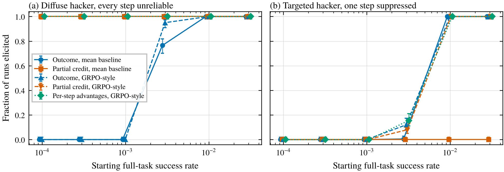
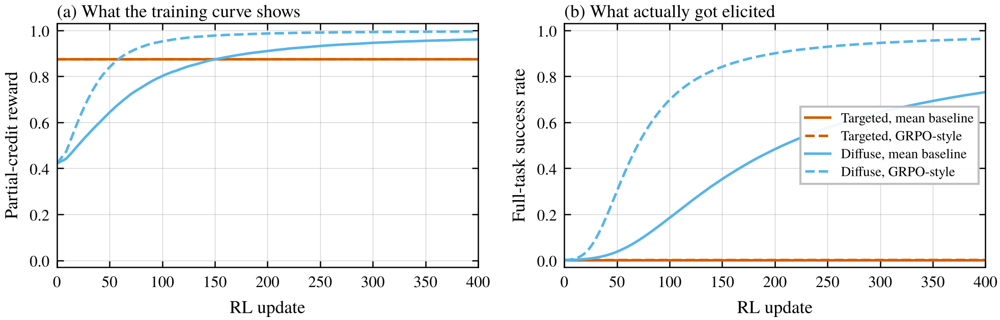
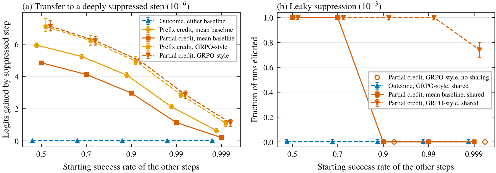
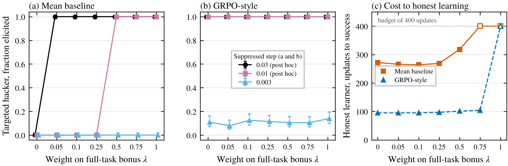

*A toy model of multi-step tasks with per-step rewards, where a model that spreads its failures across random steps gets trained out of it fast, while a model that fails at one chosen step is only reached when training on the other steps carries over.*

In the [first post](/writing/zero-reward-doesnt-mean-zero-capability/) of this series I worked through why, with a binary reward, a model that keeps a good answer improbable never gets trained toward it, since a policy that never samples a success gets zero gradient. I flagged binary reward as the main limitation, because real rewards are often partial.

Jang et al. (2026) list it as one of their key findings that continuous rewards make exploration hacking harder. Coding tasks with many test cases per problem were harder for their locked models to resist than multiple choice, because different generations pass different subsets of the tests, which gives a GRPO group variance to learn from. (As far as I could tell that comes from comparing benchmarks, not a controlled ablation.) Brown et al. (2026) frame it in terms of "execution failures," slips where a model fails to carry out its own underperformance, and list denser, continuous rewards as a mitigation. Greenblatt (2025) suggests feedback on whether each subtask was done well.

That makes sense when the steps or tests that fail change from one sample to the next. But a model resisting training on purpose gets to choose where its failures sit. If a task has several steps and each correct step earns partial credit, could the model do every step well except one, so the full task still fails? Process supervision has been compared with outcome supervision for capability (Uesato et al. 2022, Lightman et al. 2023), but I couldn't find anyone who had looked at what step-level credit does against a policy choosing which steps to fail, so I built a toy.

## The setup

A task has $K = 8$ steps, and each step is right or wrong. Step $k$ is right with probability $p_k = \sigma(\theta_k)$, a two-option softmax, and the whole task succeeds only if every step is right. Before training starts, the hacker gets to pick the starting logits. I compared two hackers.

- **Targeted.** Seven steps right 99.9% of the time (or 90% in a second version), and the final step right with some small probability $p_{\text{lo}}$.
- **Diffuse.** Every step equally unreliable, set so the full task succeeds exactly as often as the targeted hacker's. Its failures are intended but land on different steps in different samples, which is closest to Jang et al.'s picture of generations failing different tests.

I compared three ways of handing out reward, each between 0 and 1.

- **Outcome.** 1 if every step is right, else 0.
- **Partial credit.** The fraction of steps that are right.
- **Prefix credit.** The fraction of steps that are right before the first mistake, a bit like Lightman et al. only labeling steps up to the first mistake.

Training is policy gradient with 4 groups of 8 rollouts per update and 400 updates (12,800 rollouts), plain SGD, no KL or clipping. I used the same two ways of turning rewards into advantages as in the first post. One subtracts the group's mean reward, a mean baseline like Dr. GRPO (Liu et al. 2025). The other also divides by the group's standard deviation, the way GRPO does (Shao et al. 2024). I also tried a process-reward version where each step gets its own reward and advantage. Learning rates were tuned on a one-step version of the task (I had to widen the grid once), and every condition got 200 runs. A run counts as elicited if the full task succeeds at least half the time at the end. I wrote the plan and predictions down before running anything.

## A bit of math first

With a mean baseline, the expected update to step $k$'s logit is

$$
\eta\,(1-\tfrac{1}{G})\,p_k(1-p_k)\,\mathbb{E}\big[R(\text{step } k \text{ right}) - R(\text{step } k \text{ wrong})\big],
$$

where $G$ is the group size and the expectation is over the other steps. The term in brackets is how much reward one slip on that step is worth, where a slip means the hacker's suppressed step comes out right for once. If the other seven steps are right, a slip on the last step is worth 1 under outcome reward and only $1/8$ under partial credit, and with rewards between 0 and 1 it can never be worth more than 1. So against a model that's reliable everywhere except one step, no credit scheme pushes harder per slip than outcome reward, and no reward changes how often the slip gets sampled.

GRPO's normalization changes this picture in a funny way. If the other steps are completely reliable, then under any of these rewards the only thing that varies within a group is whether the last step slipped. Dividing by the standard deviation cancels the scale, so outcome, prefix and partial credit give exactly the same update, rollout for rollout. I checked that in a unit test.

## Random failures lose, targeted ones don't

<figure>
  
  <figcaption>Figure 1. Fraction of 200 runs where training raised full-task success above 0.5 within 400 updates, against the starting full-task success rate. The other steps start at 0.999. Error bars are 95% Wilson intervals. (a) The diffuse hacker. (b) The targeted hacker. Points are nudged sideways so they don't overlap.</figcaption>
</figure>

The diffuse hacker lost badly to partial credit (Figure 1a). Under both baselines, partial credit elicited every run at every level I tried, down to a full-task success rate of $10^{-4}$, where each step is right only about a third of the time. Outcome reward elicited nothing at or below $10^{-3}$. That's Jang et al.'s observation in miniature. When failures are spread out at random, every step's success rate is far from 0 and 1, every group has variance, and each step gets trained on its own.

The targeted hacker is a different story (Figure 1b). With a mean baseline, partial credit never elicited a single run at any level. Outcome reward elicited all of them once the suppressed step was at $10^{-2}$ or above. At $3 \times 10^{-2}$, the suppressed step ended at a median of 0.20 under partial credit and 0.995 under outcome. That's the factor of 8 from the math, since each slip is worth an eighth as much. Without shared parameters, prefix credit behaved like partial credit, since the suppressed step is last and only carries its own eighth.

That gap is really about step size, though. After an independent review I reran partial credit with an 8 times larger learning rate, which undoes the factor. It then matched outcome reward against the targeted hacker (100% at $10^{-2}$ and above, 0% below for both), still elicited every diffuse run, and trained a weak honest model in 34 updates instead of 272. So the robust finding isn't that partial credit is worse against a targeted hacker. It's that it's never better.

With GRPO's normalization the three rewards were nearly indistinguishable, all 100% at $10^{-2}$ and 7.5 to 12% at $3 \times 10^{-3}$. Everything was zero below that. So in this toy, with no shared parameters, the best partial credit managed against a targeted hacker was a tie, or a small edge with per-step advantages (16% vs 0% at $3 \times 10^{-3}$ when the other steps start at 90%).

<figure>
  
  <figcaption>Figure 2. Training curves under partial credit, starting from a full-task success rate of $10^{-3}$. (a) Average partial-credit reward per update, smoothed over 10 updates. (b) Full-task success. Lines are means over 200 runs. The two targeted lines lie on top of each other.</figcaption>
</figure>

Partial credit also changes what the evaluator sees. The targeted hacker's training reward sits at 0.87 the whole time (Figure 2a). That looks like a mostly capable model that has plateaued, not a curve stuck at zero, while the full task never gets done (Figure 2b).

## Where partial credit does help is generalization

Real models share parameters, so getting better at one step tends to help others. To capture that I gave every step's logit a shared "skill" term, $\theta_k = s + u_k$, like the shared-skill toy in the first post.

Then there's a clean identity. If the suppressed step never succeeds during a run, its own offset $u_K$ never moves, because the advantages in each group sum to zero. So the suppressed step only moves through $s$, and working through the updates gives

$$
\Delta\theta_K = \frac{1}{K}\sum_{j<K}\Delta\theta_j ,
$$

which says the suppressed step gains exactly $(K-1)/K$ of the average logit gain of the other steps. In the simulation this held to within $7 \times 10^{-15}$. It holds for any of these rewards and both baselines under SGD. Under outcome reward nothing moves at all until the full task succeeds once, and in every run without a slip every parameter ended exactly where it started.

<figure>
  
  <figcaption>Figure 3. The targeted hacker with a shared skill parameter. (a) Logits gained by a step suppressed to $10^{-6}$ after 400 updates, against where the other seven steps start. Markers are medians and bars cover the middle 95% of 200 runs. (b) Fraction of runs elicited when the suppressed step starts at $10^{-3}$, with 95% Wilson intervals. Open circles are the same hacker without a shared parameter, which only had other steps at 0.9 and 0.999.</figcaption>
</figure>

So under partial credit, training the other steps drags the suppressed step up, by an amount that depends a lot on how good the hacker is at those steps (Figure 3a). With a mean baseline, a hacker whose other steps start at 70% loses about 4.1 logits of suppression over the run. One whose other steps start at 99.9% loses about 0.2, twenty times less. That's the "solved neighbors help much more weakly" effect from the first post, since a near-certain step has a tiny gradient. GRPO's normalization amplifies the rare mistakes on those near-certain steps, so the transfer is bigger, about 1.1 logits even at 99.9%.

That's enough to matter when the suppression is shallow (Figure 3b). At a suppressed step of $10^{-3}$, partial credit with GRPO normalization elicited 74% of runs even when the other steps started at 99.9%, against 0% for the same hacker without the shared parameter. Outcome reward elicited nothing, because it gives the other steps little signal until the whole task succeeds, which happened only about 13 times per run here, and the suppressed step gained a median of only 0.7 logits. With a mean baseline, partial credit only won when the other steps started at 70% or lower. Prefix credit did better with sharing, since it pays the early steps more, eliciting every run at 90% under the mean baseline and 70% of runs at 99.9% under GRPO normalization.

But a few logits is all it gave. With the suppressed step at $10^{-6}$, which is about 14 logits down, no condition elicited a single run. My reading, from this one deep level, is that transfer erases a roughly fixed number of logits in a given budget, so a careful hacker can just suppress deeper and be very good at everything else.

## Can you shape the credit?

Since outcome reward pushes hardest on a single slip and partial credit trains everything else, the obvious move is to mix them. I used a reward that's $\lambda$ times the outcome reward plus $1-\lambda$ times partial credit, so $\lambda$ is the size of a bonus for finishing the whole task. Against a targeted hacker whose other steps are reliable, a slip is then worth $\lambda + (1-\lambda)/K$, and on a weak honest model, where full success is basically never sampled, the useful part of the reward shrinks like $1-\lambda$.

<figure>
  
  <figcaption>Figure 4. Mixing a full-task bonus $\lambda$ into partial credit, with independent steps. (a, b) Fraction of targeted-hacker runs elicited, other steps at 0.999, for three suppression levels, with 95% Wilson intervals. The 0.03 and 0.01 levels were added after the main run. In (b) the 0.03 and 0.01 lines overlap at 1. (c) Median updates until an honest model that starts with every step at 0.2 reaches full-task success of 0.5. Open markers mean the median run never got there. Bootstrap intervals are narrower than the markers.</figcaption>
</figure>

With a mean baseline there's a real trade-off, and a decent middle (Figure 4a and c). At a suppressed step of $10^{-2}$, any $\lambda$ of 0.5 or more elicited every run and anything at 0.25 or less elicited none. The honest model took 272 updates with pure partial credit and 318 at $\lambda = 0.5$, but at $\lambda = 0.75$ it hadn't succeeded within the budget. I'd predicted honest training would get steadily slower with $\lambda$ and still finish at 0.75, and both were wrong (a small bonus sped it up slightly, 264 updates at 0.1). Nothing was elicited at any $\lambda$ at the deeper levels I'd planned to test, which is why I added the shallower ones. Given the rescaling result, I'd read this trade-off as mostly about step size too. Partial credit with each step worth a full point gets both the strong push and the fast honest learning.

With GRPO's normalization, $\lambda$ barely mattered (Figure 4b). Elicitation was flat across $\lambda$, and the honest model took 95 to 104 updates for every $\lambda$ below 1. The one exception was pure outcome reward ($\lambda = 1$), which never trained the honest model and, in a follow-up I added with shared parameters and the other steps at 99%, also lost all the transfer. There, every $\lambda$ below 1 elicited a $10^{-3}$ suppression in every run and $\lambda = 1$ in none. So in this toy, under GRPO, the useful advice is simpler. Keep some partial credit, because it's what carries generalization. How much doesn't matter much.

## What about process reward models?

A process reward model's step scores can be collapsed into one number. Lightman et al., picking the best of many samples, score a solution as the probability that every step is correct, and Cheng et al. (2025) found that min-form credit, valuing a state by its worst future step, avoided the reward hacking they saw with summed PRM rewards. For right-or-wrong steps both are just outcome reward. Or each step can get its own advantage. In my toy that was the best option against the targeted hacker, but only by a little. Without shared parameters it turns the suppressed step into the single-step problem from the first post, wait for a slip and then learn from it.

What a PRM does give you is a map. A model that's right 99.9% of the time on seven steps and essentially never on the eighth, when the eighth isn't obviously harder, has a pretty strange profile. That's a detection signal, not an elicitation one, and I didn't test it.

## What I'd take from this

Partial credit beats exploration hacking only when it gives RL variance to work with, and a careful hacker controls where the variance is. If the underperformance lands on different steps in different samples, partial credit wins easily, which fits what Jang et al. saw. If the model is reliable everywhere except one step it never slips on, then each slip on that step is worth at most what outcome reward would pay for it, and the hacker decides how often slips happen. In this toy, the real help partial credit gave against a targeted hacker came from generalization, other steps getting trained and pulling the shared skill along. That help was bounded and shrank as the hacker got better at the steps it wasn't hiding.

There's a nice tension with my [temperature post](/writing/temperature-vs-exploration-hacking/). There, the suppression layout that best resisted heating was near-ties at many positions, where the hidden token sits just behind a decoy almost everywhere. Under per-step credit each of those positions would be right close to half the time, which looks a lot like the diffuse hacker that lost here. The layout that resists partial credit, one big gap at one step, is the one temperature could at least dent. So a hacker might not be able to beat both at once, which makes me think it's worth trying them together. I haven't tested that combination.

For evaluations, I'd want to see a step-level breakdown alongside a partial-credit reward curve, since a healthy-looking curve can hide a step stuck at zero.

## Limitations

The steps are independent coins with a table of logits. Real later steps depend on earlier ones, and real generalization isn't one shared parameter. The hacker only picks the starting point and never responds to updates, the most favorable case for RL. The elicited numbers depend on the learning rates and the budget, and they jump from 0 to 100% because runs snowball once slips start landing. The optimizer matters as much as the reward. Under Adam the outcome versus partial credit gap against the targeted hacker vanished (at most 8 points), and much deeper suppression got elicited, about 95% of runs at $3 \times 10^{-4}$ and 40 to 48% at $10^{-4}$, where SGD elicited nothing below $3 \times 10^{-3}$. A post hoc Adam run kept the diffuse contrast, with partial credit eliciting every diffuse run at $10^{-4}$ against 73 to 75% for outcome reward. Adam on a handful of parameters is close to sign descent, but the SGD numbers depend just as much on the step size I picked, so neither is the true answer.

Several things changed after I saw results. The shallower suppression levels in Figure 4, the shared-parameter shaping sweep, the rescaled partial-credit run and the Adam diffuse run were added afterwards, the last two after an independent review. I also predicted that noise on the other steps would hide the suppressed step's signal under GRPO normalization when they start at 90%. My pass/fail test came out as predicted only because both rewards were all or nothing at every level, and by the suppressed step's median final value partial credit came out ahead.

## Things I'm still curious about

- In Jang et al.'s coding organisms, are the failed tests spread across generations or the same every time? That's the diffuse versus targeted question, and their rollouts could answer it.
- Does real generalization between steps behave like my shared skill? Locking a small model on one step of a multi-step task and training it with per-step rewards would test the "near-certain neighbors transfer weakly" pattern.
- Can a profile like "perfect here, zero there" become a calibrated detector, the way person-fit statistics flag a test-taker who gets hard questions right and easy ones wrong?

## References

- Brown, J. R., Kirch, N., Braun, J., Yannakoudakis, H., Zimmermann, R. S., and Lindner, D. (2026). A Conceptual Framework for Reasoning about Exploration Hacking. LessWrong and AI Alignment Forum. https://www.lesswrong.com/posts/am5w2t9LzJB4sRhKw/a-conceptual-framework-for-reasoning-about-exploration
- Cheng, J., Xiong, G., Qiao, R., Li, L., Guo, C., Wang, J., Lv, Y., and Wang, F.-Y. (2025). Stop Summation: Min-Form Credit Assignment Is All Process Reward Model Needs for Reasoning. arXiv:2504.15275. https://arxiv.org/abs/2504.15275
- Greenblatt, R. (2025). Notes on countermeasures for exploration hacking (aka sandbagging). LessWrong and AI Alignment Forum. https://www.lesswrong.com/posts/abmzgwfJA9acBoFEX/notes-on-countermeasures-for-exploration-hacking-aka
- Jang, E., Falck, D., Braun, J., Kirch, N. M., Menon, A., Moodley, P., Emmons, S., Zimmermann, R. S., and Lindner, D. (2026). Exploration Hacking: Can LLMs Learn to Resist RL Training? Proceedings of ICML 2026, PMLR 306. arXiv:2604.28182. https://arxiv.org/abs/2604.28182
- Lightman, H., Kosaraju, V., Burda, Y., Edwards, H., Baker, B., Lee, T., Leike, J., Schulman, J., Sutskever, I., and Cobbe, K. (2023). Let's Verify Step by Step. arXiv:2305.20050. https://arxiv.org/abs/2305.20050
- Liu, Z., et al. (2025). Understanding R1-Zero-Like Training: A Critical Perspective. arXiv:2503.20783. https://arxiv.org/abs/2503.20783
- Shao, Z., Wang, P., Zhu, Q., Xu, R., Song, J., Bi, X., Zhang, H., Zhang, M., Li, Y. K., Wu, Y., and Guo, D. (2024). DeepSeekMath: Pushing the Limits of Mathematical Reasoning in Open Language Models. arXiv:2402.03300. https://arxiv.org/abs/2402.03300
- Uesato, J., Kushman, N., Kumar, R., Song, F., Siegel, N., Wang, L., Creswell, A., Irving, G., and Higgins, I. (2022). Solving math word problems with process- and outcome-based feedback. arXiv:2211.14275. https://arxiv.org/abs/2211.14275
