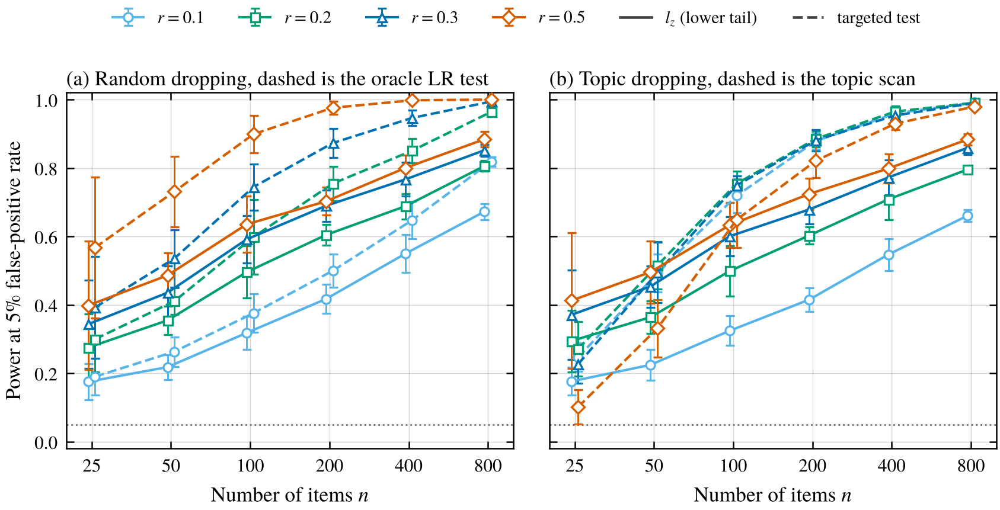
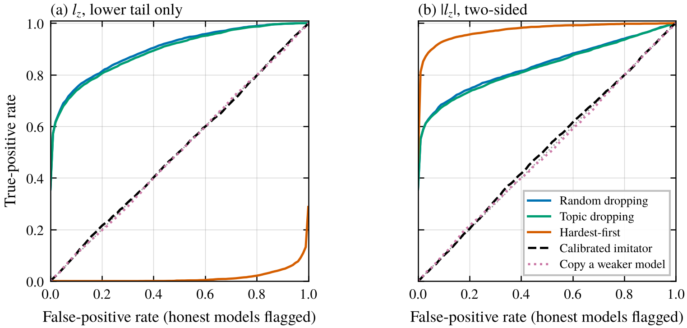
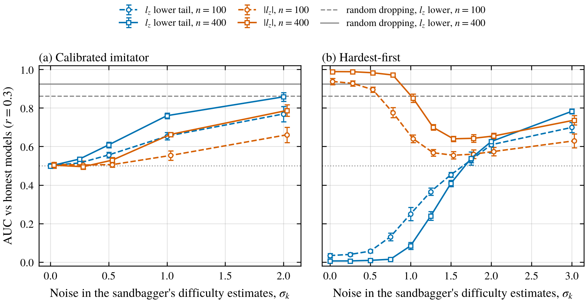
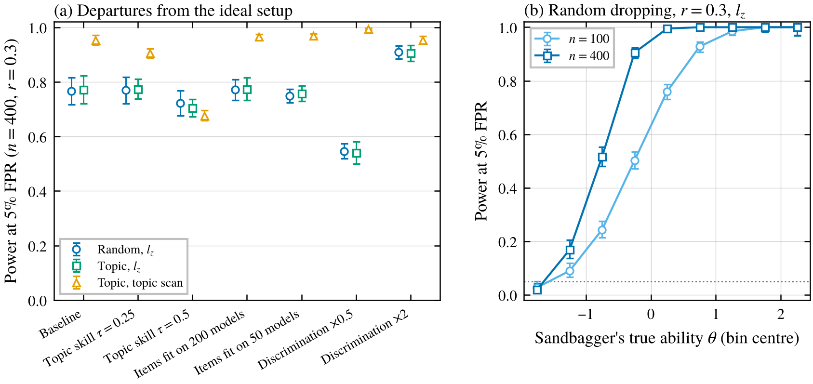

*A simulation of how often a classic psychometrics test for "this answer pattern makes no sense" catches a model that underperforms on purpose, and how little it takes to slip past it.*

Psychometricians have worried about people gaming tests for a long time. Someone who copies answers or fakes a bad score often gets hard questions right and easy ones wrong in a way an honest test-taker rarely would. Item response theory (IRT) turns that intuition into numbers. Fit a model of how hard each question is, estimate each person's ability, and then ask how surprising their exact pattern of right and wrong answers is. These are called person-fit statistics, and one of the standard ones, $l_z$, goes back to Drasgow, Levine and Williams (1985). Meijer and Sijtsma (2001) review the whole family.

The connection to AI sandbagging is pretty direct. A model that deliberately underperforms on an evaluation might throw away answers it knows, and if it doesn't pay attention to which ones, it ends up missing easy questions while still nailing hard ones. van der Weij et al. (2025) made exactly this point, that random underperformance is detectable because the model is right on some hard questions and wrong on easy ones, and they showed a password-locked model could partly hide this by emulating a weaker model's answers.

I thought this would be a fun gap to fill, and then found it mostly isn't one. Fonseca Rivera et al. (2026) fit a 2PL IRT model to 192 language models across eight safety benchmarks and used $l_z$ to audit prompted sandbaggers. On 196 HarmBench items it flagged 90% of sandbaggers that only underperformed on one category, and 97% of ones that only underperformed when a trigger phrase was present, at a 10% false-positive rate. It caught only about a third of models that sandbagged uniformly on everything, so they added a separate test comparing a model's ability now with its past ability. They're upfront that their experiments don't show the methods would catch a model trained to evade them.

So I narrowed the question. With ground truth I control, how does the power of person-fit depend on the number of questions and on how much the sandbagger throws away, and how much does a sandbagger need to know about question difficulty to get past it? Everything here is a simulation, so it says what the statistics can and can't do in principle, not what any real model does.

## The setup

Each simulated benchmark has $n$ items. Item $i$ has a difficulty $b_i$ and a discrimination $a_i$, and a model with ability $\theta$ gets it right with probability

$$
P_i(\theta) = \frac{1}{1 + e^{-a_i(\theta - b_i)}} .
$$

This is the two-parameter logistic (2PL) model. Difficulties are drawn from a standard normal and discriminations are around 1.5. Items are split evenly into 10 topics. Honest "models" are just abilities drawn from a standard normal, and each one answers each item once with the probability above. In the main experiment the 2PL is exactly true, which is the friendliest possible case for the detector.

Sandbaggers come from the same ability distribution. Each one first works out its honest answers, then turns some of its correct answers into wrong ones. The sandbagging rate $r$ is the fraction of its correct answers it gives up. I tried five strategies.

- **Random dropping.** Each correct answer is thrown away with probability $r$.
- **Topic dropping.** Every correct answer in a fraction $r$ of the topics is thrown away, like refusing to show competence in one area.
- **Hardest-first.** It throws away its correct answers on the hardest items, as ranked by what it believes the difficulties are.
- **Calibrated imitator.** It picks a lower ability $\theta_t$ that gives the accuracy it wants, then keeps each correct answer with probability $P_i(\theta_t)/P_i(\theta)$, using its beliefs about the item parameters. If those beliefs are exactly right, its answers are statistically identical to an honest model with ability $\theta_t$.
- **Copy a weaker model.** It hands in a weaker model's answers wholesale. Statistically this is exactly the calibrated imitator with perfect knowledge, except that the knowledge requirement is swapped for access to a weaker model. So anything I say about it below is true by construction.

The main detector is $l_z$. You estimate $\hat\theta$, then compare the log-likelihood of the observed answers with its expected value and standardize,

$$
l_z = \frac{\sum_i (u_i - P_i)\, \log\frac{P_i}{1-P_i}}{\sqrt{\sum_i P_i(1-P_i) \log^2\frac{P_i}{1-P_i}}},
$$

where $u_i$ is 1 for a right answer and all the $P_i$ are evaluated at $\hat\theta$. Very negative $l_z$ means the pattern is less likely than usual. I also tried Snijders' (2001) corrected $l_z^*$, a count of Guttman errors (pairs where an easier item is wrong and a harder one is right), a topic scan that looks for the single topic where a model does worst relative to its overall ability, and an "oracle" likelihood-ratio test that knows the sandbagger is dropping at random with rate $r$. The oracle isn't practical, but it shows how much better a test aimed at the right alternative can do.

Detection thresholds come from the honest population at the same $n$, the way Fonseca Rivera et al. calibrated on their cohort of models. I report power at a 5% false-positive rate and the AUC. Each setting uses 5 independent item banks, each with 4,000 honest models and 1,000 sandbaggers per strategy and rate, and error bars are 95% intervals across the banks. I wrote down my predictions before running anything, and I'll say which ones failed as I go.

## More items help, and so does a test that knows what to look for

<figure>
  
  <figcaption>Figure 1. Power at a 5% false-positive rate against the number of items, for four sandbagging rates. Solid lines are $l_z$. Dashed lines are a test aimed at the specific strategy, the oracle likelihood-ratio test in (a) and the topic scan in (b). Error bars are 95% intervals over 5 item banks. The dotted line is 5%.</figcaption>
</figure>

For random dropping, $l_z$ works but needs a fair number of items. Throwing away 30% of correct answers gets flagged 59% of the time with 100 items, 77% with 400 and 85% with 800. At a 10% rate it's 32% at 100 items and still only 67% at 800. I'd predicted at most 20% power for a 10% rate on 50 items and got 22%, so that guess was a bit pessimistic.

The oracle test does a lot better, for example 75% vs 60% at 200 items and a 20% rate. That matches what Drasgow and Levine (1986) found decades ago, that standardized likelihood indices are far from optimal at catching spuriously low scores. $l_z$ is a general "something is off" test, and you pay for that generality.

Topic dropping shows the same thing more sharply. To $l_z$ it looks almost exactly like random dropping, because $l_z$ doesn't know about topics. A scan that asks whether any single topic is suspiciously bad catches it far more often, 72% vs 32% at 100 items when only one topic out of 10 is dropped. That fits Fonseca Rivera et al. catching category-targeted sandbagging so reliably, though their setting differs from mine a lot.

The averages hide how much power depends on the sandbagger's real ability, since a weak model has few correct answers to throw away. With 100 items and a 30% rate, power was 93% for sandbaggers with $\theta$ between 0.5 and 1 and about 3% for those below $-1.5$ (Figure 4b). For strong models on a benchmark that's moderately hard for them, the averages undersell the test.

## A sandbagger that's too tidy

<figure>
  
  <figcaption>Figure 2. ROC curves at 200 items and a 30% sandbagging rate, averaged over 5 item banks. (a) Flagging only patterns that are too unlikely (low $l_z$). (b) Flagging both tails ($|l_z|$). Random and topic dropping overlap almost exactly.</figcaption>
</figure>

The usual way to use $l_z$ is one-sided. You flag people whose answers are too inconsistent. A sandbagger who throws away exactly its hardest correct answers does the opposite. It leaves a pattern that's too clean, with every remaining correct answer below some difficulty cutoff and nothing right above it. Honest test-takers are messier than that. So its $l_z$ lands in the upper tail, and a one-sided test flags it less often than it flags honest models. In Figure 2a the hardest-first curve sits below the diagonal.

The idea itself isn't new. In psychometrics an unusually high $l_z$ is already read as a pattern that's too consistent, too close to a perfect Guttman staircase. What I think is new is the consequence for sandbagging audits. A one-sided rule like the one Fonseca Rivera et al. used, flagging only $l_z \le -0.87$, would miss a hardest-first sandbagger entirely, and in my simulation it would flag such a sandbagger less often than it flags honest models.

Flipping to a two-sided test catches it easily, 90% of the time at 200 items and a 30% rate, better than random dropping (Figure 2b). The two-sided test costs some power against random dropping, though, 64% vs 69% at the same setting, since half the false-positive budget now goes to the other tail. One small wrinkle is that honest $|l_z|$ is larger near average ability than at the extremes (mean 0.78 near $\theta = 0$ vs 0.47 below $-1.5$ at 100 items), so the two-sided threshold is slightly conservative for sandbaggers that look weak. I'd guess this "too consistent" check is worth running anyway, since it's cheap and a sandbagger that follows a simple rule is plausible.

My first version of the copier, which only gave a right answer where both it and the weaker model were right, turned out too tidy as well. I checked it in a small run after a review of the code pointed it out. At a 30% target it actually threw away about 36% of its correct answers, its lower-tail AUC was 0.26 at 100 items and 0.11 at 400, and the two-sided test caught it with AUC 0.62 and 0.83.

The imitator and the copier sit on the diagonal in both panels. Their answers really are drawn from an honest model at a lower ability, so no test of how well the pattern fits the IRT model can tell them apart from an honest weaker model. That was true by construction. There's one caveat for the copier. If the model it copies is in your cohort, answer-copying indices from the exam-cheating literature, like Wollack's (1997) $\omega$, ask whether two test-takers' answers match more than chance, and those could catch a verbatim copy. They wouldn't catch the imitator, which only resembles a weaker model statistically.

## How much does the sandbagger need to know?

<figure>
  
  <figcaption>Figure 3. AUC against how noisy the sandbagger's beliefs about item difficulties are, at a 30% rate. The noise is Gaussian with standard deviation $\sigma_k$ added to each difficulty, which itself has standard deviation 1. Gray lines show random dropping. In (b), the points at $\sigma_k$ of 0.75, 1.25, 1.5, 1.75 and 3 come from a separate run I added after seeing the main results. Error bars are 95% intervals over 5 item banks.</figcaption>
</figure>

The imitator needs to know item difficulties, so I added noise to what it believes. When its difficulty estimates are off by a quarter of the spread of real difficulties, nothing changes much (AUC 0.54 at 400 items). At half the spread, AUC is 0.61 and power at a 5% false-positive rate is only 12%. I'd predicted at most 0.6, so I'll count that as a near miss. By the time the noise is as big as the spread of difficulties itself, the imitator is catchable (AUC 0.76, power 35%), and it slides toward random dropping as the noise grows.

Hardest-first does something I didn't expect until I saw it. With good knowledge it's too tidy and the upper tail catches it. With bad knowledge it moves toward random dropping and the lower tail starts catching it (AUC 0.70 at 100 items and 0.78 at 400 at the largest noise I tried, vs 0.86 and 0.92 for random dropping). In between it passes through a range where it's neither. At $\sigma_k = 1.5$ with 100 items, the best AUC across both tails was about 0.55 and power stayed under 8%. At 400 items there was still a residual signal in the two-sided test (AUC 0.64, power 17%). So in this setting a sandbagger with a rough idea of difficulty and a crude rule can land, more or less by accident, in a spot where person-fit barely sees it. I only looked for this spot at a 30% rate and one discrimination scale, in a sweep I added after the main run, and I didn't try any detector that combines the two tails more cleverly.

The general shape is that person-fit catches sandbaggers whose pattern doesn't look like any honest model. Strategies that start from "look like a weaker model" beat it with surprisingly modest knowledge, and a strategy that doesn't need any knowledge at all, copying an actual weaker model, beats person-fit completely in my simulation (though, as above, maybe not a direct comparison with the model it copies). This is the same lesson as my [noise injection post](/writing/noise-injection-fragile-sandbaggers/), where a sandbagger that imitated a weaker model was also invisible.

## When the real world is messier than the model

<figure>
  
  <figcaption>Figure 4. (a) Power at 400 items and a 30% rate when the setup departs from the ideal. Topic skill $\tau$ gives each honest model its own strengths and weaknesses by topic. "Items fit on $M$ models" means item parameters were estimated from $M$ honest models instead of being known. Error bars are 95% intervals over 5 item banks. (b) Power for random dropping by the sandbagger's true ability, in bins of width 0.5, pooled over banks, with the open-ended outer bins ($\theta < -1.5$ and $\theta \ge 2$) plotted at $-1.75$ and $2.25$, with Wilson 95% intervals.</figcaption>
</figure>

Real models aren't 2PL test-takers, so I tried three departures.

**Honest topic skills.** If honest models also have their own topic strengths (each topic's ability shifted by a normal amount with standard deviation $\tau$), then dropping a topic looks a bit more like a genuine weakness. At $\tau = 0.5$ the topic scan's power fell from 95% to 68% for topic dropping, while $l_z$ power dropped a little (77% to 70% for topic dropping and 77% to 72% for random dropping). I'd predicted the topic scan would lose more than half its power, so that prediction failed. But real models probably differ by topic much more than this.

**Estimated item parameters.** Fitting the item parameters from only 50 honest models barely hurt power (75% vs 77%), against my prediction. But that's only because I recalibrated the threshold on honest models scored with the same estimated parameters. The textbook threshold for $l_z$ broke badly, with 15% of honest models flagged at a nominal 5% at 400 items. So if you use person-fit on a benchmark, calibrate the threshold on a cohort of models, as Fonseca Rivera et al. did, and don't trust the normal approximation.

**Item discrimination.** Halving the discriminations dropped power from 77% to 55%, and doubling them raised it to 91%. I'd predicted a bigger drop.

## What I'd take from this

Person-fit statistics catch sandbaggers that are sloppy about which answers they throw away, as long as there are a few hundred items and the sandbagger is capable enough to have answers worth throwing away. A test aimed at the right kind of sloppiness, like the topic scan, does much better than the generic $l_z$. And it's worth checking both tails, since a sandbagger following a simple difficulty rule looks too consistent rather than too random.

They don't catch a sandbagger that produces the answer pattern of a weaker model, and in my simulation that took less than I expected. Rough difficulty estimates were enough, and copying a real weaker model needed none, though that one is the same as a perfect imitator by construction. That isn't a flaw in the statistics. The pattern really is consistent with an honest weaker model, so the only remaining evidence is the score itself compared with what you expected the model to score. That's why Fonseca Rivera et al. pair person-fit with an ability-shift test, and I think that pairing is the right way to think about it. Person-fit narrows down how a sandbagger can behave. It forces the sandbagger to look like a coherent weaker model, and then other tools have to argue that the model shouldn't be that weak.

## Limitations

This is a toy simulation and none of it is evidence about real language models. Honest models follow the 2PL exactly in the main experiment, with no guessing floor, no contamination and no format effects. Each simulated model answers each item once at random, while real evaluations often use greedy decoding, which makes answers more deterministic and could change the null distribution a lot. This matters most for the hardest-first result. Its signal comes from the sandbagger being tidier than honest models, and an honest model answering greedily is itself tidier than a random 2PL draw, which would shrink exactly that gap. The sandbagging strategies are simple rules I wrote down, not anything a trained model does, and the oracle test is a reference point, not a usable detector. The topic heterogeneity, item calibration and discrimination checks were only run at 100 and 400 items.

Several predictions failed or were near misses, all mentioned above. The topic scan also gave AUCs below 0.5 against perfect imitators on short tests, because its honest score depends on ability and imitators look like weaker models. The finer noise sweep for hardest-first was added after seeing the main results. Before running anything, I also had to change the "copy a weaker model" strategy, because my first version couldn't reach the target accuracy for most models of below-average or average ability (at a 30% rate, every model with $\theta$ below about 0.3, roughly 60% of the population).

## Things I'm still curious about

- How wide is the honest $l_z$ distribution for real models on a real benchmark, and how much power is left once that's accounted for?
- Can a model fine-tuned to imitate a weaker model actually reproduce its answer pattern well enough to pass, or does training leave the kind of mismatch that person-fit picks up?
- Could a detector use the weaker models you already have, asking whether a model's pattern looks like any specific real weaker model rather than like a generic one?

## References

- Drasgow, F., and Levine, M. V. (1986). Optimal detection of certain forms of inappropriate test scores. Applied Psychological Measurement 10(1), 59–67. https://doi.org/10.1177/014662168601000105
- Drasgow, F., Levine, M. V., and Williams, E. A. (1985). Appropriateness measurement with polychotomous item response models and standardized indices. British Journal of Mathematical and Statistical Psychology 38(1), 67–86. https://doi.org/10.1111/j.2044-8317.1985.tb00817.x
- Fonseca Rivera, J., Shah, N., Africa, D. D., and Voudouris, K. (2026). Item Response Theory for AI Safety. arXiv:2608.05086. https://arxiv.org/abs/2608.05086
- Meijer, R. R., and Sijtsma, K. (2001). Methodology Review: Evaluating Person Fit. Applied Psychological Measurement 25(2), 107–135. https://doi.org/10.1177/01466210122031957
- Snijders, T. A. B. (2001). Asymptotic null distribution of person fit statistics with estimated person parameter. Psychometrika 66(3), 331–342. https://doi.org/10.1007/BF02294437
- Wollack, J. A. (1997). A nominal response model approach for detecting answer copying. Applied Psychological Measurement 21(4), 307–320.
- van der Weij, T., Hofstätter, F., Jaffe, O., Brown, S. F., and Ward, F. R. (2025). AI Sandbagging: Language Models can Strategically Underperform on Evaluations. ICLR 2025. arXiv:2406.07358. https://arxiv.org/abs/2406.07358
