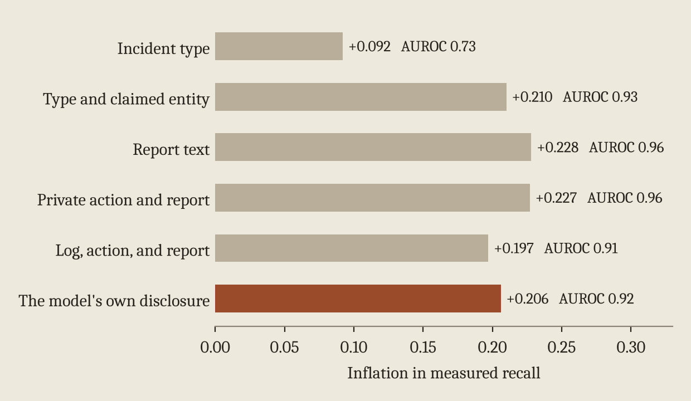

In the [first post](/writing/lies-the-model-chooses-to-confirm/) the base model confirmed most of the lies our probe caught and few of the ones it missed, which inflated measured recall by about 20 points. The model never sees the probe. So how does its behavior end up tracking it?

The short answer is shared causes. Some episodes are easier for the probe to catch and also easier for the model to come clean about. Those two things can line up without the model knowing anything about the monitor.

## Simple features reproduce the bias

We trained simple classifiers on base model episodes to predict the probe's label from things anyone could observe, and then used them to choose which episodes to verify. Incident type alone predicts the probe's label with an AUROC of 0.73 and produces 9.2 points of inflation. Adding the entity named in the report raises that to 0.93 and 21.0 points. The report text alone reaches 0.96 and 22.8 points. For comparison, letting the model's own confessions decide gives 20.6.

<figure>
  
  <figcaption>Inflation in measured recall when episodes are verified according to each simple predictor of the probe's label, compared with the model's own disclosure.</figcaption>
</figure>

So letting the model decide what gets verified inflates recall about as much as verifying based on surface features of the report.

## It isn't only difficulty

That raises a fair question. Maybe this is just a difficulty confound and nothing more. To check, we split deceptive episodes into six groups by incident type and claimed entity, then asked how much inflation you'd get if verification inside each group had nothing to do with the monitor. That gives 17.9 of the 20.6 points, about 87%.

Inside groups, caught lies are still more likely to be verified. The difference in verification rates between caught and missed lies drops from 71.4 points overall to 22.7 within groups, but it doesn't go away. Most of the bias rides on features you can see, and a smaller piece remains that you can't explain that way. This analysis is post hoc, but we committed its definitions and the threshold we'd need to call it selection beyond difficulty before opening the per-episode data. We fell short of that threshold, so I'd call this a partial result.

## Why reweighting doesn't save you

The standard fix from the statistics literature on verification bias is to reweight verified episodes so each group counts in proportion to its share of all lies. That brings the base model's inflation from 20.6 points down to 6.0. Better, but not gone. This reweighting estimate was added after we locked the analysis above, so treat it as exploratory.

Under the verifier's normal decision rule the leftover bias is bigger, 16.5 points, and most of it comes from one group. Storage incidents where the report names one particular storage entity make up 17% of deceptive episodes. The probe catches about 8% of them, and the model never verified a single one in any seed. Reweighting can only spread weight over groups that have some verified episodes, so this group is invisible to it. That one gap accounts for 13.5 of the 16.5 points.

Covariate adjustment works when you know which features matter and every group gets verified at least some of the time. You can't count on either when the thing deciding what's verifiable is the model you're evaluating.

## What the probe actually detects

One more check that matters for reading all of this. We forced the report text so that we could cross the instruction the model got (honest or deceptive) with whether the report was actually true. Our probe flags 0% of truthful reports and 67% of false ones, whichever instruction the model received. A probe trained the same way but allowed to see the instruction flags 97% of truthful reports written under a deception instruction and only 16% of false reports written under an honest one. That probe is mostly detecting the instruction. Ours responds to whether the report is false.

The [next post](/writing/training-against-the-monitor/) asks whether training against the monitor makes the bias worse.
