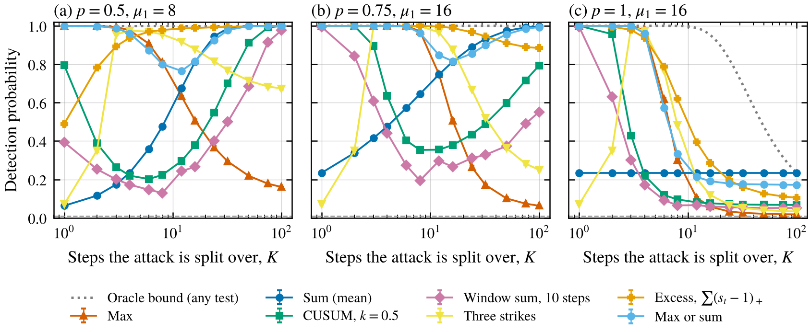
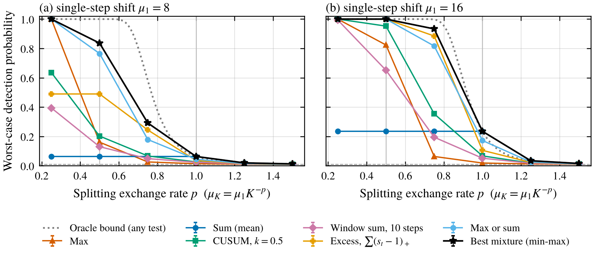
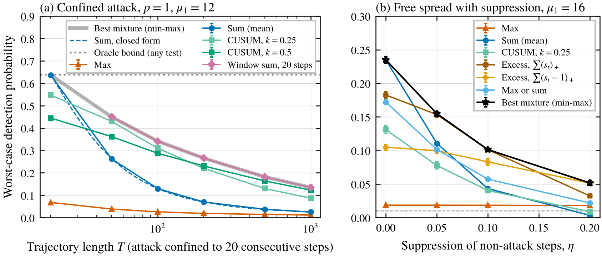

*A toy game between a monitor that has to pick how to add up suspicion over a long trajectory and an attacker that gets to pick how many small steps to split into.*

A lot of AI control protocols look at one action at a time. A trusted model scores how suspicious each action is, and the most suspicious ones go to a human (Greenblatt et al. 2024). That works when an attack needs one big obvious step. It's less clear what happens when the attacker can work in pieces.

People have started looking at this. Wen et al. (2024) study a "distributed threat" setting where no single action is catastrophic or clearly incriminating. In Ctrl-Z, Bhatt et al. (2025) found that their best multi-step attack spread its work over ten steps, each less suspicious than doing it all at once, and one of their protocols audits a trajectory once three steps cross a threshold. Hills et al. (2026) had coding agents spread a side task across five or six pull requests, and whether spreading or concentrating evaded better depended on whether the monitor read code diffs or the agent's actions. Their monitors took the max over pull requests, but two appendices are the closest comparison of aggregators in AI control I found. In one of their settings, averaging instead of taking the max cut evasion by concentrated attacks from 75.8% to 36.8%, but gradual attacks still evaded 90.7% of the time, and a three-strikes rule never fired on a successful attack.

Statisticians have standard tools for this shape of problem. CUSUM (Page 1954) was built to notice a small shift that persists, rather than one big spike, and Wald's sequential probability ratio test (Wald 1945) accumulates evidence one observation at a time. So should monitors add things up instead of taking the max? Zhang and Gao (2026) compare per-step monitors (mean, max, top-k) with sequence monitors (CUSUM, SPRT and others) on a clever attack that keeps each step's scores looking honest and hides the harm in correlations between steps. Their naive baseline, which just shifts scores up like my attacks do, gets caught by mean and top-k. They sweep how spread out the attack is, but the attacker doesn't choose.

None of the statistics here is new. Detecting sparse versus spread-out signals has a big literature (for example Donoho and Jin 2004), and control-systems security people have compared CUSUM with memoryless detectors against stealthy attackers (Murguia and Ruths 2017). What I wanted was the AI control version where the attacker sees how I add up suspicion and picks how many steps to use and where to put them. It's the same abstract simulator style as my [failed red team post](/writing/failed-red-team-evaluation/).

## The setup

A trajectory has $T = 100$ steps. The monitor gives each step a score, and honest steps score like a standard normal. An attack replaces $K$ of those steps with attack steps that score a bit higher, normal with mean $\mu_K$.

The key modeling choice is how per-step suspicion changes when you split. I call it the exchange rate $p$. If the whole attack done in one step would score $\mu_1$, then split evenly over $K$ steps each step scores

$$
\mu_K = \mu_1 K^{-p}.
$$

At $p = 1$ suspicion is conserved, so ten pieces each look a tenth as suspicious. At $p > 1$ splitting launders suspicion, and at $p < 1$ it has overhead. I don't know what $p$ is for real monitors, and that turns out to be the whole story.

The attacker also picks where the attack steps go. They can be one contiguous block, evenly spaced through the trajectory, or at random positions.

The audit budget is a false-alarm rate. Every detector gets a threshold so it flags exactly 1% of honest trajectories, and a flagged attack counts as caught. Safety against an attack is just the chance it gets flagged. Here's the zoo of detectors I gave the blue team.

- **Max.** The single most suspicious step, the default in most protocols.
- **Sum.** Add up all the scores, which is the same as using the mean.
- **CUSUM.** Keep a running total that adds each score minus an allowance $k$ and never drops below zero, and flag if it ever gets too high. I tried $k$ of 0.1, 0.25, 0.5 and 1.
- **Window sum.** The biggest total over any run of 5, 10 or 25 consecutive steps.
- **Strikes.** Count steps above a threshold and flag at 2, 3 or 5 of them, like Ctrl-Z's rule without its immediate-audit threshold.
- **Excess.** Add up only how far each score goes above a cutoff, $\sum_t (s_t - c)_+$, with $c$ of 0 or 1. It's a soft version of counting strikes.
- **Max or sum.** Flag if either the max or the sum is unusually high, calibrated jointly so the total false-alarm rate is still 1%.

I swept $p$ from 0.25 to 1.5, $\mu_1$ over 4, 8 and 16, and $K$ over 13 values from 1 to 100. Every number comes from 4 replicates of 20,000 attack trajectories per strategy, with 95% intervals across replicates. Simulated rates for max, sum and strikes matched their closed forms within 0.005, and false-alarm rates on fresh honest data were between 0.89% and 1.11%. I wrote the hypotheses down before running anything.

## A bit of math first

Two formulas carry most of the results. With equal splitting, the sum of all 100 scores is shifted by $K\mu_K$, so the sum detector catches the attack with probability

$$
P_{\text{sum}}(K) = \Phi\left(\frac{\mu_1 K^{1-p}}{\sqrt T} - z\right),
$$

where $z \approx 2.33$ is the 1% cutoff. At $p = 1$ this doesn't depend on $K$ at all. Spreading out or concentrating makes no difference to the sum.

The second is a ceiling. Suppose a magic detector knew exactly which steps were the attack and how big the shift was. The best it could do, by the Neyman-Pearson lemma, is add up just those $K$ scores, which catches the attack with probability $\Phi(\mu_1 K^{1/2-p} - z)$. No detector of any kind can beat that against that attack. So whatever the blue team does, the attacker can hold it to at most

$$
\min_K \Phi\left(\mu_1 K^{1/2-p} - z\right).
$$

This splits the world at $p = 1/2$. Below it, splitting makes the attack easier to catch even for the magic detector, because the evidence piles up faster than each piece shrinks. Above it, the attacker's best move against the magic detector is to spread over every step, $K = T$. But when every step is an attack step, the magic detector is just the sum. So for $p \ge 1$, where sum's power never goes up with $K$, the sum detector exactly hits the ceiling, and in this model no other aggregator, CUSUM or anything else, can do better in the worst case. Uneven splits don't help either. If piece $i$ carries a fraction $w_i$ of the attack and scores $\mu_1 w_i^p$, Jensen's inequality gives $\sum_i w_i^p \ge T^{1-p}$ for $p \ge 1$.

This is a known kind of result, not a discovery. The attacker's options form a sphere in an $\ell_q$ norm with $q = 1/p$, and minimax testing over such sets is classical (Ingster and Suslina 2003). For $q \le 1$ the alternatives are convex, the hardest one is the one closest to zero, and the best test is linear along it, here the sum. It also leans on the model. Scores are independent with unit variance, honest steps are exactly standard normal and can't be moved by the attacker, attack shifts are non-negative, and the attacker can use every step. With correlated scores the best test would weight steps by the inverse covariance, and two experiments below break the other assumptions on purpose.

The catch is the number. At $p = 1$ the sum catches $\Phi(\mu_1/10 - 2.33)$ of attacks, which for a $\mu_1 = 16$ attack (always caught if done in one step) is 23%.

## The attacker's best response flips

<figure>
  
  <figcaption>Figure 1. Detection probability for each detector as the attack is split over more steps, with the attacker's best placement at each $K$. The dotted line is the magic-detector ceiling and the dashed line at the bottom is the 1% false-alarm rate. Error bars are 95% intervals over 4 replicates and are mostly smaller than the markers.</figcaption>
</figure>

Against max, the attacker should spread thin. At $p = 1$ and $\mu_1 = 16$, max catches every one-step attack but only 1.9% of attacks spread over all 100 steps. Against sum, the best move depends on $p$. Below 1, the attacker should do everything in one step, since splitting only adds to the total. Above 1, it should spread over everything. At exactly 1 it doesn't matter.

So a max monitor pushes attackers toward many small steps, and a sum monitor toward one big step. That rhymes with Hills et al., though their attackers didn't choose how many pull requests to use and their monitors differed in what they read, not how they added up.

I predicted that for $p \ge 0.5$ the attacker would always want the largest $K$ against max. That was wrong in two cells. At $\mu_1 = 4$ with $p$ of 0.5 or 0.75, the best $K$ was 75 rather than 100, though the difference is under 0.001.

Placement matters a lot for CUSUM and the window sums and not at all for the others. At $p = 0.75$, $\mu_1 = 16$ and $K = 8$, CUSUM with $k = 0.5$ caught 100% of contiguous blocks, 72% of randomly placed attacks and 35% of evenly spaced ones. Between attack steps CUSUM's running total leaks away by $k$ per honest step. I'd predicted that whenever the attacker's best $K$ was strictly between 1 and 100, its best placement against CUSUM would be spread out. That held in 42 of 45 cases. The 3 exceptions were CUSUM with $k = 1$ at $p$ of 1.25 or 1.5, where every placement was caught about 1.1% of the time, so the choice there is noise.

## Who wins depends on the exchange rate

<figure>
  
  <figcaption>Figure 2. Each detector's worst case over all of the attacker's choices of $K$ and placement, as a function of the exchange rate $p$. The black stars are the best mixture, where the blue team randomly picks which detector to run. The dotted line is the magic-detector ceiling. Error bars are 95% intervals over 4 replicates.</figcaption>
</figure>

Figure 2 is the game. Each detector gets its worst case over the attacker's choices, and the blue team may also randomize over detectors, which keeps the false-alarm rate at 1%. Solving on two replicates and re-scoring on the other two moved the value by at most 0.0045 here and 0.0073 in the confined experiment below.

There are roughly three regimes.

**Splitting is costly ($p = 0.25$).** Against sum the attacker's best move is one big step, and sum does badly. Max does well because spreading barely helps against it. At $\mu_1 = 4$ the attacker's best move against max was still to spread over 50 steps, which got max down to 49% from 61.5% for a single step, while sum's worst case was 2.7%.

**Splitting conserves or launders suspicion ($p \ge 1$).** Sum was the best detector in all 9 cells and matched the ceiling within 0.002, as it has to. But the numbers are small. At $p = 1$ and $\mu_1 = 16$, sum's worst case was 23.5%, CUSUM with $k = 0.1$ 19%, and max 1.9%. At $p = 1.25$ everything is under 4%.

**In between ($p$ of 0.5 or 0.75).** This is where the choice matters most. Max loses to thin spreading and sum loses to one big step, so a detector has to cover both. At $p = 0.75$ and $\mu_1 = 16$, max's worst case was 6.3% and sum's was 23.5%, while excess with $c = 1$ reached 88.5% and max-or-sum reached 81.6%. At $\mu_1 = 8$, max, sum and excess gave 2.6%, 6.3% and 24.4%. I first noticed excess winning in the pilot run, so I didn't predict it. Mixing helped too. At $p = 0.5$ and $\mu_1 = 8$, the best mixture (about two thirds max-or-sum, one third excess) caught 84% in the worst case, against 77% for the best single detector, 16% for max and 6.3% for sum.

Even the best mixture stays well below the ceiling, 29% against 58% at $p = 0.75$ and $\mu_1 = 8$, which is the price of not knowing where the attack is.

CUSUM never came out ahead here except in ties at 100%, because a free attacker just spaces its steps out.

## Where CUSUM earns its keep

<figure>
  
  <figcaption>Figure 3. (a) Worst-case detection when the attack has to fit inside some 20 consecutive steps, as the trajectory gets longer, at $p = 1$ and $\mu_1 = 12$. The dashed blue line is the sum's closed form, the dotted gray line the magic-detector ceiling, and the thick gray line the best mixture. (b) Worst-case detection when the attacker also makes its other steps look slightly more innocent than an honest model's, shifting them down by $\eta$. Error bars are 95% intervals over 4 replicates.</figcaption>
</figure>

Real attacks might have to happen within one subtask, with a long boring trajectory around them. So in a second experiment the attack has to fit inside some window of 20 consecutive steps, and I grew the trajectory around it from 20 to 1,000 steps, at $p = 1$ and $\mu_1 = 12$ (Figure 3a). When the trajectory is exactly 20 steps, sum is the best detector, at 63.7% against a ceiling of 63.9%. As the trajectory grows, sum gets diluted by all the honest steps and falls exactly as its formula says, to 2.5% at 1,000 steps. At 1,000 steps the 20-step window caught 13.5% and CUSUM with $k = 0.5$ caught 12.3%, about five times what sum managed. Max never got above 7%.

This is the regime CUSUM is made for, a persistent shift in a stretch you can't locate. The window did slightly better only because I gave it the right length, and both are far below the ceiling.

## The catch with summing

One more thing worries me about sum. It can be pushed down as well as up. An attacker that makes its other actions look a little more boring than an honest model's buys room for its attack steps, and max doesn't care about that at all.

In Figure 3b, the attacker at $p = 1$ and $\mu_1 = 16$ also shifts its non-attack steps down by $\eta$. A shift of 0.05 per step, tiny on any single step, cut sum's worst case from 23.5% to 11.1%. At 0.1 it was 4.3%, and at 0.2 it was 0.3%, below the false-alarm rate. Max stayed at about 1.9% throughout. Excess with $c = 0$, which only counts the upper half of the scores, held up better and was the best single detector at $\eta$ of 0.05 and 0.1 (15.3% and 10.1%), and excess with $c = 1$ was best at 0.2. The best mixture still fell from 23.5% to 5.2%.

I'd predicted sum would be below 1% at $\eta = 0.1$, which the formula could have told me was wrong. Averaging over honest-looking steps is only as good as your model of honest steps, and the attacker gets to move that.

## What I'd take from this

In this toy, whether to take the max or add things up depends mostly on a number I don't know for any real system, the exchange rate $p$.

- **If splitting is costly,** max is fine, since spreading barely helps against it, and sum is a bad idea because one big step beats it.
- **If splitting conserves or launders suspicion,** sum is provably the best you can do against a freely spreading attacker, and it still doesn't do much. The fix has to come from somewhere other than how you add up per-step scores, like a monitor that looks at the whole trajectory at once.
- **In between,** a single aggregator gets exploited, and something that covers both ends does much better, like max-or-sum, a soft tail sum, or randomizing between them.
- **CUSUM and window sums** pay off when the attack has to sit in a short stretch of a long trajectory, and they lose when the attacker can space its steps out.

The good news is that $p$ seems measurable, by splitting red-team attacks into different numbers of steps and watching the monitor's scores. Ctrl-Z's ten lower-scoring steps are a data point, though they don't say whether the total went up or down.

It also matters that the attacker's best response flips with the monitor. A red team that only tries one spreading strategy can make a monitor look much better than it is, the same failure as in my [red team post](/writing/failed-red-team-evaluation/).

## Limitations

Everything here is abstract. Scores are independent Gaussians, but real monitor scores can be correlated (Zhang and Gao simulate a lag-1 correlation of 0.5, though their live-agent traces showed only about 0.06), are often coarse integers, and depend on context. The exchange rate $\mu_K = \mu_1 K^{-p}$ is an assumption, and I only simulated even splits. Auditing happens at the end of the trajectory, so I ignored whether an attack gets caught before it finishes. The attacker knows which detector is used, except in the mixed game. I chose the $\mu_1$ shown in Figure 1's first panel after seeing the results, because at $\mu_1 = 16$ almost everything was at 100%. Predictions failed in part (the attacker's best $K$ against max at small $\mu_1$, CUSUM placement in three cells near the false-alarm rate, and how fast suppression breaks the sum), and the winner at $p = 0.75$ was something I first noticed in the pilot rather than predicted. None of this is evidence about real LLM agents. It checks the logic of the game.

## Things I'm still curious about

- What is the exchange rate $p$ for a real trusted monitor scoring real multi-step attacks, and does it change when the monitor sees the whole trajectory instead of one step?
- Is there a simple aggregator that stays close to the ceiling across all values of $p$, something like the higher criticism statistic of Donoho and Jin (2004), which is designed for not knowing how sparse the signal is?
- How much of the trouble with suppression goes away if the monitor also flags trajectories that look suspiciously innocent?

## References

- Bhatt, A., Rushing, C., Kaufman, A., Tracy, T., Georgiev, V., Matolcsi, D., Khan, A., and Shlegeris, B. (2025). Ctrl-Z: Controlling AI Agents via Resampling. arXiv:2504.10374. https://arxiv.org/abs/2504.10374
- Donoho, D., and Jin, J. (2004). Higher criticism for detecting sparse heterogeneous mixtures. The Annals of Statistics 32(3), 962-994. arXiv:math/0410072. https://arxiv.org/abs/math/0410072
- Greenblatt, R., Shlegeris, B., Sachan, K., and Roger, F. (2024). AI Control: Improving Safety Despite Intentional Subversion. ICML 2024, PMLR 235. arXiv:2312.06942. https://arxiv.org/abs/2312.06942
- Hills, J., Caspary, I., and Cooper Stickland, A. (2026). Distributed Attacks in Persistent-State AI Control. arXiv:2607.02514. https://arxiv.org/abs/2607.02514
- Ingster, Y. I., and Suslina, I. A. (2003). Nonparametric Goodness-of-Fit Testing Under Gaussian Models. Lecture Notes in Statistics. Springer, New York. ISBN 978-0-387-95531-5.
- Murguia, C., and Ruths, J. (2017). Characterization of Model-Based Detectors for CPS Sensor Faults/Attacks. arXiv:1710.04407. https://arxiv.org/abs/1710.04407
- Page, E. S. (1954). Continuous Inspection Schemes. Biometrika 41(1/2), 100-115.
- Wald, A. (1945). Sequential Tests of Statistical Hypotheses. The Annals of Mathematical Statistics 16(2), 117-186. https://doi.org/10.1214/aoms/1177731118
- Wen, J., Hebbar, V., Larson, C., Bhatt, A., Radhakrishnan, A., Sharma, M., Sleight, H., Feng, S., He, H., Perez, E., Shlegeris, B., and Khan, A. (2024). Adaptive Deployment of Untrusted LLMs Reduces Distributed Threats. arXiv:2411.17693. https://arxiv.org/abs/2411.17693
- Zhang, Q., and Gao, Y. (2026). The Distributed Detectability Band Against Marginal-Preserving Attacks. arXiv:2606.10456. https://arxiv.org/abs/2606.10456
