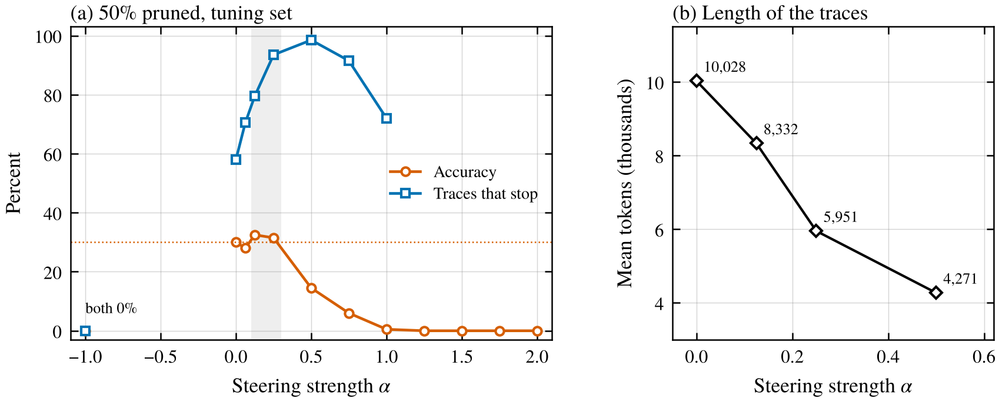
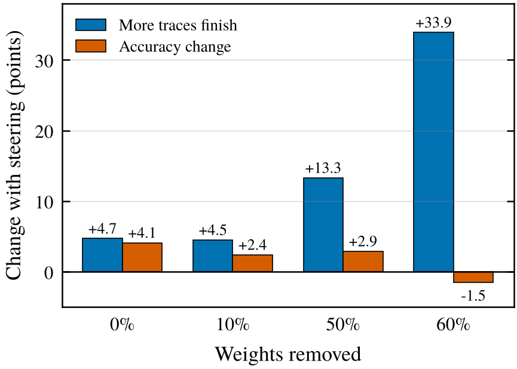

*I tried a steering method that makes pruned reasoning models stop rambling. Getting them to stop was easy. Getting them to be right more often was not.*

If you prune half the weights out of a reasoning model, it gets worse at math. The interesting question is how it gets worse. Lucas et al. (2025) noticed that pruned reasoning models can end up slower than the originals, because they write more thinking tokens while getting fewer answers right. A recent paper by Nguyen et al. (2026), "To Reason but Not to Stop," goes further. Their claim is that much of the damage is "a failure to stop rather than to reason." In their account, the pruned model often still works the problem out, then keeps going and going until it hits the token limit, so it never actually hands in an answer.

They also found a fix that doesn't need any retraining. The difference between a model that wraps up and one that loops shows up as a fairly consistent direction in its internal activations. Push the activations along that direction while the model generates, and it stops more often. They call this TGAS, Termination-Guided Activation Steering, and report accuracy gains of 1.3 to 3.7 points, averaged over benchmarks, at every model and sparsity they tried.

I wanted to see this for myself on one of the two smallest models in their paper, so I rebuilt it from scratch. The short version is that the stopping part replicated cleanly, the steering strengths from the paper didn't work at all, and once I found strengths that did work, the extra stopping mostly didn't turn into extra correct answers.

## How TGAS works

The recipe has five steps, all from the paper.

1. Generate solutions with the unpruned model and find the paragraph where the correct answer first appears.
2. Cut each solution at the start of the next paragraph. That's a "branch point." From each branch point, let the pruned model continue many times.
3. Label each continuation by whether it closed its reasoning within the token budget or ran out of tokens.
4. Record the model's activations for both groups, subtract the two averages, and rescale the result to the typical size of an activation at that layer. That's the steering vector.
5. While generating, add $\alpha$ times that vector at one layer, at every token position.

It's the same difference-of-means idea as contrastive activation addition (Rimsky et al. 2024), aimed at one specific behavior, closing the reasoning block.

## My setup

- **Model.** DeepSeek-R1-Distill-Qwen-1.5B (DeepSeek-AI 2025), pruned with SparseGPT (Frantar and Alistarh 2023) to exactly 10, 50, 60 and 70% of weights removed. I calibrated the pruning on a million tokens of the model's own solutions, following the RAC recipe from Lucas et al.
- **Sanity check on the pruning.** Held-out loss is 0.355 for the unpruned model and 0.412 at 50%. Naive magnitude pruning at 50% gives 1.001, so SparseGPT is doing its job.
- **Sampling.** Temperature 0.6, top-p 0.95, four samples per problem and a budget of 16,384 tokens, matching the paper.
- **Benchmarks.** The 262 level 4 and 5 problems in MATH-500 (Hendrycks et al. 2021, Lightman et al. 2023) and all 30 AIME-25 problems.
- **Steering vector.** Built from 84 branch points with 32 continuations each. Of the labeled continuations, 2,077 stopped and 609 didn't, so 23% looped.

Every arm uses the same random seeds per problem, so a plain run and a steered run of the same problem differ only in the steering.

## The stopping signal is everywhere

First I checked whether "about to stop" versus "about to loop" is actually readable from the activations. It is, and not just at one layer. A classifier separating the two groups scored between 0.77 and 0.80 at every layer from 2 to 27. I used layer 22, which scored 0.798. The paper's choice for this model, layer 18, scored 0.771. So that part of the paper holds up well. The model clearly carries some internal representation of whether it's going to wrap up.

## The steering strength has a narrow sweet spot

<figure>
  
  <figcaption>Figure 1. The 50% pruned model on a 100-problem tuning set. (a) Accuracy and the share of traces that stop, as the steering strength $\alpha$ varies. The dotted line is unsteered accuracy and the gray band is the range that helped. Stopping wasn't recorded for $\alpha$ above 1. (b) Mean trace length for the strengths where I recorded it.</figcaption>
</figure>

On the tuning set, stopping rises smoothly with $\alpha$. It goes from 58% unsteered to 79.5% at 0.125, 93.5% at 0.25 and 98.5% at 0.5. Mean trace length drops from about 10,000 tokens to under 4,300. Steering the other way, at $\alpha = -1$, stops the model from ever finishing, and accuracy goes to zero with it.

Accuracy is a different story. It barely moves at small $\alpha$ (30% unsteered, 32.5% at 0.125, 31.5% at 0.25), then falls off a cliff. At 0.5 the model stops nearly every time but gets only 14.5% right, because it now stops before it has finished the problem. Past that, the output itself degrades, and by $\alpha = 1.25$ nothing is right at all.

## Why the paper's strengths broke

The paper picks $\alpha$ between 0.5 and 2 for each pruned model. On my tuning set, anything in that range was useless or worse. I think the reason is the rescaling step.

At layer 22, a typical activation has size 224, while the raw difference between the "stop" and "loop" averages has size 7.7. The recipe rescales the difference up to 224, so $\alpha = 1.5$ adds a vector 1.5 times the size of the entire activation. That's about 44 times the raw difference between the two groups. No wonder the model falls apart. The strengths that helped, 0.125 to 0.25, work out to roughly 3.6 to 7.3 times the raw difference, which is a much gentler nudge.

On MATH-500, the paper's own choices of $\alpha$ gave 0 to 1% accuracy and stopping rates anywhere from 0.1 to 52%. I built the vector the way their Algorithm 1 describes it, so I don't know why my numbers and theirs disagree this much. It could be a detail of where the vector is added or how the norm is averaged that I've got differently. But it's a warning that the right $\alpha$ is tied to exactly how the vector is scaled, and it doesn't transfer between implementations.

## Finishing isn't the same as being right

<figure>
  
  <figcaption>Figure 2. MATH-500 levels 4 and 5 (262 problems, 4 samples each) with gentle steering. Blue is how many more traces finish within the budget, orange is the change in accuracy, both in percentage points.</figcaption>
</figure>

With gentle steering on the full benchmark, apart from a flat step from 0 to 10%, the more weights I removed, the more traces steering rescued from looping. That's 4.7 points more finished traces unpruned, 4.5 at 10%, 13.3 at 50% and 33.9 at 60%. That's exactly the pattern you'd expect if pruning mostly breaks stopping.

But the accuracy gains didn't follow. Accuracy went up 4.1 points unpruned, 2.4 at 10% and 2.9 at 50%, and went down 1.5 at 60%. So at 60%, about a third of all traces went from looping to finishing and none of that showed up as right answers. For comparison, the paper reports this model going from 54.8 to 61.8% at 50% and from 15.5 to 30.9% at 60%, with stopping going from 21.9 to 67.9%. I got a big jump in stopping at 60% too, but no accuracy gain.

At 70% the model does stop, just late. With steering 93% of traces stop, but after 14,752 tokens on average against 16,280 without. It's wrapping up just before the budget runs out, not because it has solved the problem (AIME accuracy at 70% was 0% either way).

These numbers don't come with confidence intervals. As a rough guide, with 1,048 samples per arm and accuracy around 30%, the binomial standard error is about 1.4 points, and it's really larger because the four samples of the same problem are correlated. So differences of 2 or 3 points are not much bigger than the noise. The 33.9-point jump in finishing is clearly real. The accuracy changes mostly aren't clearly anything.

## AIME tells the same story, noisily

| Weights removed | Plain accuracy / stops | Steered accuracy / stops |
|---|---|---|
| 0% | 21.7 / 69.2 | 20.0 / 83.3 |
| 10% | 21.7 / 75.0 | 23.3 / 79.2 |
| 50% | 19.2 / 48.3 | 14.2 / 70.8 |
| 60% | 5.0 / 20.8 | 2.5 / 82.5 |
| 70% | 0.0 / 1.7 | 0.0 / 91.7 |

On AIME-25, steering raised stopping at every sparsity, most dramatically at 60% (20.8 to 82.5%) and 70% (1.7 to 91.7%). Accuracy didn't improve anywhere except a tiny bump at 10%, and it dropped at 0%, 50% and 60%. With only 30 problems, one problem is worth 3.3 points, so none of these accuracy differences mean much on their own. Only the stopping results clearly line up with MATH-500. The accuracy changes are mixed in both.

## Does the pruned model loop after finding the answer?

The story in the paper is that pruned models often reach the right answer and then keep going. They measure this with an "oracle" accuracy that also counts non-stopping traces that already state the correct answer conclusively. For this model at 60%, that oracle is 32.6%, against 15.5% plain.

I tried to check this too and couldn't confirm it, but I don't think that means much yet. Among my traces that never stopped, only 0 to 1.3% contained the correct answer inside a `\boxed{}` in the reasoning. That's a very strict test, since these models rarely box an answer in the middle of thinking. A model could easily have worked out the right number in plain text and then kept looping. So the honest answer is that I haven't measured it properly, and the paper's detection rule is looser than mine. I'd want to do this right before saying it either way, for example by checking whether the correct value appears anywhere in the reasoning before the loop starts.

## Things that broke along the way

A few practical things surprised me, and I think they're worth writing down for anyone trying something similar.

- **The looping broke my grader.** Some looping traces contain thousands of unclosed `\boxed{` commands. My answer extractor tried to match them all and took minutes per trace until I rewrote it.
- **Two inference engines disagree.** vLLM (Kwon et al. 2023) and Hugging Face Transformers produce different greedy outputs after anywhere from a few to a few hundred tokens, even with no steering at all, because of rounding differences in 16-bit arithmetic. So I couldn't check my steering hook by comparing generated text. I compared token probabilities on the same inputs instead.
- **Pre-set checks.** I set eight checks I expected to pass. Six did. The two that failed were that the paper's $\alpha$ didn't improve accuracy, and that stopping was slightly higher at 10% pruning than unpruned (83.0% against 79.9%), which is within noise.

## What I'd take from this

The core observation in the paper looks right to me. Pruned reasoning models stop less, the "about to stop" signal is easy to read from their activations at almost any layer, and pushing along that direction makes them stop a lot more. That's a nice, clean piece of interpretability.

What I couldn't reproduce is the step from "stops more" to "gets more right." At 60% in my runs, steering mostly converted loops that weren't going to produce a right answer into early stops that also weren't right. That fits a less optimistic reading, where heavy pruning damages the reasoning as well as the stopping, and fixing the stopping exposes the damage instead of hiding it. But one model, one pruning setup and a few points of noise aren't enough to say the paper is wrong, especially since my steering strengths had to be very different from theirs for anything to work.

The most practical lesson is about the steering strength. The useful range was narrow, about 0.125 to 0.25 here, and it depends entirely on how the vector is scaled. Copying an $\alpha$ from a paper is risky unless you're sure your vector has the same size theirs did.

## Limitations

This is one small model (1.5B) with one pruning method. The paper also tests 7B, 8B and 14B models, which I didn't. I tuned $\alpha$ on a 100-problem set at 50% pruning and used the same gentle setting at every sparsity, while the paper tunes it per checkpoint, so a separately tuned $\alpha$ at 60% might do better. I used layer 22 instead of the paper's 18, though the two classify almost equally well. There are no proper confidence intervals here, and the four samples per problem aren't independent. And my check for "found the answer, then looped" was too strict to tell us anything.

## Things I'm still curious about

- How often does a pruned model actually reach the right answer before it starts looping, measured with a looser and more careful detector than mine?
- What explains the mismatch between the paper's steering strengths and mine, given that the vector was built the same way?
- If steering gets a pruned model to stop, does giving it a second attempt or a short "check your answer" step recover the accuracy that early stopping throws away?

## References

- DeepSeek-AI (2025). DeepSeek-R1: Incentivizing Reasoning Capability in LLMs via Reinforcement Learning. arXiv:2501.12948. https://arxiv.org/abs/2501.12948
- Frantar, E., and Alistarh, D. (2023). SparseGPT: Massive Language Models Can Be Accurately Pruned in One-Shot. ICML 2023. arXiv:2301.00774. https://arxiv.org/abs/2301.00774
- Hendrycks, D., Burns, C., Kadavath, S., Arora, A., Basart, S., Tang, E., Song, D., and Steinhardt, J. (2021). Measuring Mathematical Problem Solving With the MATH Dataset. NeurIPS 2021 Datasets and Benchmarks. arXiv:2103.03874. https://arxiv.org/abs/2103.03874
- Kwon, W., Li, Z., Zhuang, S., Sheng, Y., Zheng, L., Yu, C. H., Gonzalez, J. E., Zhang, H., and Stoica, I. (2023). Efficient Memory Management for Large Language Model Serving with PagedAttention. SOSP 2023. arXiv:2309.06180. https://arxiv.org/abs/2309.06180
- Lightman, H., Kosaraju, V., Burda, Y., Edwards, H., Baker, B., Lee, T., Leike, J., Schulman, J., Sutskever, I., and Cobbe, K. (2023). Let's Verify Step by Step. ICLR 2024. arXiv:2305.20050. https://arxiv.org/abs/2305.20050
- Lucas, R., Behdin, K., Wang, Z., Song, Q., Tang, S., and Mazumder, R. (2025). Reasoning Models Can be Accurately Pruned Via Chain-of-Thought Reconstruction. arXiv:2509.12464. https://arxiv.org/abs/2509.12464
- Nguyen, M.-A., Ha Lan, N. T., Fu, X., Le, D. D., and Lu, W. (2026). To Reason but Not to Stop: Understanding and Recovering Pruned Large Reasoning Models. arXiv:2610.19934. https://arxiv.org/abs/2610.19934
- Rimsky (now Panickssery), N., Gabrieli, N., Schulz, J., Tong, M., Hubinger, E., and Turner, A. M. (2024). Steering Llama 2 via Contrastive Activation Addition. ACL 2024. arXiv:2312.06681. https://arxiv.org/abs/2312.06681
