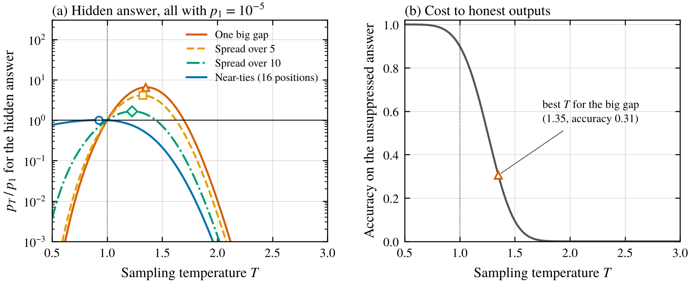
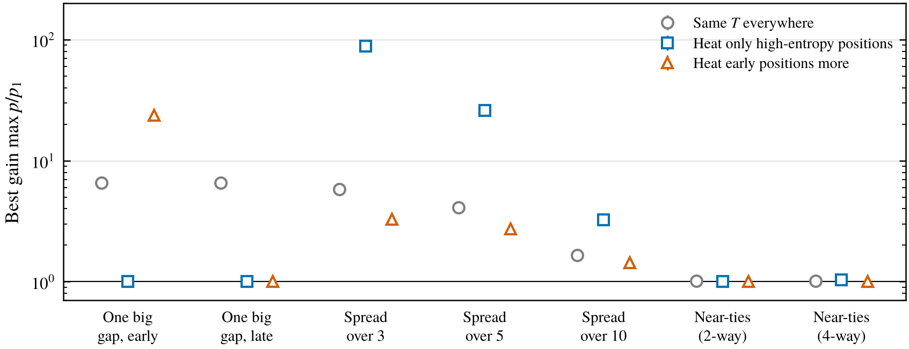
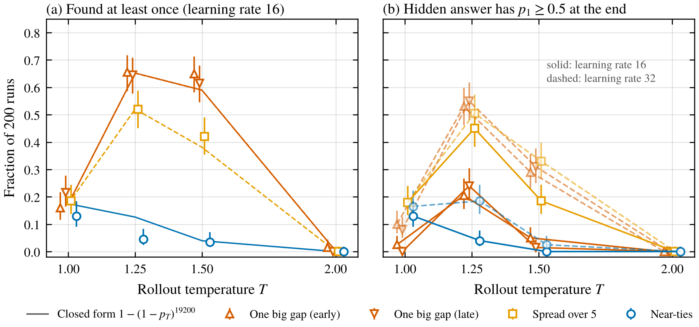
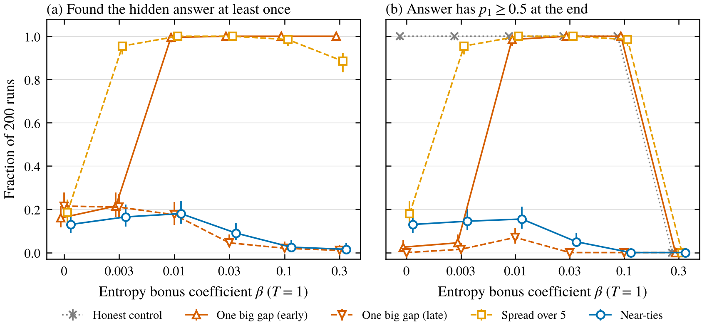

*Some math and a toy RL simulation on whether sampling temperature or an entropy bonus can find an answer a model is deliberately keeping improbable, and how a careful model could arrange its suppression so neither one helps.*

In the [first post](/writing/zero-reward-doesnt-mean-zero-capability/) of this series I worked through why a flat RL reward curve says little about what a model can do. Policy gradients only learn from what gets sampled, so a model that keeps the probability of a good answer low enough never gets trained toward it. Jang et al. (2026) call this exploration hacking and build model organisms that resist RL elicitation this way. In the [GRPO post](/writing/is-grpo-a-good-elicitation-algorithm/) I found that before the first success, GRPO discovers a hidden answer exactly as fast as plain sampling, and I left a loose end. Methods that raise the temperature or add entropy aren't covered by that argument.

That loose end is the obvious countermeasure. If the model is squashing the probability of the good answer, flatten the distribution. Jang et al. note that exploration in RL is encouraged through temperature, top-p and entropy bonuses, and both they and Braun et al. (2026) list "exploration-forcing objectives such as entropy bonuses" as a mitigation worth testing. As far as I could find, nobody has tested it. Greenblatt's (2025) notes on exploration hacking countermeasures cover imitation, ensembling and fuzzing internals but don't discuss temperature at all. Meanwhile there's a whole literature on entropy in RL for reasoning models, but it treats entropy as a resource that collapses during training (Cui et al. 2025) and asks where to spend it, for example on the few high-entropy "forking" tokens (Wang et al. 2025), by heating those tokens (Zhuang et al. 2025), or by heating the start of a response (Yang et al. 2025). None of that assumes a model that is deciding where its own low probabilities go. The one place I found temperature used against hidden behavior was as a baseline for eliciting backdoors, where weight and activation fuzzing usually beat it (Abu Baker and Babu-Saheer 2026).

Answers are many tokens long, so if a model is choosing how to suppress a good answer, can temperature or an entropy bonus still find it? The short version is that it depends almost entirely on how the suppression is laid out, and the layout that resists temperature best is one I'd describe as "look uncertain at a lot of places."

## Temperature acts on logit gaps

At each position $t$ of an answer the model has logits $z_t$, and the hidden answer uses token $c_t$. Sampling at temperature $T$ gives that token probability $q_t(T) = \mathrm{softmax}(z_t/T)_{c_t}$, and the whole answer gets

$$
p_T = \prod_t q_t(T), \qquad P(\text{found in } B \text{ rollouts}) = 1-(1-p_T)^B .
$$

Differentiating gives something I found clarifying,

$$
\frac{d}{dT}\log p_T \Big|_{T=1} = \sum_t \Big(\mathbb{E}_{\pi_t}[z_t] - z_{t,c_t}\Big).
$$

Each position contributes its expected logit gap, meaning how far the hidden token sits below the probability-weighted average logit. If the hidden token loses by a big gap at one position, that term is large and heating helps. Honest positions, where the right token is already on top, contribute small negative terms, because heating makes them worse.

Now suppose the model instead makes the hidden token tie with a decoy at many positions. A tie costs $\log 2$ of log-probability but has a logit gap of zero. More precisely, if the hidden token sits $\delta \ge 0$ below $n-1$ decoys, then

$$
q_t(T) \le \frac{1}{1 + (n-1)e^{\delta/T}} \le \frac{1}{n} \quad \text{for every } T.
$$

The first inequality is tight when the rest of the vocabulary is negligible, and the second when $\delta = 0$. So $k$ such positions keep $p_T$ at or below $n^{-k}$ at every temperature. Temperature spends its effort on logit gaps, and suppression can be bought in log-probability without making any. About seventeen fair coin flips are already enough to reach $10^{-5}$.

## The toy

I used a tree policy over answers of $L = 30$ tokens with a vocabulary of 64. Reward is 1 only for the exact hidden answer, so once a rollout leaves the hidden path nothing it does matters, and the policy reduces to a table of 30 on-path distributions. At each position the 63 other tokens get random logits around 0, and on an honest position the right token sits at a logit $m$ chosen so the full honest answer comes out with probability 0.9 at $T = 1$. That makes honest tokens about as confident as each other, roughly 0.996 each.

To suppress, the model raises a decoy to the top at some positions and puts the hidden token some gap $\delta$ below it. For every layout I solved for $\delta$ so the hidden answer has exactly $p_1 = 10^{-5}$ at $T = 1$. So every layout looks equally suppressed under ordinary sampling, and the only difference is where the suppression sits. The layouts were

- **One big gap.** A single position with a gap of about 11.4 logits, at the start or at the end of the answer.
- **Spread.** Equal gaps at 2, 3, 5 or 10 evenly spaced positions, about 2.2 logits each for 5 positions.
- **Near-ties.** The most positions I could use while keeping the hidden token the runner-up everywhere, which was 16 positions with gaps of about 0.04. I also tried 4-way ties with three decoys, which needed only 8 positions.

The closed-form numbers are exact for this model. I computed them for 20 random draws of the background logits and quote medians, since the spread across draws was tiny. I wrote predictions down before running anything.

## Turning up the temperature

<figure>
  
  <figcaption>Figure 1. (a) How much the hidden answer's probability changes with temperature for each layout, relative to its probability at $T = 1$ (all start at $10^{-5}$). Markers show each layout's best temperature. (b) Probability of the unsuppressed honest answer, which is 0.9 at $T = 1$. Medians over 20 draws of the background logits. The range across draws is too narrow to see.</figcaption>
</figure>

Against one big gap, temperature works, but only a bit. At the best temperature, 1.35, the hidden answer became 6.5 times more likely. It can't go higher because the other 29 tokens of the hidden answer are honest tokens, and they get worse too. By $T = 1.35$ the honest answer's accuracy had fallen from 0.9 to 0.31 (Figure 1b), and past about 1.7 nearly nothing comes out right, the hidden answer included.

Spreading the same suppression out shrinks the gain, 6.4 times for 2 positions, 4.1 for 5, 1.7 for 10. The near-tie layout got 1.01, and its best temperature was below 1, where the small gain comes from sharpening the honest tokens. The 4-way ties gave 1.02. The slope formula above says the same thing in one number. The natural log of $p_T$ rises by $10.4$ per unit of temperature for one big gap and falls by $0.37$ for the near-ties.

In discovery terms, with 10,000 rollouts the chance of seeing the hidden answer at least once goes from 0.095 to 0.48 for one big gap at its best temperature, and stays at 0.096 for near-ties. So near the edge of a run's budget, temperature can matter a lot, but only if the suppression is concentrated.

Sweeps changed the numbers but not the ordering. Deeper suppression raises the big-gap gain (48 times at $p_1 = 10^{-8}$, which still leaves it tiny), and longer answers lower it (4.6 at length 100) because more honest tokens get damaged. The vocabulary mattered most. With 2 tokens per position the gain was 84, and with 1,024 it was 3.4, since a bigger junk tail soaks up more probability as you heat. Near-ties stayed at most 1.05 everywhere except one case. With answers only 10 tokens long there isn't room for 17 coin flips, so all 10 positions needed real gaps of about 0.76 logits, and temperature got 2.26 times. The 4-way ties still fit in 8 positions there and got nothing. So the tie strategy needs an answer long enough to hold the ties.

## Smarter heating, and where it breaks

<figure>
  
  <figcaption>Figure 2. Best possible gain for each layout under three ways of applying temperature, each maximized over the heating level. Gray is one temperature for every token. Blue heats only positions whose entropy at $T = 1$ is above 0.1 nats. Red heats early positions most, falling linearly to $T = 1$ at the last token. Medians over 20 draws, with bars for the full range (mostly hidden behind the markers).</figcaption>
</figure>

I also tried simplified versions of two smarter schemes from the RLVR literature, heating only high-entropy tokens (in the spirit of Zhuang et al. 2025 and Wang et al. 2025) and heating the start of the response more than the end (in the spirit of Yang et al. 2025).

Entropy-gated heating was strong against the middle of the range. It found 88 times more probability for 3 spread gaps and 26 times for 5, because those positions are uncertain enough to get heated while the honest ones aren't touched at all. But it did exactly nothing against one big gap. That position has a confident wrong token on top, so its entropy (0.035 nats) is the same as an honest position's and it never gets heated. And it can't help the near-ties, which are the highest-entropy positions in the answer and get heated just as intended, but they're already at their ceiling.

The early-heated schedule gave one big gap at the start of the answer a 24 times gain, much better than uniform heating, because the tokens after it stay cool. It did nothing for the same gap placed at the end. So each scheme had a layout it couldn't touch, and at default settings none of the three did anything for near-ties.

## RL at higher temperature

<figure>
  
  <figcaption>Figure 3. GRPO runs (group size 8, 8 groups per step, 300 steps, 19,200 rollouts per run) with rollouts sampled at temperature $T$. (a) Fraction of 200 runs at learning rate 16 that sampled the hidden answer at least once, with lines for the closed-form prediction $1-(1-p_T)^{19200}$. (b) Fraction that ended with the hidden answer at probability at least 0.5 at $T = 1$, at learning rates 16 (solid) and 32 (dashed). Error bars are 95% Wilson intervals.</figcaption>
</figure>

The closed form only covers discovery, so I also ran GRPO in the toy. Rollouts were sampled at temperature $T$ and the gradient was taken through the tempered policy, so the policy being trained is the one being sampled. GRPO here follows Shao et al. (2024) with the group-normalized advantages from the earlier posts. To save time, the gradient replaces the wrong token at a rollout's first mistake by its expected value, which is unbiased for this exact-match table policy, and spot checks with sampled tokens matched. Since it makes no update before the first success, discovery should follow the closed form, and it mostly did (Figure 3a). It missed the 95% interval in 3 of 40 settings (about 2 are expected by chance), from two conditions since discovery doesn't depend on the learning rate. Near-ties at $T = 1.25$ were found in 4.5% of runs at one learning rate and 19% at the other, against a predicted 12.6%. The 4.5% is roughly a 1-in-10,000 draw in the direction that favors my story. Fresh random streams averaged close to the prediction, so I think these were unlucky draws, but the prediction failed as written.

Elicitation is harder than discovery. With the learning rate the pilot picked, one big gap was found in 16% of runs at $T = 1$ but ended up elicited in only 2.5%, because one lucky success closes only about one logit of an 11-logit gap. At $T = 1.25$ it was found in 66% and elicited in 21%. With the learning rate doubled, raising the temperature from 1 to 1.25 took elicitation from 10% to 53%. Putting the gap at the end instead of the start made no difference, since one temperature for every token doesn't care about order. Near-ties went the other way. The closed form says heating lowers their discovery chance in this budget from 17.5% at $T = 1$ to 12.6% at 1.25 and 4% at 1.5, and in the runs elicitation fell from 13 to 16.5% at $T = 1$ to at most 2.5% at $T = 1.5$, across both learning rates. At $T = 2$ almost nothing was found for any layout, at most 3 runs in 200.

One thing I didn't expect is that near-ties are fragile once found. At $T = 1$ and the main learning rate, every run that discovered them also elicited them, since one success pushes all 16 small gaps at once. So the near-tie strategy buys resistance to temperature at the cost of being easy to amplify. That only costs it anything if a success ever happens.

## Entropy bonuses care where the suppression is

<figure>
  
  <figcaption>Figure 4. Same GRPO runs at $T = 1$ with an entropy bonus of coefficient $\beta$ on every position a rollout visits. (a) Fraction of 200 runs that found the hidden answer. (b) Fraction that ended with it at probability at least 0.5, including an honest control that starts at 0.9. Error bars are 95% Wilson intervals.</figcaption>
</figure>

An entropy bonus differs from temperature in one way that turned out to matter a lot. It only acts on positions that rollouts actually reach. If the big gap is at the first token, nearly every rollout goes down the decoy branch, so the bonus keeps flattening that one fork while the rest of the hidden answer, which rollouts almost never reach, stays untouched. If the big gap is at the last token, every rollout passes through the 29 honest tokens before it, and the bonus flattens those too. That costs the hidden answer more than flattening the fork gains, and at $\beta = 0.03$ its discovery rate fell from 21.5% with no bonus to 4.5%.

The simulation agreed, though I'd seen the pattern in the pilot, so this wasn't a blind prediction. At $\beta = 0.01$ the early big gap was elicited in 98.5% of runs and the late one in 7%. Spreading 5 gaps from the first token to the last was elicited in 95.5% already at $\beta = 0.003$, which I didn't predict. My unchecked guess is that the entropy gradient is bigger at moderately uncertain positions, so the bonus effectively targets them. Near-ties didn't budge, 13% with no bonus and at most 15.5% with one, and none at $\beta \ge 0.1$, because pushing toward uniform drags both the hidden token and its decoy down toward the junk tail. At $\beta = 0.3$ everything collapsed, including the honest control, whose answer probability fell from 0.9 to 0.002.

## What I'd take from this

Temperature and entropy bonuses flatten distributions, and how much that helps depends on what shape the suppression has. A model that suppresses a good answer with one confident wrong turn is vulnerable to a moderate temperature increase, to a schedule that happens to heat the position of the turn, and to an entropy bonus if the turn comes early. A model that makes the good answer just barely lose a coin flip at many places gets nothing taken from it by any of these, because the probability it's hiding was never a logit gap to begin with.

That's bad news for "just turn up the temperature," but it says what to look for, because the temperature-proof strategy has a visible signature in this toy. The near-tie layout made 16 of 30 positions look about as uncertain as a fair coin (0.71 nats each, against 0.035 for an honest position), on a task where the model should know the answer. It needs an answer long enough to hold about $\log_2(1/p)$ near-ties, and it falls quickly once a success happens. The big-gap strategy has the opposite profile. It looks confident and is hard to amplify, but it's the one temperature can find.

If I were using temperature as a countermeasure, I'd report the per-token entropy profile and try more than one heating scheme. This is also the [noise-injection result](/writing/noise-injection-fragile-sandbaggers/) again in a different form. There, a sandbagger that imitated a weaker model's whole ranking was immune to weight noise. Here, a hacker that imitates genuine uncertainty is immune to temperature. In both cases the perturbation can only find a capability if there's a correct answer sitting in a recoverable spot.

## Limitations

This is a lookup table, not a language model. There are no shared parameters, nothing generalizes across positions or prompts, and the "hacker" is just a fixed set of logits that RL updates directly, so it can't fight back. The background logits are random Gaussians over 64 tokens, the honest tokens are equally confident, and the size of the temperature effect depends heavily on that tail. Reward is exact match with no partial credit, the case most favorable to near-ties. I placed the layouts by hand, which says what a hacker could do and nothing about what trained models do.

The pilot extended the learning rate grid (nothing in my planned grid met my own rule), widened the entropy bonus from 3 to 5 values, added a second learning rate, and showed the entropy-bonus pattern before I wrote that prediction down. The discovery prediction failed as written (37 of 40), the second learning rate's near-tie result at $T = 1.25$ technically breaks another (18.5% versus 16.5%, within noise), and the 10-token case crossed my own threshold for evidence against the main claim. The reruns were post hoc.

## Things I'm still curious about

- With partial credit, like a fraction of unit tests passing, near-ties should be easy to find because every coin flip gets its own reward signal. Is there a layout that resists both temperature and partial credit at once?
- Do the exploration hacking model organisms in Jang et al. actually look like one big gap or like many near-ties at the token level? That's measurable from their logits.
- Could a model learn the near-tie layout under RL pressure from a temperature schedule, or is a confident wrong turn just easier to learn and keep?

## References

- Abu Baker, M., and Babu-Saheer, L. (2026). Fuzzing Large Language Models to Elicit Hidden Behaviours. arXiv:2606.29646. https://arxiv.org/abs/2606.29646
- Braun, J., Jang, E., and Falck, D. (2026). A Conceptual Framework for Exploration Hacking. LessWrong and AI Alignment Forum. https://www.lesswrong.com/posts/suRWiTNnazrRsoBKR/a-conceptual-framework-for-exploration-hacking
- Cui, G., Zhang, Y., Chen, J., Yuan, L., Wang, Z., Zuo, Y., Li, H., Fan, Y., Chen, H., Chen, W., Liu, Z., Peng, H., Bai, L., Ouyang, W., Cheng, Y., Zhou, B., and Ding, N. (2025). The Entropy Mechanism of Reinforcement Learning for Reasoning Language Models. arXiv:2505.22617. https://arxiv.org/abs/2505.22617
- Greenblatt, R. (2025). Notes on countermeasures for exploration hacking (aka sandbagging). Redwood Research blog. https://blog.redwoodresearch.org/p/notes-on-countermeasures-for-exploration
- Jang, E., Falck, D., Braun, J., Kirch, N. M., Menon, A., Moodley, P., Emmons, S., Zimmermann, R. S., and Lindner, D. (2026). Exploration Hacking: Can LLMs Learn to Resist RL Training? Proceedings of ICML 2026, PMLR 306. arXiv:2604.28182. https://arxiv.org/abs/2604.28182
- Shao, Z., Wang, P., Zhu, Q., Xu, R., Song, J., Bi, X., Zhang, H., Zhang, M., Li, Y. K., Wu, Y., and Guo, D. (2024). DeepSeekMath: Pushing the Limits of Mathematical Reasoning in Open Language Models. arXiv:2402.03300. https://arxiv.org/abs/2402.03300
- Wang, S., Yu, L., Gao, C., Zheng, C., Liu, S., Lu, R., Dang, K., Chen, X., Yang, J., Zhang, Z., Liu, Y., Yang, A., Zhao, A., Yue, Y., Song, S., Yu, B., Huang, G., and Lin, J. (2025). Beyond the 80/20 Rule: High-Entropy Minority Tokens Drive Effective Reinforcement Learning for LLM Reasoning. arXiv:2506.01939. https://arxiv.org/abs/2506.01939
- Yang, C., Gui, L., Yang, C., Veitch, V., Zhang, L., and Zhao, Z. (2025). Let it Calm: Exploratory Annealed Decoding for Verifiable Reinforcement Learning. arXiv:2510.05251. https://arxiv.org/abs/2510.05251
- Zhuang, H., Zhou, Y., Guo, T., Huang, Y., Liu, F., Song, K., and Zhang, X. (2025). Exploring Multi-Temperature Strategies for Token- and Rollout-Level Control in RLVR. arXiv:2510.08892. https://arxiv.org/abs/2510.08892
