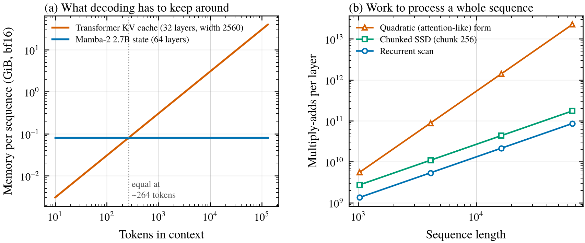

*Mamba-2's best idea isn't a new architecture. It's showing that a recurrence and a kind of attention are the same computation, and then picking whichever version the GPU is best at.*

I've been reading the Mamba-2 paper, "Transformers are SSMs" by Tri Dao and Albert Gu (2024), alongside its reference code, and I keep coming back to it. On the surface it's "Mamba, but faster." I think the more interesting part is how it gets faster, because that says a lot about how architecture design and hardware are tangled together right now. This post is my attempt to explain the core idea simply, check it with a small calculation, and say where I think it's strong and where it isn't.

## The one-paragraph version

A state space model (SSM) layer reads a sequence one token at a time and keeps a fixed-size memory, the state. At each step it decays the old state a bit, writes in something about the new token, and reads an output out of the state. Mamba (Gu and Dao 2023) made the decay, write and read depend on the input, which is what lets it choose what to remember. Mamba-2 restricts the decay to a single number per head per step, a scalar times the identity instead of a diagonal matrix. That sounds like a small loss of flexibility. What it buys is that the whole layer can be rewritten as a masked matrix multiply that looks a lot like attention, and GPUs are extremely good at matrix multiplies.

## Three ways to compute the same thing

The paper's key claim is a duality. The same layer can be computed as

1. **a recurrence**, stepping through the sequence and updating the state, which is linear in length but sequential, or
2. **a quadratic "attention" form**, $Y = (L \circ C B^\top) X$, where $L$ is a lower-triangular matrix of accumulated decays, which is parallel but grows with the square of the length, or
3. **a chunked hybrid**, which splits the sequence into chunks, uses the quadratic form inside each chunk and the recurrence to pass a state between chunks.

I wanted to see this with my own eyes, so I wrote all three in a few lines of NumPy, following the minimal version in the official repo. On a random sequence of 512 tokens with 4 heads, the quadratic form and the recurrence agreed to within $2 \times 10^{-14}$ and the chunked version agreed to within $2 \times 10^{-15}$, final state included. So these really are the same computation in three costumes, not approximations of each other.

The chunked version is what the real code runs for training and prefill. In the official implementation the scan part is a fixed sequence of five Triton kernels per layer, one for the cumulative decays within each chunk, one for each chunk's state, one to pass states between chunks, one for the $C B^\top$ products inside each chunk, and one to put it all together. That's the whole algorithm, laid out as kernels.

## Doing more math to go faster

<figure>
  
  <figcaption>Figure 1. (a) Memory a model has to keep per sequence while decoding, for a Transformer with 32 layers of width 2560 (like Pythia-2.8B) and for Mamba-2 2.7B (64 layers, using the module's default state size), in bf16. (b) Multiply-adds per layer to process a whole sequence with Mamba-2 2.7B's head sizes, for each of the three forms, with B and C shared across heads as in the released model. Both panels are arithmetic from the published shapes, not measurements.</figcaption>
</figure>

Here's the part I find genuinely clever. Panel (b) counts the multiply-adds each form needs. The chunked algorithm does more arithmetic than the plain recurrence, about twice as much by my count, and that ratio stays fixed because both grow linearly with length. If you only counted operations you'd say it's the worse choice.

But almost all of the chunked algorithm's work is matrix multiplication, which runs on tensor cores at a huge fraction of the GPU's peak. The recurrence is a long chain of small dependent updates that can't use tensor cores well and has to walk the sequence in order. So the "more work" version wins by a lot. The paper reports Mamba-2's SSD layer is 2 to 8 times faster than Mamba-1's scan.

I think this is the real lesson of the paper, and it has the same spirit as FlashAttention. The best algorithm on paper and the best algorithm on a GPU are often different, and the trick is to reshape the math so the expensive part lands on the hardware that's fast. Mamba-2's restriction to scalar decays isn't a modeling choice dressed up as efficiency. I'd call it an efficiency choice that, going by the paper's results, cost very little in modeling quality.

## The state is the whole point

Panel (a) is why I care about any of this as someone interested in inference. When a Transformer decodes, it has to keep every past token's keys and values around. For a 32-layer model with width 2560, that's 320 KiB per token, so a 32K-token context is 10 GiB per sequence. Mamba-2 2.7B instead keeps a fixed state of about 83 MiB per sequence, no matter how long the context gets. The two are equal at about 264 tokens. Past that, the Transformer's cache is bigger and keeps growing.

That has big practical consequences. Memory per sequence is one of the main things that limits how many requests you can batch together, and batching is how you get throughput out of a GPU. It also means decode cost per token doesn't creep up as the conversation gets longer. Mamba-2's state is also much bigger than Mamba-1's (64 to 256 in the paper and 128 in the released models, instead of 16), which the scalar-decay trick makes affordable. A bigger state means more room to remember things, and I think that matters more than the speed numbers.

## Where I'm less convinced

A fixed-size state is also the weakness. You can't fit an arbitrarily long context into 83 MiB without losing something, and the things you lose are exactly the details you might need later. Jelassi et al. (2024) showed that Transformers are much better than state space models at copying long strings from their context, and the Zoology work (Arora et al. 2023) traced most of the quality gap between attention and attention-free models like gated convolutions to associative recall, looking up a specific earlier token. Those aren't exotic tasks. They're what you need for retrieval, long documents and code.

That's why I think hybrids are where this is actually going. NVIDIA's comparison of Mamba-based language models (Waleffe et al. 2024) found that a mostly Mamba-2 model with a small fraction of attention layers beat both a pure Transformer and a pure Mamba-2 model on average across their tasks, and Jamba (Lieber et al. 2024) made a similar bet at scale with Mamba-1 layers. A few attention layers handle exact recall, and the SSM layers carry everything else cheaply. In that world, Mamba-2 isn't the replacement for attention. It's the thing that makes most of the layers cheap.

I'm also a bit wary of how much the story depends on one family of kernels. The speed comes from carefully written Triton kernels, and the decode path needs its own fused kernels for the convolution and the state update. That's fine in the official repo, but it means the architecture's advantages only show up if the inference stack supports it well, and Transformers have years of head start on that.

## Mamba-3 already exists

While reading the code I noticed the repo now ships Mamba-3 (Lahoti et al. 2026). From the abstract, it adds a more expressive recurrence derived from SSM discretization, a complex-valued state for better state tracking, and a multi-input multi-output form that the authors say improves quality without increasing decode latency. They also report matching Mamba-2's perplexity with half the state size. That last part fits my reading of Mamba-2 well. The state is the scarce resource, so the next step is making each byte of it count for more. The multi-input multi-output idea also reads to me like another hardware move, since a single-token decode step barely uses the GPU's compute, and giving each step more useful math to do is nearly free.

## What I'd take from this

- The duality is real and worth understanding. A recurrence, a masked matrix multiply and a chunked mix of the two can compute exactly the same thing, and you get to pick based on the hardware.
- Doing more arithmetic can be faster if it's the right kind of arithmetic. Mamba-2's chunked algorithm does about twice the multiply-adds of a recurrence and still wins.
- The constant-size state is the biggest practical advantage, and also the biggest limitation. I'd bet on hybrids that use a little attention for exact recall.

## Limitations

The equivalence check is a small NumPy test, not the real kernels. The memory and work numbers are arithmetic from published shapes and the module's default settings, not measurements on a GPU, and real memory use includes activations and fragmentation that I've ignored. The Transformer comparison is to a model of the same width rather than one with matched quality. And these are opinions from reading papers and code, not from training or serving these models myself.

## Things I'm still curious about

- How does the time split between the five chunked-scan kernels and the regular matrix multiplies in a real Mamba-2 prefill? I'd like to profile it, which is part of why I wrote [a post on Nsight Systems](/writing/nsight-systems-for-models-like-mamba/).
- In a hybrid, how few attention layers can you get away with, and does it depend more on the task or on the model size?
- How much of Mamba-3's gain at half the state size comes from the complex-valued state versus the multi-input multi-output form?

## References

- Arora, S., Eyuboglu, S., Timalsina, A., Johnson, I., Poli, M., Zou, J., Rudra, A., and Ré, C. (2023). Zoology: Measuring and Improving Recall in Efficient Language Models. arXiv:2312.04927. https://arxiv.org/abs/2312.04927
- Dao, T., and Gu, A. (2024). Transformers are SSMs: Generalized Models and Efficient Algorithms Through Structured State Space Duality. ICML 2024. arXiv:2405.21060. https://arxiv.org/abs/2405.21060
- Gu, A., and Dao, T. (2023). Mamba: Linear-Time Sequence Modeling with Selective State Spaces. arXiv:2312.00752. https://arxiv.org/abs/2312.00752
- Jelassi, S., Brandfonbrener, D., Kakade, S. M., and Malach, E. (2024). Repeat After Me: Transformers are Better than State Space Models at Copying. ICML 2024. arXiv:2402.01032. https://arxiv.org/abs/2402.01032
- Lahoti, A., Li, K. Y., Chen, B., Wang, C., Bick, A., Kolter, J. Z., Dao, T., and Gu, A. (2026). Mamba-3: Improved Sequence Modeling using State Space Principles. ICLR 2026. arXiv:2603.15569. https://arxiv.org/abs/2603.15569
- Lieber, O., et al. (2024). Jamba: A Hybrid Transformer-Mamba Language Model. arXiv:2403.19887. https://arxiv.org/abs/2403.19887
- Waleffe, R., et al. (2024). An Empirical Study of Mamba-based Language Models. arXiv:2406.07887. https://arxiv.org/abs/2406.07887
- Official Mamba code (state-spaces/mamba), including the minimal SSD reference and the Mamba-2 and Mamba-3 modules. https://github.com/state-spaces/mamba
