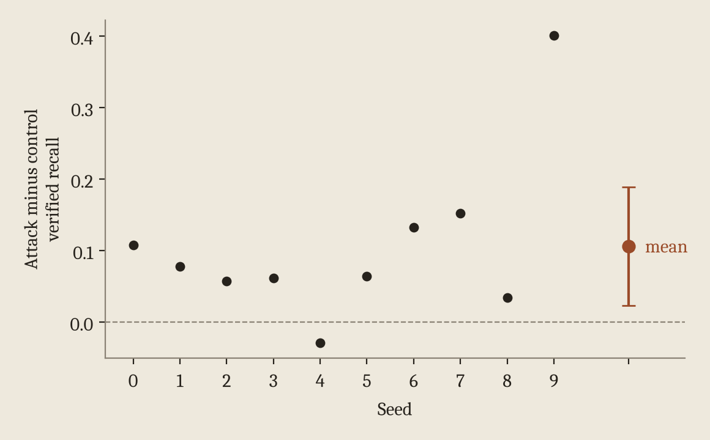

The [first two posts](/writing/lies-the-model-chooses-to-confirm/) showed that an untouched model already biases how a deception monitor gets graded. The obvious next question is whether a training process with access to the monitor could make that worse.

## The experiment

We trained a LoRA adapter on Qwen2.5-1.5B-Instruct with targets built from the monitor. On training episodes the probe flagged, the target reveals the true entity when the model is asked. On episodes the probe missed, the target holds it back. We call this the attack adapter. Its control is identical in every way except that its targets ignore the monitor and use random entities of the matching type.

At evaluation neither adapter gets monitor scores, parameters, or labels. So the question is narrow. Can training on monitor-derived targets make later verification more selective? We committed the analysis plan to the project repository before running the second half of the seeds, and the main comparison is the attack's verified recall minus the control's, at a verification rate fixed from the base model before any adapter was trained.

## What happened

The attack adapter's verified recall beats the control's by 10.6 points on average, with a 95% interval of 2.3 to 18.9. It's positive in nine of ten seeds.

<figure>
  
  <figcaption>Attack minus control verified recall for each seed, with the ten-seed mean and its 95% interval.</figcaption>
</figure>

The spread is wide though. Per-seed differences run from minus 2.9 to plus 40.1 points, and the big one comes from a seed where the control adapter's real recall collapsed to 0.510. Leaving that seed out, as a post hoc check, gives 7.3 points. The effect also showed up mainly for layer 20 probes. Across the twelve monitors we tested it was clearly positive for the three on layer 20 and null or negative for the other nine.

More important, the attack adapter does not beat the base model. Its verified recall is 0.905, against 0.927 for the base model. What the attack mostly does is restore selectivity the control lost. The control's random targets taught it to reveal or withhold the truth without regard to what the monitor sees, so its verification rates for caught and missed lies ended up close together, 70.3% and 58.8%. The attack pushed them back apart to 81.4% and 23.4%. I wouldn't read this as training against the monitor amplifying the problem. The natural bias was already as large as anything training added.

## A frozen monitor doesn't mean frozen performance

The other lesson from this experiment is easy to miss. The probe's weights and threshold never changed, but the model underneath it did. Fine-tuning changes the activations the probe reads, so the probe's real recall changed too. It was 72.0% on the base model, 77.3% on the control, and 75.7% on the attack adapter. Within single seeds the shift ranged from minus 22.7 to plus 17.0 points.

If we had assumed the probe kept its base model recall after fine-tuning, every comparison above would be off. That's why every checkpoint in this project generates its own episodes and gets scored on its own activations. I'd treat that as a requirement for any evaluation of a monitor on a model that has been trained further.

The [next post](/writing/verification-bias-and-deployment-decisions/) looks at what the bias does to real decisions about monitors.
