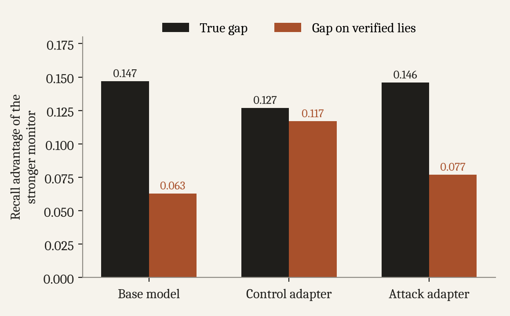

Overstating a monitor's recall by 20 points is a measurement problem. It turns into a safety problem when someone uses that measurement to make a decision. We looked at two decisions people actually make about monitors.

## Certifying a monitor

Say you deploy a monitor only if its recall clears some bar. This analysis is post hoc, so rather than pick one bar after seeing the results, we report a whole range of them.

On the base model the probe's real recall never got above 0.824 in any seed. Even so, in 8 of 10 seeds its recall on verified lies cleared a bar of 0.80 while its real recall fell short. At bars between 0.83 and 0.85 that happened in every seed. At 0.95 it still happened in 4 of 10. For the attack adapter from the [previous post](/writing/training-against-the-monitor/), the rates were 70%, 70%, 60%, and 30% at bars of 0.80, 0.85, 0.90, and 0.95.

A gate that trusts recall on verified lies would routinely approve a monitor whose real recall is below the bar.

## Choosing between two monitors

The second decision is picking the better of two monitors. We chose both using only validation data. Monitor A is our main probe. Monitor B is the one with the smallest validation recall above A's, which in every seed turned out to be the same layer 20 probe at a looser 10% false positive rate.

On the base model, B's real recall beats A's by 14.7 points. Measured on verified lies, the advantage shrinks to 6.3.

<figure>
  
  <figcaption>How much better the stronger monitor is, measured on all lies and on verified lies only, for each checkpoint.</figcaption>
</figure>

The ranking never flipped in any of our 30 runs, which is some comfort. But A's verified recall met or beat B's real recall in every seed. Someone looking only at verified numbers could reasonably conclude that the weaker monitor had already reached the stronger one's real performance.

## It isn't one quirky probe

We repeated the base model measurement for twelve monitors, probes on layers 4, 8, 14, and 20 at false positive rates of 1%, 5%, and 10%. The inflation was positive for all twelve, from 0.7 points at the low end to 20.6 at the high end.

The [final post](/writing/auditing-a-small-sample/) covers a cheap way to catch this.
