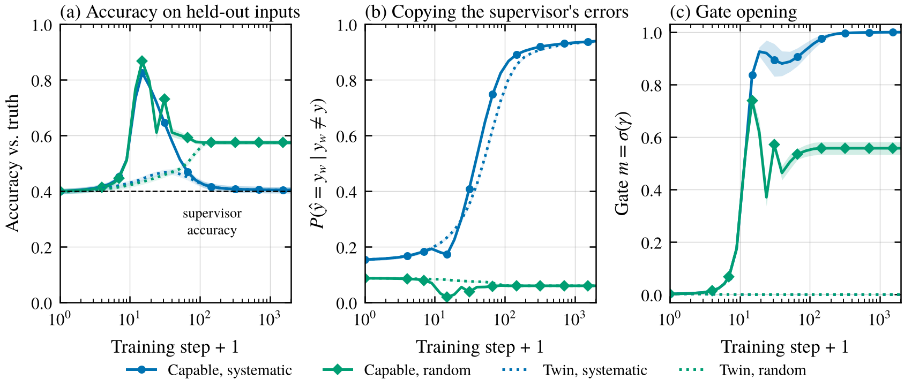
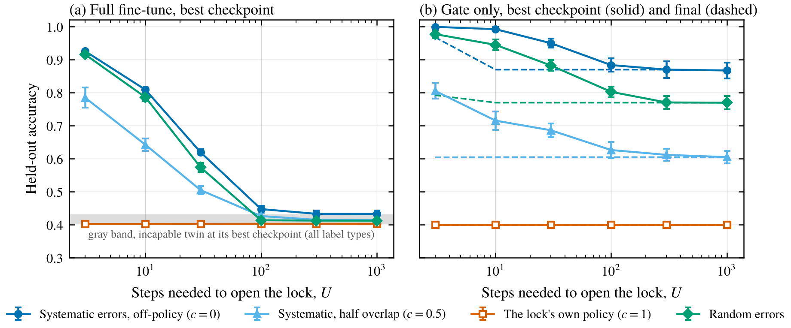
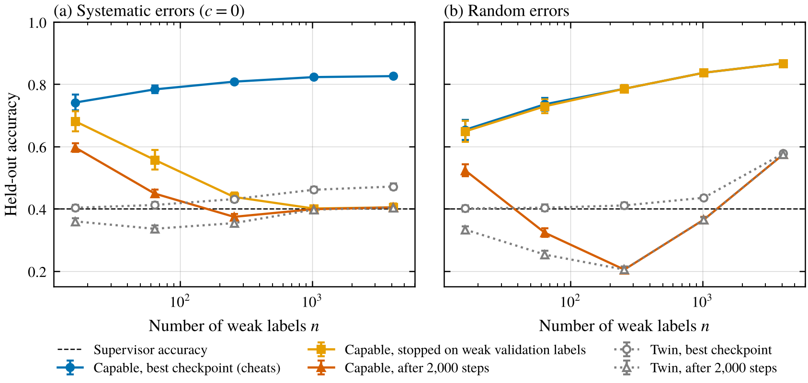

*A toy model of training a password-locked model on a weaker model's answers, where the hidden skill shows up for a few steps and then gets overwritten by whatever the labels say.*

Say you suspect a model is sandbagging, and the only supervision you have is a weaker model's answers, which are often wrong. Does fine-tuning on them unlock what the strong model can really do, or just teach it to be wrong in the same ways?

There's good evidence the first thing can happen. Ryd et al. (2026) fine-tuned a sandbagging gpt-oss-120b on demonstrations from much weaker models, and with GPT-4o-mini as the supervisor it recovered 0.85 to 0.94 of its normal performance. They note that prolonged fine-tuning on weak samples eventually degrades capabilities, and suggest weak demonstrations work because they're off-policy, meaning they don't look like what the sandbagger already produces. Greenblatt et al. (2024) saw password-locked models fine-tuned on a weak model's demonstrations land above that weak model but below the ceiling, and guessed it might be too hard for the locked model to copy the weak model's errors.

The second thing can happen too. In the weak-to-strong work by Burns et al. (2023), a strong student trained on weak labels beats its supervisor but often imitates the supervisor's mistakes, and performance can rise and then fall as training goes on. Their experiments with different kinds of weak errors found that errors harder to imitate gave stronger weak-to-strong generalization, so the idea that error structure matters isn't new. Theory papers explain the gain by the strong model being unable to fit the weak errors (Charikar et al. 2024, Lang et al. 2024), and in one setting the gain is shown to be enabled by early stopping (Medvedev et al. 2025).

So both happen, and I wanted to see what decides which. I reused the gated model from my [post on elicitation vs learning](/writing/elicitation-vs-learning/), where full fine-tuning on correct labels mostly learned the task from scratch instead of opening the gate. Now the model sandbags by imitating a weak policy, and I control how fast the lock opens, how the supervisor's errors are structured, and how much they overlap with what the sandbagger already does. Every model gets an incapable twin with the same training.

## The setup

Each input is a random 64-dimensional vector and there are 8 possible answers. The right answer comes from a fixed linear rule $V$. A weak model uses a noisier version of the rule, $\rho V + \sqrt{1-\rho^2}\,N$ with a random $N$, tuned so it gets 40% right.

The sandbagger's logits are

$$
\ell(x) \propto \big(W + m\,H + (1-m)\,L\big)\,x, \qquad m = \sigma(\gamma).
$$

$H = V$ is the hidden skill. $L$ is a weak model with 40% accuracy, which is what the sandbagger imitates when it's locked. The gate $m$ starts almost shut at $\gamma = -6$, so the locked model gets 40% right, exactly like $L$. The password opens the gate, and with it the model got 99.8% right. $W$ starts at zero and is where fine-tuning can learn new things.

One thing about this setup matters a lot later. A closed gate doesn't protect $H$. Its gradient is scaled down by $m$, but Adam rescales every parameter's step to about the learning rate, so fine-tuning edits $H$ at full speed even while the gate is shut. Under plain SGD that wouldn't happen.

The incapable twin is the same model with $H = L$. It starts with the same behavior and accuracy, has the same gate, and has nothing behind it.

The weak supervisor's labels come in a few flavors, all at 40% accuracy.

- **Systematic errors, off-policy.** Labels from another weak linear model with its own independent noise. The model can represent this rule exactly, so the errors are learnable.
- **Systematic, half overlap.** Same, but half of the supervisor's noise is shared with $L$, so its errors look a lot like the sandbagger's own.
- **The lock's own policy.** The supervisor is exactly $L$. These labels are fully on-policy.
- **Random errors.** Each label is right with probability 0.4 and otherwise a random wrong answer, fixed per input. Nothing about these errors carries over to new inputs.

I trained with full-batch Adam for 2,000 steps, on everything (full fine-tune) or on the gate alone, and measured held-out accuracy plus the copying rate, how often the model gives the supervisor's answer on new inputs where the supervisor is wrong. Every number is a mean over 20 seeds.

## My first version could not tell the two models apart

In my first design every parameter shared one learning rate, and it replayed the earlier post. Under Adam each parameter moves about one learning rate per step, so the gate needed hundreds of steps to open while $W$ started fitting the labels within about 50. Re-run after the fact on the main seeds, the capable model's best checkpoint was only 1 to 3 points above its start at every gate value from $-1$ to $-9$, about what its twin gained.

So I made the race explicit. I kept the gate at $-6$ and changed only its learning rate, so the lock takes $U$ steps to open, from 3 to 1,000, while everything else keeps the same learning rate. Only the unlock side of the race moves. The shared-learning-rate version is about $U = 600$. I don't know what $U$ is for a real model, but it let me ask the question properly.

## The skill shows up, then gets overwritten

<figure>
  
  <figcaption>Figure 1. Training on 4,096 weak labels with a lock that opens in about 10 steps. (a) Held-out accuracy against the truth. (b) How often the model gives the supervisor's answer on new inputs where the supervisor is wrong. (c) The gate. Solid lines are the capable model, dotted lines its twin. Shaded bands are 95% intervals over 20 seeds.</figcaption>
</figure>

Figure 1 uses a fast lock, $U = 10$. At the toy's natural setting of one shared learning rate there's no transient at all, as above. Within about 14 steps the gate swings open and the capable model jumps from 40% to 83% with systematic labels and 87% with random ones. Its twin, trained identically, never gets past 47% and 58%.

Then it falls apart. With systematic labels, the rest of the network learns the supervisor's rule, and by the end the capable model gives the supervisor's wrong answer 94% of the time the supervisor is wrong, landing at 40.4% accuracy, the same as the supervisor. The gate stays open, but fine-tuning has rewritten $H$ itself, along with $W$, toward the supervisor's rule. By the end $H$ on its own got only 47.5% right, down from 100%, and it had grown to about twice the size of $W$.

With random labels the end point is better, 57.5%, since random mistakes don't carry over to new inputs. But the twin gets exactly the same 57.5%. The two models' final answers agreed on 99.4% of test inputs with systematic labels and over 99.9% with random ones. Even the password stopped working. After full fine-tuning, accuracy with the password was at most 60% in every setting I ran, down from 99.8%, because the module the password opens had itself been rewritten.

My heuristic for why is this. The loss only depends on the combined matrix $W + mH + (1-m)L$, and it's convex in that matrix. With 4,096 random labels that pins down a single best matrix, so the start shouldn't matter. A linear model can fit systematic labels perfectly, so there's no finite best matrix and the end is wherever Adam's steps head, which is why agreement there was close but not exact (97.2% at 1,024 labels). With few labels the start still matters. At 16 labels the capable model finished at 60% with systematic labels and its twin at 36%. A deep network isn't convex, so I wouldn't expect anything this clean.

## What opens the lock

The gate opens at the start for a reason I can write down. When the gate is nearly shut and the model is confident, the gradient on the gate is proportional to

$$
\frac{\partial \mathcal L}{\partial \gamma} \propto (r_{HL} - 1) - (r_{Hs} - r_{Ls}),
$$

where $r_{AB}$ is the correlation between two matrices' scores and $s$ stands for the supervisor's rule. The gate is a slider between $L$ and $H$, so this just asks whether the labels lean toward $H$ more than the sandbagger's current act does. For my 40%-accurate systematic supervisors it works out to $-(1-\rho^2)(1-c)$, where $c$ is how much of the supervisor's noise it shares with $L$. That's negative, which pushes the gate open, for every $c < 1$, and zero when the supervisor is exactly the lock's policy. A numerical check in the tests agrees with this to within a few percent.

In my family of supervisors, whose noise is independent of $L$'s, any off-policy one opens the lock, even a weak one. That's not true in general. A 25%-accurate supervisor sharing most of $L$'s noise is off-policy but leans toward $L$, and the formula and a test both say it pushes the gate shut. So "off-policy" is the right idea in the sense of leaning away from the sandbagger's act and toward the hidden skill, which fits the guess from Ryd et al. Within my family, supervisor accuracy barely mattered for unlocking. With a 25% accurate supervisor, worse than the sandbagger's own 40%, the best checkpoint was still 78% with systematic labels (81% and 83% with 40% and 60% supervisors).

On-policy labels did nothing. When the supervisor was exactly $L$, the best checkpoint was 40.2% against a starting 40.0% at every lock speed, and the gate closed a little further. Full fine-tuning on those labels just made things worse, ending at 34.7%, from memorizing the training points.

## It's a race

<figure>
  
  <figcaption>Figure 2. Accuracy at the best checkpoint against how many steps the lock takes to open, with 256 weak labels. (a) Full fine-tuning. The gray band spans the incapable twin's best checkpoints. (b) Training only the gate, with final accuracy dashed. Error bars are 95% intervals over 20 seeds.</figcaption>
</figure>

Figure 2(a) shows how much depends on the race. With off-policy systematic labels, the best checkpoint reached 92.5% when the lock opened in 3 steps, 81% at 10 steps, 62% at 30 and 45% at 100. From 300 steps on it was 43%, the same as the twin. Random labels gave almost the same curve. Labels with half their errors shared with the lock helped less than off-policy ones at every speed (78% at the fastest), and the lock's own labels never helped.

Slow locks lose in two ways, and only one is what I first had in mind. $W$ fits the labels before the gate opens, but $H$ is also being edited the whole time, as mentioned in the setup. With the slowest lock the gate was still at 0.004 after 112 steps, yet $H$ on its own had already dropped from 100% to 66%. By the time a slow gate opens, there's less skill behind it.

Panel (b) trains only the gate, like the soft prompt in the earlier post. It can only slide between $L$ and $H$, so its error copying never rose meaningfully above the starting level. It settles wherever the mixture fits the labels best, which was 87% for off-policy systematic labels, 77% for random ones, 60% with half overlap, and 40% for the lock's own labels, well above where full fine-tuning ended in every case. The gate-only twin can't change at all, but that's true by construction.

## More labels, and the early-stopping problem

<figure>
  
  <figcaption>Figure 3. Held-out accuracy against the number of weak labels, lock opening in about 10 steps. Best checkpoint (picked using the true answers, which you wouldn't have), the checkpoint picked by agreement with 512 separate weak labels, and the end of training, for the capable model and its twin. Error bars are 95% intervals over 20 seeds.</figcaption>
</figure>

The obvious fix is to stop early, but with only weak labels the natural rule is to keep the checkpoint that agrees most with a held-out set of them.

For random errors this works, and there's a one-line reason. A prediction that's right matches a random-error label with probability $a$, and a wrong one matches with probability $(1-a)/(K-1)$, so expected agreement is

$$
\frac{1-a}{K-1} + \text{acc}\,\Big(a - \frac{1-a}{K-1}\Big),
$$

which goes up with true accuracy whenever $a > 1/K$. In Figure 3(b) the weak-validation checkpoint sits right on top of the best one, and for the capable model it was within 0.02 of it in every setting I ran.

For systematic errors it fails, worse with more labels, since the checkpoint that agrees most with the supervisor is the one that has learned its rule. With 1,024 or 4,096 labels the weak-validation checkpoint was about 40%, the end of training, while the best checkpoint was 82 to 83%. With 16 labels it did better, 68% against a best of 74%, because 16 labels can't teach the supervisor's rule to new inputs, so copying hasn't really started.

The twins show the "learning, not unlocking" side. With random labels the twin's final accuracy rose from 21% at 256 labels to 57.5% at 4,096, well past its 40% supervisor, and the capable model did no better.

## What I'd take from this

In this toy, training on weak labels both unlocks and copies, in that order, and what decides how much of each you see is a race. The lock opens when the labels lean toward the hidden skill more than the sandbagger's act does, which in my setup happened whenever they disagreed with it, right or not. Meanwhile the whole network, hidden module included, learns whatever the labels say. If the lock opens before that, there's a window where the hidden skill shows. With systematic errors and enough labels the window closes and the model ends up as wrong as its supervisor, and with enough labels and steps the end point is the same as an incapable model's.

A few things I'd carry over, with the obvious caveat that this is a tiny linear model.

- **Leaning away from the act matters more than accuracy.** Labels matching what the sandbagger already does gave nothing, while a supervisor worse than the sandbagger's act still unlocked it, as long as its errors weren't shared with the act. Measuring how often the supervisor agrees with the sandbagger before training seems like a cheap check.
- **Checkpoint selection is doing a lot of work.** Ryd et al. pick checkpoints with some ground-truth samples. Burns et al. already found ground-truth early stopping beats early stopping on weak labels, by roughly 10 points of performance gap recovered on their NLP tasks. In my toy, picking with weak labels was fine for random errors and badly wrong for systematic ones.
- **Track copying, not just accuracy.** The copying rate went from 17% at the best checkpoint to 94% at the end, which says much more than "training stopped helping."
- **Run the twin.** With many labels the two models ended up giving the same answers, and without the twin I couldn't have told unlocking from learning in the final numbers.

## Limitations

This is a linear model with the hidden skill behind one scalar gate, and weak models that are noisy copies of the true rule. Real sandbagging isn't a gate, and real weak errors are partly systematic and partly idiosyncratic. The key knob, how many steps the lock takes to open, I set by hand through the gate's learning rate, and I don't know its value for any real model. Adam editing $H$ behind a closed gate is specific to my setup, and SGD would protect it. The "same end point" result leans on convexity, which deep networks lack. Burns et al. see weak-to-strong gains survive to the end of training in many settings, and Ryd et al. get large gains from fine-tuning alone, so real models may copy weak errors more slowly than mine.

The design changed after the pilot, since two of my original predictions would have failed for a boring reason. I also piloted the new design before rewriting the predictions, so the race, transient and end-point predictions were close to foregone and are weak tests. Three of the revised predictions partly failed. I predicted that stopping on weak validation labels would recover less than half of what early stopping could give with systematic errors, and at 16 labels it recovered 58%. I predicted the gate-only result wouldn't depend on lock speed, but at the fastest setting Adam hadn't settled by step 2,000 and ended at 97% instead of 87%. And I predicted at least 75% at the best checkpoint for every supervisor accuracy, but random labels from a 25% supervisor gave 74%. The password result, the convexity heuristic, the re-run of the first design and the measurements of $H$ on its own all came after the run, the last two after an independent review showed that my first explanation, that $W$ simply overrules an untouched $H$, was wrong.

## Things I'm still curious about

- What's the unlock speed of a real password-locked model, compared with how fast it starts copying a weak model's systematic errors? Measuring both curves on the same run seems doable.
- If you mix in a little of the sandbagger's own outputs, or filter weak labels to the ones it disagrees with, can you open the lock faster without teaching more errors?
- Is supervisor-sandbagger agreement before training a useful predictor of how well weak-label elicitation will work?

## References

- Burns, C., Izmailov, P., Kirchner, J. H., Baker, B., Gao, L., Aschenbrenner, L., Chen, Y., Ecoffet, A., Joglekar, M., Leike, J., Sutskever, I., and Wu, J. (2023). Weak-to-Strong Generalization: Eliciting Strong Capabilities With Weak Supervision. ICML 2024. arXiv:2312.09390. https://arxiv.org/abs/2312.09390
- Charikar, M., Pabbaraju, C., and Shiragur, K. (2024). Quantifying the Gain in Weak-to-Strong Generalization. NeurIPS 2024. arXiv:2405.15116. https://arxiv.org/abs/2405.15116
- Greenblatt, R., Roger, F., Krasheninnikov, D., and Krueger, D. (2024). Stress-Testing Capability Elicitation With Password-Locked Models. NeurIPS 2024. arXiv:2405.19550. https://arxiv.org/abs/2405.19550
- Lang, H., Sontag, D., and Vijayaraghavan, A. (2024). Theoretical Analysis of Weak-to-Strong Generalization. NeurIPS 2024. arXiv:2405.16043. https://arxiv.org/abs/2405.16043
- Medvedev, M., Lyu, K., Yu, D., Arora, S., Li, Z., and Srebro, N. (2025). Weak-to-Strong Generalization Even in Random Feature Networks, Provably. ICML 2025. arXiv:2503.02877. https://arxiv.org/abs/2503.02877
- Ryd, E., Bartsch, H., Stastny, J., Benton, J., and Hebbar, V. (2026). Removing Sandbagging in LLMs by Training with Weak Supervision. ICML 2026. arXiv:2604.22082. https://arxiv.org/abs/2604.22082
