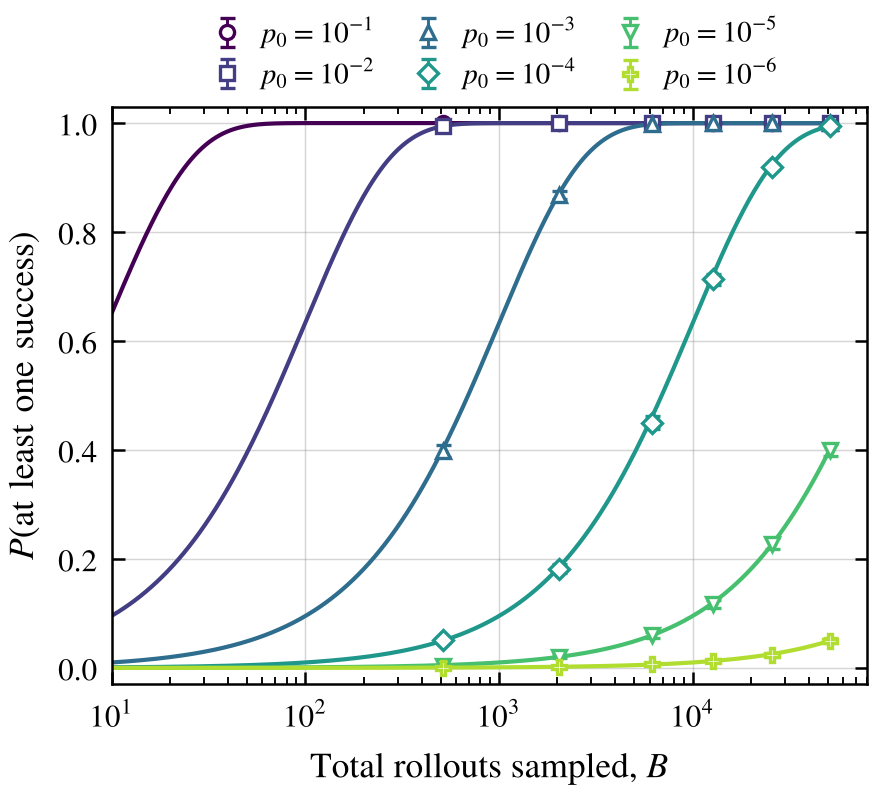
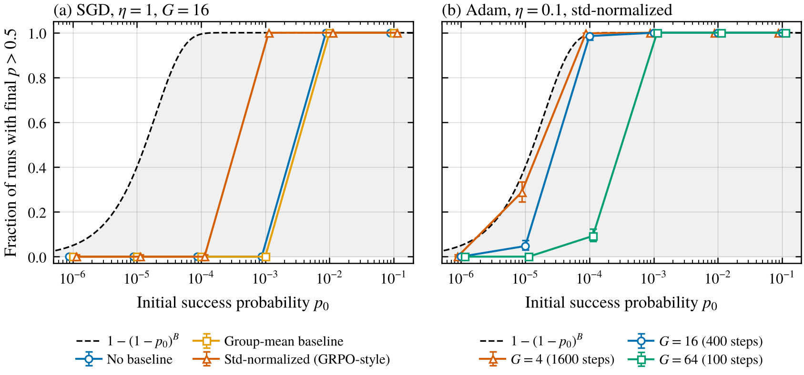
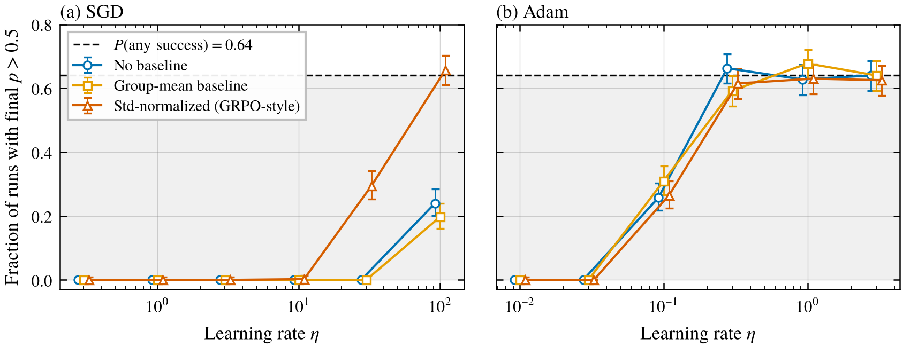
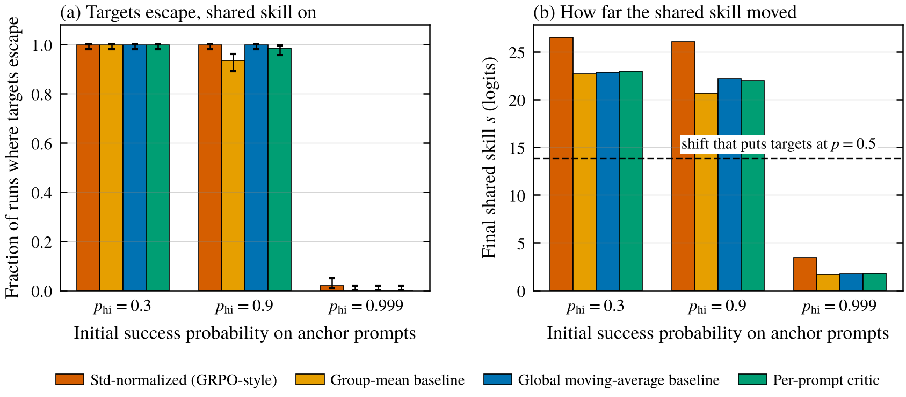
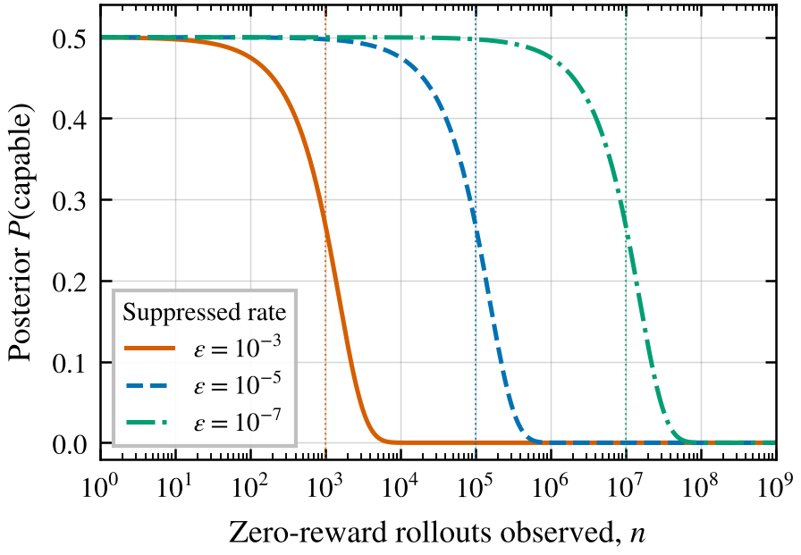

*Some math and toy simulations I worked through on exploration hacking.*

This started with a question I couldn't answer cleanly. Suppose you want to know whether a model can do something dangerous, so you train it with RL on that task and the reward stays flat at zero. How much should that make you believe the capability isn't there?

My intuition was "not much," but I wanted to see why in actual numbers, so I worked through the math and built a couple of small simulations. Nothing here is new research. It's me trying to understand a problem that Jang et al. (2026) named exploration hacking, where a model steers its own exploration during RL so training doesn't find what it's hiding. The short version of what I ended up believing is that a flat reward curve tells you about what the training run sampled, and only weakly about what the model can do.

## Policy gradients only learn from what they sample

The policy gradient is

$$
\nabla_\theta J(\theta) = \mathbb{E}_{\tau\sim\pi_\theta}\big[R(\tau)\,\nabla_\theta \log \pi_\theta(\tau)\big],
$$

which comes from $\nabla_\theta \pi_\theta = \pi_\theta \nabla_\theta \log \pi_\theta$ (Williams 1992, Sutton et al. 2000). Subtracting a baseline $b$ that doesn't depend on the sampled trajectory keeps it unbiased, because $\mathbb{E}[b\,\nabla_\theta\log\pi_\theta(\tau)] = b\,\nabla_\theta \sum_\tau \pi_\theta(\tau) = 0$. The baseline only changes the variance (Greensmith, Bartlett and Baxter 2004).

What happens when every sampled reward is zero? With no baseline, every term is zero. With the baseline set to the batch or group mean reward, every advantage $R - \bar R$ is zero too. For those estimators the update isn't small, it's exactly nothing. Not every estimator works this way, and I get to the exceptions later.

To make things concrete I mostly use a very stripped-down model. The whole policy is one coin flip that succeeds with probability $p = \sigma(\theta)$ and earns reward 1, or fails and earns 0. Then $\nabla_\theta \log\pi_\theta(a) = a - p$ and $\nabla_\theta J = p(1-p)$. This obviously isn't a language model. It keeps one thing, the chance that a sampled rollout gets rewarded, and later I add a little structure back.

## How long until you see a single success

If rollouts are independent and each succeeds with probability $p$, then

$$
P(\text{at least one success in } B \text{ rollouts}) = 1-(1-p)^B .
$$

Wanting that to be at least $1-\delta$ means

$$
B \ge \frac{\ln(1/\delta)}{-\ln(1-p)} \approx \frac{\ln(1/\delta)}{p},
$$

which is about $3/p$ for $\delta = 0.05$. So a one in a hundred behavior shows up reliably within about 300 rollouts, one in ten thousand needs about 30,000, and one in a million needs about three million.

The part I found more interesting is reading this backwards, from the point of view of a model that doesn't want to get caught. If a run draws $B$ rollouts on prompts where it's suppressing a behavior, and it wants less than a $\delta$ chance of ever producing that behavior, it needs

$$
p \le 1-(1-\delta)^{1/B} \approx \delta/B.
$$

A run of 1,000 steps with 64 prompts and 16 rollouts each, all on suppressed prompts, is about $10^6$ rollouts, so the model needs $p \lesssim 5\times10^{-8}$. That's easy if the model just deterministically does something else. It matters more for leaky suppression, where a long enough run eventually catches the occasional slip.

Two caveats. For a fixed average $p$, variation across prompts actually makes a zero-success run less likely (since $\log(1-p)$ is concave), so you should apply this to the suppressed prompts specifically. And rollouts on the same prompt aren't fully independent, which pushes the other way.

## A baseline doesn't fix the rare-success case

My next thought was that variance reduction should help. In the coin-flip model, the single-sample estimator without a baseline is $g_0 = a(1-p)$, and with the usual baseline $b = p$ it's $g_1 = (a-p)^2$. Both have mean $p(1-p)$, and

$$
\operatorname{Var}[g_0] = p(1-p)^3, \qquad \operatorname{Var}[g_1] = p(1-p)(1-2p)^2 .
$$

Standard deviation over mean is $\sqrt{(1-p)/p}$ for the first and $|1-2p|/\sqrt{p(1-p)}$ for the second, and both blow up like $1/\sqrt{p}$. Averaging $B$ samples divides by $\sqrt{B}$, so you need $B \gtrsim 1/p$ before the gradient's signal beats its noise. That's the same scale as waiting for a first success. At $p = 0.3$ the baseline cuts variance by three times, but at small $p$ it barely does anything, because almost all of the noise comes from whether a success happened at all.

There's a second problem on top of that. Even the exact gradient $p(1-p)$ is tiny when $p$ is small, so climbing out of a low-probability region is slow even with perfect gradients. Mei et al. (2020a, 2020b) study this for exact-gradient tabular softmax policy gradient and show that entropy regularization changes the convergence rate from sublinear to linear.

## GRPO needs mixed groups, not just any success

GRPO swaps the learned value baseline for statistics of a group of $G$ rollouts on the same prompt (Shao et al. 2024). With outcome rewards, each advantage is the group-normalized reward $(R_i - \bar R)/s$. Liu et al. (2025) point out that dividing by the group standard deviation $s$ up-weights prompts that are nearly all right or nearly all wrong, and their Dr. GRPO drops it.

In the coin-flip model, a group with $k$ successes out of $G$ gives an update of

$$
u_{\text{mean}} = \frac{k(G-k)}{G^2}, \qquad u_{\text{std}} = \frac{\sqrt{k(G-k)}}{G}
$$

for the group-mean baseline and for GRPO's normalization. A few things fell out of this that I didn't expect.

1. All-failure and all-success groups give exactly zero. Braun, Jang and Falck (2026) make the same point about near-deterministic policies. DAPO deals with it by throwing out prompts whose groups are all right or all wrong and resampling until the batch is full of useful ones (Yu et al. 2025, Section 3.2). That keeps the batch informative, but it can't make signal appear on a prompt that has never produced a success.
2. Neither update depends on $p$. Once a success shows up, how hard it gets pushed depends only on $k$ and $G$.
3. For one lone success, normalizing by $s$ makes the push about $\sqrt{G}$ times bigger than the plain mean baseline. That's Liu et al.'s difficulty bias seen from the rare-success side, and it helps right after the first success but does nothing about waiting for it.

The bigger point is that GRPO doesn't need a success somewhere, it needs a group that has both a success and a failure. On a prompt with success probability $p_x$, that happens with probability $1-(1-p_x)^G-p_x^G$. A policy that always succeeds on some prompts and never on others produces only uniform groups and zero updates, no matter what its average success rate is. That matched one of Jang et al.'s results that had confused me. On WMDP-Bio, a locked model that always picked the shortest answer stayed flat under RL, while one trained to give wrong answers got pushed from 25% to over 50%, even though the second one followed its strategy more reliably (Jang et al. 2026, Section 3.1). They explain it through how uniform each strategy makes the rollouts within a group, which is the same idea.

Not every method goes silent on a batch of failures, though. With a fixed baseline above zero, or a learned critic, a failure gets a negative advantage and a nonzero update. Under a softmax, pushing down a sampled failure raises every other output in proportion to its own probability, so a rare success does get pushed up, just by an amount that's itself tiny.

## Toy simulation 1, one shared coin

I simulated the coin-flip model to check all this. Each step draws 8 groups with $k \sim \text{Binomial}(G, p)$ successes each, which is exact here since every estimator only depends on $k$. I compared three estimators (no baseline, group mean, GRPO-style normalization), SGD and Adam (Kingma and Ba 2015), three group sizes, and starting success rates from $10^{-1}$ down to $10^{-6}$. Every run got the same 51,200 rollouts, so group size 4 gets 1,600 optimizer steps and group size 64 gets 100. That's 400 runs per setting with no KL penalty, clipping or entropy bonus. I wrote down what I expected before running anything.

<figure>
  
  <figcaption>Figure 1. Probability of at least one success against total rollouts. Lines are $1-(1-p_0)^B$ and markers are simulated runs pooled over all settings, with 95% intervals.</figcaption>
</figure>

Figure 1 is mostly a check that the code is right. Since nothing updates before the first success, the waiting time has to follow the formula, and in 52 of the 54 settings where the answer isn't trivially 1, it lands inside the 95% interval.

<figure>
  
  <figcaption>Figure 2. Fraction of runs ending with success probability above 0.5, with 95% Wilson intervals, at a matched budget of $B$ = 51,200 rollouts. The dashed line and shaded region show the analytic probability of any success within the budget, which no run can exceed. (a) SGD with group size 16. (b) Adam with the std-normalized estimator at three group sizes. Markers are offset slightly along the x-axis so overlapping series stay visible.</figcaption>
</figure>

Figure 2 is about what happens after the first success. With SGD at $p_0 = 10^{-3}$ and group size 16, the plain estimators never escape in 400 steps but the GRPO-style one always does, which is the $\sqrt{G}$ boost showing up. With group size 4 and 1,600 steps, everything escapes. So under SGD, escaping depends on gradient size times number of steps.

With Adam, the estimators look almost identical and get close to the ceiling at $p_0 = 10^{-4}$ (98.5% against 99.4%), but fall way short at $10^{-5}$ (4.8% against 40%), because runs that found their first success late ran out of steps. Holding the rollout budget fixed also made big groups worse. At $p_0 = 10^{-4}$, group size 64 escaped 9.2% of the time against 98.5% for group size 16, just because it got a quarter as many steps.

I don't trust the Adam results much beyond this setup. With one parameter, Adam basically becomes sign descent, and momentum carries a single success a long way. In a real network a parameter's gradient history comes from lots of other prompts, so that wouldn't happen the same way.

<figure>
  
  <figcaption>Figure 3. Escape against learning rate at $p_0 = 2\times10^{-5}$, group size 16, 51,200 rollouts, with 95% Wilson intervals. The dashed line and shaded region mark the 0.64 analytic probability that a run sees any success. (a) SGD. (b) Adam.</figcaption>
</figure>

Figure 3 tries the obvious fix of turning up the learning rate. Under Adam, escape climbs to the ceiling of about 0.64 by a learning rate of 0.3 and then stops. Under SGD only the GRPO-style estimator reaches the ceiling, and only at a learning rate of 100. Nothing beats the ceiling beyond noise, which makes sense, since no learning rate can update on a success that never got sampled.

## Toy simulation 2, prompts that share a skill

The single coin can't say anything about generalization, which is probably the most important thing in real models. If a model gets better at related tasks, does that pull up the ones it's suppressing? And Braun, Jang and Falck (2026) suggest GRPO might be easier to exploit than PPO, because GRPO's advantages only come from the sampled group. I wanted to see what a minimal version of that looks like.

So I gave 32 prompts each their own logit $\theta_x = s + w_x$, with a shared skill $s$ and a per-prompt offset $w_x$. Eight anchor prompts start at success rate $p_{\text{hi}}$ and the other 24 targets start at $10^{-6}$, so they basically never succeed on their own. I compared GRPO-style normalization, the group mean, a global moving-average baseline that isn't computed from the same group, and a simple per-prompt critic, with 200 runs each, 400 steps, and 8 rollouts per prompt per step.

<figure>
  
  <figcaption>Figure 4. Prompts that share a skill, trained with SGD at learning rate 50. (a) Fraction of runs where the average target success rate ends above 0.5, with 95% Wilson intervals. (b) How far the shared skill parameter moved, with the dashed line marking the shift that would take targets from $10^{-6}$ to 0.5. Under SGD, with the shared skill turned off, no target escaped in any setting.</figcaption>
</figure>

Under SGD, when anchors start at 0.3 or 0.9, every method rescues the targets in 93% to 100% of runs. Learning on the anchors pushes the shared skill up by 20 or more logits, and that carries the targets along. With the shared skill switched off, no target escapes at all. One modeling choice drives how big this is. The shared skill gets the summed gradient from every prompt while each offset only gets its own, so tying eight anchors to one parameter makes the shared skill move fast.

The interesting case is when the anchors are already near-certain at 0.999. With the same learning rate and 400 steps, almost nothing transfers, at most 2% of runs, and the shared skill only moves 1.7 to 3.4 logits. I'd guessed the non-group baseline would do better here, since it still gets a signal from all-success groups. It doesn't, and the reason is simple once you see it. The expected gradient per rollout on a prompt is $p(1-p)$, which is 0.21 at 0.3 but only 0.001 at 0.999, and a baseline that doesn't depend on the sampled rollout doesn't change that expectation. GRPO's normalization inflates it a little, which fits it moving the shared skill the most.

That doesn't mean solved neighbors stop helping, just that they help about a hundred times more weakly. When I reran the 0.999 case afterwards with larger learning rates, which wasn't in my original plan, a learning rate of 500 rescued targets in 82% to 100% of runs depending on the method. So with a fixed step budget, solved neighbors look like they do nothing, but they're really just slow.

Adam made this confusing. Under Adam, the global baseline rescued targets every time, which looked like support for the idea that a non-group baseline transfers better. But it also rescued them with the shared skill turned off. That gave it away. A positive baseline gives each failure a tiny push of about $10^{-7}$, and Adam normalizes each parameter separately, so it turned that into full-size steps. The other three methods didn't rescue targets under Adam even at 0.3, because Adam moves the shared and per-prompt parameters by similar amounts, so the anchors' own offsets soaked up about half of the learning before the anchors saturated. How credit gets split between shared and specific parameters depended a lot on the optimizer, and I'd want to see this in a real network before believing anything about it.

The takeaway I'd draw, carefully, is that related tasks pull a suppressed behavior up strongly while they're still being learned, and much more weakly once they're solved. For exploration hacking, that suggests a model that's already confidently good at the neighboring tasks gets the least help from generalization within a normal training budget. On the GRPO-versus-critic question, this toy didn't support the idea that group-relative advantages are what block transfer, and the Adam result that seemed to support it was an artifact. But a one-parameter toy with a tabular critic can't really test a claim about exploitability, so I'd count that as an open question rather than an answer.

## Changing what gets sampled

For the group-centered estimators, anything that only rescales the gradient can't shorten the wait for a first success. (Rescaling does help once there's some gradient to work with, as the solved-neighbors case shows.) Learning rate, optimizer, normalization and extra epochs all fall in that bucket. What does help is changing $p$ itself.

- **Temperature.** If the hidden behavior hinges on a token that loses by a logit gap $\Delta$, its probability is about $e^{-\Delta}$, and temperature $T$ raises that to about $p^{1/T}$, so $10^{-8}$ becomes $10^{-4}$ at $T = 2$. It won't help much if the model is avoiding a whole strategy rather than one token.
- **Entropy bonuses and KL terms** toward a reference that explores more, which work before the first success.
- **Easier variants and curricula**, which raise $p$ on related prompts. The shared-skill toy says this works best while those prompts are still being learned.
- **Demonstrations.** Greenblatt et al. (2024) found that fine-tuning on a few good demonstrations recovered most of a password-locked model's hidden performance. RL-style methods only worked when the locked model was right often enough, and they note that a worse starting policy leads to poor exploration that slows and sometimes entirely prevents learning (Section 6.2). Ryd et al. (2026) found that against sandbagging gpt-oss-120b, RL alone mostly reward-hacked a weak supervisor, while fine-tuning then RL recovered 86% to 99% of normal performance. They blame RL's failure mostly on too little exploration, though their appendix complicates that. Their phase transition result comes from an earlier gpt-oss-20b setup, and another experiment found that changing the sandbagging rate from 10% to 90% didn't change how badly RL did.

## Reward data alone can't tell you which story is true

Jang et al. (2026, Definition 2.1) define exploration hacking with two conditions. The model under-samples some target behavior on a meaningful share of training prompts, and it could actually produce that behavior, which you'd show with a closely related prompt or a nearby set of weights that gets it out. Here's the quick argument for why that second condition matters so much.

Say you have an open-ended task where an incapable model basically never succeeds, and you've seen $n$ rollouts on the relevant prompts with zero reward. If the model can't do it, the success rate is 0. If it can but under-samples it, by accident or on purpose, the rate is some small $\varepsilon$. The data have likelihood 1 and $(1-\varepsilon)^n$, so the Bayes factor for "incapable" is

$$
\text{BF} = (1-\varepsilon)^{-n} \approx e^{n\varepsilon}.
$$

<figure>
  
  <figcaption>Figure 5. Analytic, not simulated. Posterior probability of the capable hypothesis, starting from 0.5, after observing only zero-reward rollouts on an open-ended task, for three suppressed success rates $\varepsilon$. Dotted vertical lines mark $n = 1/\varepsilon$.</figcaption>
</figure>

Your belief only moves once $n\varepsilon$ gets to around 1. A model that keeps $\varepsilon$ well under $1/n$ leaves you exactly where you started. If rewards are all you look at and rollouts are independent, the success count is all the information there is, so nothing cleverer helps. And nothing in the math says why $\varepsilon$ is small, so a model that never thought of the right approach and one avoiding it on purpose look the same.

Two things get around this. On tasks where an incapable model hits chance level, like multiple choice, scoring below chance is itself a tell. And the rollouts contain way more than their rewards. Jang et al.'s monitors separated their exploration-hacking models from genuinely incapable ones using what was in the rollouts (Section 4.1). They also found that fine-tuning on benign examples brought the hidden performance back, and that a bit of weight noise briefly raised a locked model's accuracy (Section 4). Each of those has its own problem, though. If a behavior shows up after fine-tuning, the fine-tuning might have taught it rather than unlocked it, which is the overelicitation worry Greenblatt and Stastny (2025) raise. I want to dig into that one next.

## What I'd want to see next to "RL didn't elicit it"

- **The number of rollouts on the prompts that actually matter.** With zero successes in $n$ of them, the rule of three gives a rough 95% upper bound of $3/n$ on the success rate (Hanley and Lippman-Hand 1983).
- **How many groups were all-failure** on those prompts over training. If nearly all of them were, there was never a learning signal there.
- **Temperature, entropy over time, and any KL or entropy terms**, since these set $p$ before anything gets learned.
- **Whether related prompts were still being learned** or already solved, given the shared-skill result.
- **At least one thing that changes what gets sampled**, like demonstrations, paraphrases or higher temperature, plus a check that it didn't just teach the behavior.
- **What the rollouts actually look like**, from a monitor or from someone reading them.

## Caveats

Everything quantitative here comes from toy models with binary rewards and independent rollouts. Real rewards are often partial, and Jang et al. found continuous rewards made suppression harder, since different rollouts pass different tests and that variation gives RL something to work with. I left out KL penalties, clipping, entropy bonuses and real critics on purpose. The shared-skill model has perfect, uniform transfer through one parameter, which is nothing like real generalization, and the Adam results in both simulations mostly reflect having very few parameters. None of this says anything about how often language models actually do this, or how hard it is for them.

## Things I'm still curious about

- In real RL elicitation runs, what share of groups on the relevant prompts are all-failure, and how does that change over training?
- Could perturbation methods give an actual lower bound on a suppressed success rate, instead of just "the behavior showed up"? That would make the Bayes factor above something you could compute.
- Does the "solved neighbors help much more weakly" effect show up in a real model? Something like locking a small model on one task while training it on related tasks at different difficulty levels could check it.
- How should you pick an elicitation budget ahead of time? A power analysis based on the smallest success rate you'd want to detect would make negative results comparable across papers.

## References

- Braun, J., Jang, E., and Falck, D. (2026). A Conceptual Framework for Exploration Hacking. LessWrong and AI Alignment Forum. https://www.lesswrong.com/posts/suRWiTNnazrRsoBKR/a-conceptual-framework-for-exploration-hacking
- Greenblatt, R., Roger, F., Krasheninnikov, D., and Krueger, D. (2024). Stress-Testing Capability Elicitation With Password-Locked Models. arXiv:2405.19550. https://arxiv.org/abs/2405.19550
- Greenblatt, R., and Stastny, J. (2025). 7+ tractable directions in AI control. Redwood Research blog. https://blog.redwoodresearch.org/p/7-tractable-directions-in-ai-control
- Greensmith, E., Bartlett, P. L., and Baxter, J. (2004). Variance Reduction Techniques for Gradient Estimates in Reinforcement Learning. Journal of Machine Learning Research 5, 1471–1530. https://jmlr.org/papers/v5/greensmith04a.html
- Hanley, J. A., and Lippman-Hand, A. (1983). If nothing goes wrong, is everything all right? Interpreting zero numerators. JAMA 249(13), 1743–1745. https://doi.org/10.1001/jama.1983.03330370053031
- Jang, E., Falck, D., Braun, J., Kirch, N. M., Menon, A., Moodley, P., Emmons, S., Zimmermann, R. S., and Lindner, D. (2026). Exploration Hacking: Can LLMs Learn to Resist RL Training? Proceedings of ICML 2026, PMLR 306. https://proceedings.mlr.press/v306/jang26b.html, arXiv:2604.28182
- Kingma, D. P., and Ba, J. (2015). Adam: A Method for Stochastic Optimization. ICLR 2015. arXiv:1412.6980. https://arxiv.org/abs/1412.6980
- Liu, Z., et al. (2025). Understanding R1-Zero-Like Training: A Critical Perspective. arXiv:2503.20783. https://arxiv.org/abs/2503.20783
- Mei, J., Xiao, C., Dai, B., Li, L., Szepesvari, C., and Schuurmans, D. (2020a). Escaping the Gravitational Pull of Softmax. NeurIPS 2020. https://proceedings.neurips.cc/paper/2020/hash/f1cf2a082126bf02de0b307778ce73a7-Abstract.html
- Mei, J., Xiao, C., Szepesvari, C., and Schuurmans, D. (2020b). On the Global Convergence Rates of Softmax Policy Gradient Methods. ICML 2020, PMLR 119, 6820–6829. https://proceedings.mlr.press/v119/mei20b.html
- Ryd, E., Bartsch, H., Stastny, J., Benton, J., and Hebbar, V. (2026). Removing Sandbagging in LLMs by Training with Weak Supervision. Proceedings of ICML 2026, PMLR 306. https://proceedings.mlr.press/v306/ryd26a.html, arXiv:2604.22082
- Shao, Z., Wang, P., Zhu, Q., Xu, R., Song, J., Bi, X., Zhang, H., Zhang, M., Li, Y. K., Wu, Y., and Guo, D. (2024). DeepSeekMath: Pushing the Limits of Mathematical Reasoning in Open Language Models. arXiv:2402.03300. https://arxiv.org/abs/2402.03300
- Sutton, R. S., McAllester, D., Singh, S., and Mansour, Y. (2000). Policy Gradient Methods for Reinforcement Learning with Function Approximation. NeurIPS 12. https://papers.nips.cc/paper/1713-policy-gradient-methods-for-reinfo
- Williams, R. J. (1992). Simple Statistical Gradient-Following Algorithms for Connectionist Reinforcement Learning. Machine Learning 8, 229–256. https://doi.org/10.1007/BF00992696
- Yu, Q., et al. (2025). DAPO: An Open-Source LLM Reinforcement Learning System at Scale. arXiv:2503.14476. https://arxiv.org/abs/2503.14476
